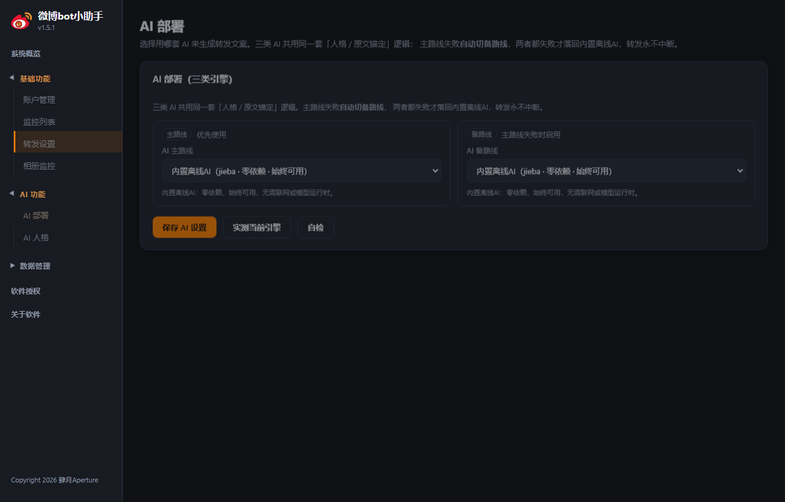
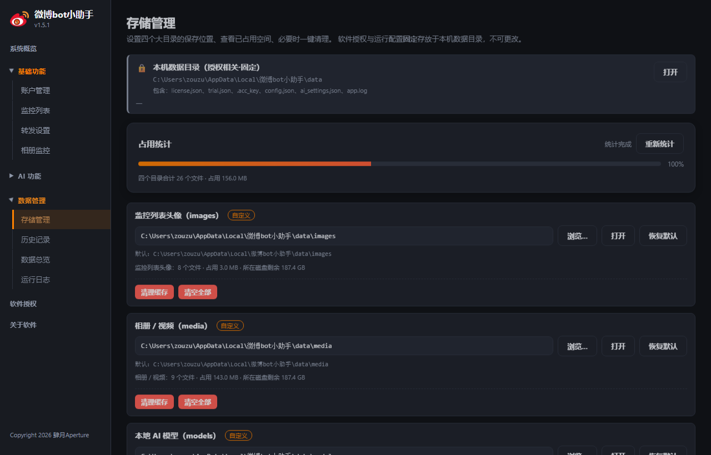

<div align="center">


# 微博bot小助手

**单机桌面版微博自动化辅助工具 · 监控动态 · 定时转发 · AI 文案**


*基于 Edge WebView2 原生窗口运行，不依赖外部浏览器，无需服务器。*

[功能特性](#-功能特性) · [界面预览](#-界面预览) · [快速开始](#-快速开始) · [使用教程](#-使用教程) · [更新日志](#-版本迭代记录)

</div>

---

> 一款**单机桌面**微博自动化辅助工具，用于监控指定微博账户的新动态并自动转发。
>
> 原生窗口（Edge WebView2 内核）运行，**不依赖外部浏览器**即可使用。
>
> - **大版本号**：`v1.5.1`
> - **内部版本号规则**：`YYMMDD` + 4 位当日迭代序号（例如 `2609290001` 表示 2026-09-29 第 1 次构建）
> - **版权**：Copyright 2026 肆月Aperture。本软件为开源软件，未经授权禁止用于任何商业用途。

---

## ✨ 功能特性

| # | 功能               | 说明                                                                                                                                                                                                                                   |
| - | ---------------- | ------------------------------------------------------------------------------------------------------------------------------------------------------------------------------------------------------------------------------------ |
| 1 | **多账户登录**        | 通过内置浏览器或系统浏览器登录，获取微博 Cookie；最多记录 **5 个**账户，本地加密存储                                                                                                                                                                                    |
| 2 | **UID 监控**       | 填入微博 UID（如 `5789387121`）即自动获取最新昵称；监控数量**无上限**；实时检测账号状态                                                                                                                                                                               |
| 3 | **定时轮询转发**       | 可设定轮询间隔，自动检测监控对象是否发布新微博；若出现多条新微博，**随机挑选一条**进行转发                                                                                                                                                                                      |
| 4 | **普通 / AI 增强转发** | 提供开关；AI 增强模式下内置轻量化内容生成引擎，按设定的「转发人格」生成符合人设的转发文案（离线可用，无需联网大模型）                                                                                                                                                                         |
| 5 | **关键词黑名单**       | 转发内容或原微博中出现黑名单关键词时，**跳过该条**不转发                                                                                                                                                                                                       |
| 6 | **工作时间**         | 可设置软件仅在指定时间段内工作（支持跨天，如 22:00–08:00）                                                                                                                                                                                                  |
| 7 | **历史查询与导出**      | 记录被监控对象发过的微博（文字 + 图片存档）、本软件转发记录、运行操作日志；支持导出 CSV / JSON / XLSX，可一键导出含图片的完整数据包                                                                                                                                                         |
| 8 | **版权与声明**        | 内置版权信息与非商业开源声明                                                                                                                                                                                                                       |
| 9 | **软件授权**         | 默认 **7 天免费试用**，过期后自动禁用转发功能。内置「授权」页：生成 **48 位本机特征码**（由 时间 + 机器识别码 + MAC 生成，可重新生成，自生成起 7 天有效）；粘贴作者提供的**离线授权密钥**（格式 `0000-0000-0000-0000-0000`，支持 1个月 / 3个月 / 6个月 / 1年 / 永久）即可激活；密钥与生成特征码的机器绑定。作者使用配套**授权机**（`授权机.exe`）基于特征码签发密钥 |

---

---

## 🖼 界面预览

> 以下截图存于仓库 `docs/screenshots/`，与 README 一起提交发布，随仓库版本管理，不会因更新而失效。
>
> （推送到 GitHub 时请连同 `docs/screenshots/` 目录一起提交）

### 系统概览

运行总览与快捷操作：调度状态、最近一轮轮询结果一键直达。


### 账户管理

最多 5 个账户，Cookie 本地加密存储；**Cookie 有效期预测 + 一键/自动续期**（临近失效自动滑动延长）。


### 监控列表

填入 UID 即自动获取昵称并实时检测状态；监控数量无上限；支持批量导入导出。


### 转发设置

定时轮询 + 随机转发；**关键词黑名单**（命中即跳过）与**工作时间**（支持跨天时段，时段外自动休眠）为页内子标签页。


### AI 人格 / AI 部署

多种内置人格可选、支持自定义；**三类 AI 引擎**可任选其一为主路线，主失败自动切备。




#### 三类 AI 引擎（v1.2.0）

| 引擎                 | 标识           | 说明                                                            |
| ------------------ | ------------ | ------------------------------------------------------------- |
| 内置离线 AI            | `builtin`    | jieba 分词 + 人格模板 + 意图识别，**零依赖、始终可用**，是主备全失败后的最终兜底              |
| 本地离线 AI（Ollama）    | `local`      | 走本机 Ollama（默认 `127.0.0.1:11434`），纯本地推理，需自行安装                  |
| 本地离线 AI（llama.cpp） | `local_gguf` | 随软件自动下载 Qwen2.5-1.5B GGUF（约 1GB），无需装 Ollama，保留 v1.1.x 的三层去重逻辑 |
| 云端在线 AI            | `cloud`      | 兼容 OpenAI `/chat/completions`，需自备 endpoint 与 API Key          |

- **主 / 备双路线**：主失败自动切备，备失败才落回内置引擎，转发永不中断，也不会静默假装成功。
- **草稿配置探测**：探测设置页当前控件取值，消除「下拉选了 Ollama、状态却显示内置引擎」的错位。
- **密钥安全**：云端 API Key 单独存于 `data/ai_settings.json`，不进业务配置、不会出现在导出数据里，界面只回显掩码。

### 相册监控

监控对象相册批量增量下载；首次为全量下载，之后按活动增量续传（已下载的资源不会重复请求）。


### 存储管理（v1.2.2）

四个数据目录（`images` 头像 / `media` 相册视频 / `models` AI 模型 / `history` 历史记录）均可自定义到其他磁盘，

每行实时显示**文件数 · 已用空间 · 所在磁盘剩余**，并提供两级清理：

- **清理缓存**（安全）：只删可重新下载的图片 / 视频，保留数据库与模型；
- **清空全部**：连数据库和模型一起删，请谨慎。**历史记录目录明确拒绝整体清空**——其中的 `history.db`

  正被本程序占用，强删会导致数据丢失且当前会话报错，此时会返回提示引导改用「清理缓存」或关闭软件后手动处理。

软件授权与运行配置**固定存放**在 `%LOCALAPPDATA%\微博bot小助手\data`（不可更改，保证授权校验基线稳定）。

**首次启动**会弹向导让你确认这四个目录的位置；之后每次启动只读一个很小的配置文件、不再遍历目录，秒开。



### 历史记录

微博与转发历史全程留档，支持按类型检索与导出（CSV / JSON / XLSX / 含图数据包）。


### 数据总览 / 运行日志

抓取/转发趋势曲线；分级分类日志系统，支持冗余调试模式与关键词检索。


### 软件授权 / 关于

7 天免费试用；离线特征码 + 授权密钥激活（1 个月 / 3 个月 / 6 个月 / 1 年 / 永久）。


---

## 🚀 快速开始

### 方式一：使用已打包的 exe（推荐）

1. **获取 exe**：从本仓库 [Releases](../../releases) 页面下载最新版 `微博bot小助手.exe`（基于 Python 3.13，已内嵌 VC++ 运行库，开箱即用），或向作者索取。
2. **首次运行需确保本机已安装 [Microsoft Edge WebView2 运行时](https://developer.microsoft.com/zh-cn/microsoft-edge/webview2/)**（Windows 10/11 通常已预装）。
3. 双击运行，无需任何服务器或浏览器。

> 仓库内不包含 exe 二进制（体积大且不适合版本管理），请通过 Releases 页面获取；`history/` 目录仅留档结构，不纳入 git。

### 方式二：从源码运行

```bash
pip install -r requirements.txt
python _src_v151k/_app_v117.py
```

### 自己打包 exe

```bash
python _do_build_v151k.py
```

> 打包脚本读取 `_src_v151k/version.json` 的内部版本号（`YYMMDD` + 4 位序号）并同步进前端 CHANGELOG，PyInstaller 全量构建（`--clean`）产出 `dist_v151k_m/微博bot小助手.exe`，再复制到仓库根目录与 `history/微博bot小助手_<内部版本号>.exe` 留档，三处 sha256 一致后结束。
>
> 脚本默认调用项目专属虚拟环境 `weibobot` 的 Python（已装 PyInstaller + pywebview / pystray / Pillow / jieba / llama_cpp / psutil / pynvml 等全部依赖）。请确保该环境已安装 `requirements.txt` 中的依赖，否则 PyInstaller 会漏收集模块导致 exe 启动崩溃；延迟导入的模块需在 spec 的 `hiddenimports` 中显式声明。

---

## 📖 使用教程

### 1. 添加微博账户（获取 Cookie）

- 进入「账户管理」页。
- 点击 **内置浏览器登录** → 在弹出窗口内完成微博登录 → 点击 **获取 Cookie** 自动填入文本框 → 填写昵称 → **添加账户**。
- 或点击 **系统浏览器登录**，在浏览器登录后复制 Cookie 粘贴到文本框。
- 最多可添加 5 个账户，Cookie 采用本地加密存储。

### 2. 添加监控对象

- 进入「监控列表」页，填入微博 UID（从 `https://weibo.com/u/5789387121` 中取 `5789387121`）。
- 点击「添加监控」，软件会自动获取该 UID 的最新昵称并实时检测状态。
- 监控数量无上限。

### 3. 配置转发

- 「转发设置」：设置轮询间隔（分钟）；页内「关键词黑名单」子标签页添加需跳过的敏感词，「工作时间」子标签页按需开启并设定时段。

### 4. 启动自动轮询

- 在「概览」页点击 **启动自动轮询**，软件将按间隔自动检测并转发。
- 也可点击 **立即轮询一次** 手动触发。

### 5. 查看与导出历史

- 「历史记录」页可查询被监控微博与转发记录，并导出数据。
- **单选 / 多选导出**：勾选需要导出的记录（任意页码均可勾选，选择跨页保留），点击「导出选中」即可仅导出这些条；也可用「导出当前筛选」按筛选条件批量导出。
- **分页**：每页支持 10 / 20 / 50 / 100 条，亦可自定义每页条数。
- 所有数据保存在 `%LOCALAPPDATA%\微博bot小助手\data`（账户加密密钥、数据库、图片、日志；四个大目录可在「存储管理」页改到其他磁盘）。

### 6. 软件授权

- 软件默认提供 **7 天免费试用**，试用期结束后转发功能将被禁用（监控与历史记录不受影响）。
- 进入「授权」页：
  1. 点击 **生成特征码**，复制本机 48 位特征码（有效期 7 天）发送给作者；
  2. 作者使用配套**授权机**（`授权机.exe`）基于特征码离线签发授权密钥；
  3. 将密钥粘贴到「激活授权」框并点击 **激活**，即可解锁转发功能。
- 授权密钥与生成特征码的机器绑定，复制到其他电脑无效。
- 如需更换机器或清除授权，可点击「清除授权」（试用期内不受影响）。

---

## 🗂 目录结构

```
微博bot小助手/
├── _src_v151k/            # 后端源码（Python）
│   ├── _app_v117.py       # 入口：pywebview 窗口 + API 桥 + 托盘
│   ├── api_bridge.py      # 前后端桥接层（全部接口在此暴露）
│   ├── paths.py           # 数据目录解析（四个大目录可自定义）
│   ├── history_db.py      # SQLite 持久化（抓取/转发/日志/媒体台账）
│   ├── scheduler.py       # 轮询调度（含排程转发时刻回传）
│   ├── forward_engine.py  # 转发引擎（普通 / AI 增强）
│   ├── ai_engine/         # 四类 AI 引擎（内置 / Ollama / llama.cpp / 云端）
│   ├── media_engine.py    # 相册增量下载
│   ├── licensemgr.py      # 授权校验
│   └── version.py / version.json   # 内部版本号（YYMMDD + 4 位序号）
├── _ui_v151k/             # 前端界面（index.html + app.js + style.css，打包进 exe）
├── _do_build_v151k.py     # 一键构建 + 三处归档脚本
├── _manifest_v151j.xml    # PyInstaller 清单（管理员权限声明）
├── tests/                 # 历史测试脚本（Cookie 续期 / 授权等）
├── docs/screenshots/      # README 截图
├── logo.ico               # exe 图标
├── history/               # 旧版本 exe 留档（不纳入 git）
├── requirements.txt
├── LICENSE
└── README.md
```

## 🗂 数据说明

运行时数据全部位于 `%LOCALAPPDATA%\微博bot小助手\data`，**不在仓库内**（已由 `.gitignore` 排除）：

- **固定位置**（保证授权校验基线稳定，不可更改）：`license.json`（授权信息，未激活时不存在）、`trial.json`（试用起始时间）、`ai_settings.json`（AI 配置；云端 API Key 单独存放，界面只回显掩码）、`data_paths.json`（四个大目录的位置 + 首启向导完成标记）、`app.log`（运行日志）、`diag.log`（启动诊断日志，分阶段毫秒时间戳）。
- **四个大目录**（默认在 `data\` 下，可在「存储管理」页改到其他磁盘）：
  - `images\`：被监控微博头像缓存
  - `media\`：相册图片与视频下载目录
  - `models\`：llama.cpp 的 GGUF 模型文件（约 1GB）
  - `history\`：`history.db` 数据库与导出产物

---

## ⚠️ 免责声明

1. 本软件仅供个人学习、合法自动化使用，使用者须遵守微博平台规则及相关法律法规。
2. 因使用本软件造成的账号封禁、数据泄露、法律纠纷等后果，由使用者自行承担。
3. 本软件为开源软件，**未经著作权人授权禁止用于任何商业用途**。

---

## 📌 版本迭代记录

> ### ⭐ 关键版本：v1.5.0（内部版本号 2610140004 · 2026-10-14）
>
> **修复积攒已久的「一进软件就未响应 / 主状态读取失败」问题。** 该问题偶发、重启后常见，曾长期无法定位；v1.5.0 借助 py-spy 实时线程栈与 WebView2 `ProcessFailed` 崩溃转储逐层定位，完成**五层根因修复**，并叠加启动可靠性加固：
>
> 1. **`get_functions()` 递归拖死 UI 线程**——pywebview 注入期枚举 API 方法时递归遍历 js_api 属性，走进 Window 的 `.native`（WinForms 控件），成百上千次 `getattr` 跨 COM 边界切回 UI(STA) 线程，消息循环被拖死（线程栈实测卡在 `get_functions`）；改为只收集 api 顶层方法、不再向下递归。
> 2. **双路注入竞争**——`on_webview_ready` 与 `on_navigation_completed` 各自发起注入（实测两个 `generate_js_object` 线程）；统一走带去重的单次注入。
> 3. **注入过早落在空文档**——固定延迟注入时页面文档尚未提交，桥脚本被写进导航前空文档、随后被真实页面覆盖；改为轮询 `document.readyState` 至真实文档加载完成再注入，注入后校验 `window.pywebview.api` 确已挂载、失败自动重试。
> 4. **UI 改走 `file://` 直载**——不再经过 pywebview 本地 HTTP 服务，彻底避开系统代理对回环请求的干扰；本应用数据全走 pywebview 桥、前端无 fetch/XHR，无副作用。
> 5. **第三方钩子 DLL 致 WebView2 子进程崩溃**——WPS 输入法全局钩子（`qingnse64.dll` 等）注入致 GPU/工具进程连环崩溃、`CoreWebView2` 失效；附加 `--disable-gpu --no-sandbox` 浏览器参数绕开崩溃链。
>
> **启动可靠性加固**：单实例互斥（关窗拖尾期再开新实例会明确提示「请稍候」，不再静默叠出打不开的窗口）、根治约 12.5 秒退出拖尾（落库收尾后 `os._exit(0)` 硬退出）、启动诊断日志 `diag.log` 分阶段落盘、修复开屏卡死 4% 的静默失败（`boot()` 在 `.api` 未就绪时抢跑）、测试判定升级为「必须等 `UI_READY`」。
>
> 修复后源码直跑实测：桥 3 秒内挂载、`BOOT_STAGE` 15%→100%、`UI_READY`、窗口全程响应、监控数据实时刷新。
>
> 完整更新内容见下方版本表 v1.5.0 行。

| 版本      | 内部版本号      | 日期         | 更新内容                                                                                                                                                                                                                                                                                                                                                                                                                                                                                                                                                                                                                                                                                                                                                                                                                                                                                                                                                                                                                                                                                                                                                                                                                                                                                                                                                                                                                                                                                                                                                                                                                                                                                                                                                                                                                                                                                                                                                                                                                                                                                                                                                                                                                                                                                                                                                                                                                                                                                                                                                                                                                                                                                                                                |    |        |            |            |                                                                                                                                                                                                                                                                                                                                                                                                                                                                                                                                                                                                                                                                                                                                                                                                                |
| ------- | ---------- | ---------- | ----------------------------------------------------------------------------------------------------------------------------------------------------------------------------------------------------------------------------------------------------------------------------------------------------------------------------------------------------------------------------------------------------------------------------------------------------------------------------------------------------------------------------------------------------------------------------------------------------------------------------------------------------------------------------------------------------------------------------------------------------------------------------------------------------------------------------------------------------------------------------------------------------------------------------------------------------------------------------------------------------------------------------------------------------------------------------------------------------------------------------------------------------------------------------------------------------------------------------------------------------------------------------------------------------------------------------------------------------------------------------------------------------------------------------------------------------------------------------------------------------------------------------------------------------------------------------------------------------------------------------------------------------------------------------------------------------------------------------------------------------------------------------------------------------------------------------------------------------------------------------------------------------------------------------------------------------------------------------------------------------------------------------------------------------------------------------------------------------------------------------------------------------------------------------------------------------------------------------------------------------------------------------------------------------------------------------------------------------------------------------------------------------------------------------------------------------------------------------------------------------------------------------------------------------------------------------------------------------------------------------------------------------------------------------------------------------------------------------------- | -- | ------ | ---------- | ---------- | -------------------------------------------------------------------------------------------------------------------------------------------------------------------------------------------------------------------------------------------------------------------------------------------------------------------------------------------------------------------------------------------------------------------------------------------------------------------------------------------------------------------------------------------------------------------------------------------------------------------------------------------------------------------------------------------------------------------------------------------------------------------------------------------------------------- |
| v1.5.1  | 2610140005 | 2026-10-14 | **【修复两个偶发 BUG】**：① **【BUG1·进度环生长期高光】**——本日转发次数卡的进度环从启动生长到满环的整段过程，卡片外框一直带橙色高光（border-color + box-shadow），像「出错了」一样干扰阅读；现生长期（`fwd-active`）只亮进度环本身，外框高光仅保留给到达排程转发时刻后的满环驻留期（`fwd-done`）。② **【BUG2·轮询进度条间歇不显示】**——stub-DOM 时序复现定位到竞态：上一轮轮询完成时挂了一个无句柄的「1.8 秒后隐藏进度条」定时器，若在 1.8 秒内再次点击「立即轮询一次」，旧定时器会在新一轮轮询进行中把整条进度条误藏（快速连续轮询必现、单次操作不出现，正对应「有时候不显示」）；现隐藏定时器改用句柄管理、每轮进入先清除遗留定时器，同时完成时进度条直达满格（跳过 0%→100% 的 0.25s 宽度过渡），修掉「轮询极快完成时条还贴在 0% 处、文案却已跳完成」的观感；无人干预时的 1.8s 自动收起行为保留不变。                                                                                                                                                                                                                                                                                                                                                                                                                                                                                                                                                                                                                                                                                                                                                                                                                                                                                                                                                                                                                                                                                                                                                                                                                                                                                                                                                                                                                                                                                                                                                                                                                                                                                                                                                                                                                                                                                                                                                                                                                                                                                                                                                                                                                                                                  |    |        |            |            |                                                                                                                                                                                                                                                                                                                                                                                                                                                                                                                                                                                                                                                                                                                                                                                                                |
| ⭐ v1.5.0 | 2610140004 | 2026-10-14 | **【修复「一进软件就未响应 / 主状态读取失败」·五层根因】**：经 py-spy 实时线程栈 + WebView2 `ProcessFailed` 崩溃转储逐层定位并修复：① **`get_functions()` 递归拖死 UI 线程**——pywebview 注入期枚举 API 方法时递归遍历 js_api 属性，走进 pywebview Window 的 `.native`（WinForms 控件），每次 `getattr` 跨 COM 边界切回 UI(STA) 线程，成百上千次后消息循环被拖死（线程栈实测卡在 `get_functions`）；改为只收集 api 顶层方法、不再向下递归。② **双路注入竞争**——`on_webview_ready` 与 `on_navigation_completed` 各自发起注入（线程栈实测两个 `generate_js_object` 线程）；统一走带去重的单次注入。③ **注入过早落在空文档**——固定 2.5s 延迟注入时页面文档尚未提交（实测 `window.location.href` 求值落空、`CoreWebView2 uninitialized`），桥脚本被写进导航前空文档随后被真实页面覆盖；改为轮询 `document.readyState` 至真实文档加载完成再注入，注入后校验 `window.pywebview.api` 确已挂载、失败自动重试。④ **UI 改走 `file://` 直载**——不再经过 pywebview 本地 HTTP 服务，彻底避开系统代理（本机 ProxyServer=127.0.0.1:8899）对回环请求的干扰；本应用数据全走 pywebview 桥、前端无 fetch/XHR，无副作用，内置浏览器登录仍走 http 不受影响。⑤ **第三方钩子 DLL 致 WebView2 子进程崩溃**——WPS 输入法全局钩子（`qingnse64.dll` 等）注入致 GPU/工具进程连环崩溃、`BrowserProcessExited` → `CoreWebView2` 失效；附加 `--disable-gpu --no-sandbox` 浏览器参数绕开崩溃链，`clear_user_data` 增加 `CoreWebView2` 空值守卫。修复后源码直跑实测：桥 3 秒内挂载、`BOOT_STAGE` 15%→100%、`UI_READY`、窗口全程响应、监控数据实时刷新。**【启动可靠性加固：单实例互斥 + 启动诊断日志 + 根治退出拖尾 + 开屏卡死修复】**：① **【单实例互斥】**——实测关窗后进程要拖约 12.5 秒才真正退出（WebView2 拆环境），这段时间再开新实例可能撞资源竞争导致白屏卡死；现用命名互斥体兜底，上一个实例还在退出时新实例明确弹窗提示「请稍候」，不再静默叠开打不开的窗口。② **【根治退出拖尾】**——窗口关闭（含托盘「退出」）后立即停托盘、落库收尾并 `os._exit(0)` 硬退出，进程即关即走；SQLite 与配置写盘均为崩溃安全设计，硬退无副作用。③ **【启动诊断日志】**——启动全链路（互斥→目录→迁移→CA→窗口→WebView→前端各阶段→UI_READY→退出）分阶段写入数据目录 `diag.log`（毫秒时间戳），此后「打不开/未响应」可直接定位卡点。④ **【删除页码跳页控件】**——监控列表与历史记录分页栏的「页码输入框 + GO」整体移除。⑤ **【修复开屏卡死（4% 不动）】**——旧启动触发 `if (window.pywebview) boot()` 会在 pywebview 桥 `window.pywebview` 已挂载、但 `.api` 尚未就绪的竞态下抢跑，导致 init 拿到 undefined 的 API、其后所有 api 调用（含 boot_stage 埋点）被静默吞掉，表现为窗口出现、开屏永远停在 4%、诊断日志毫无前端阶段；改为仅在 `window.pywebview.api` 真正就绪时才 boot，并加 pywebviewready 监听 + 250ms 轮询兜底（至多 8s），彻底消除该静默失败。⑥ **【测试判定升级】**——启动测试不再只看「窗口出现」，必须等 diag 日志出现 `UI_READY`（真正进入主界面）才算成功，并用未响应检测盯住开屏→主界面区间。                                                                                                                                                                                                                                                                                                                                                                                                                                                                                                                                                                                                                                                                                                                                                                                             |    |        |            |            |                                                                                                                                                                                                                                                                                                                                                                                                                                                                                                                                                                                                                                                                                                                                                                                                                |
| v1.4.22 | 2610130017 | 2026-10-13 | **【满环高亮渐隐后彻底熄灭（修复熄灭后立即复燃）】**：满环驻留 10 秒、1.5 秒渐隐结束后，`fwd-fading` 的 `opacity:0` 一旦移除，遗留的 `fwd-active` 会带着仍为满环的 dashoffset 立即复燃。现渐隐结束时连 `fwd-active` 一起清掉并把环清空（带守卫：已进入新周期则跳过，不误杀正在生长的进度），环保持熄灭直到下一次轮询新周期重新走进度时再点亮。                                                                                                                                                                                                                                                                                                                                                                                                                                                                                                                                                                                                                                                                                                                                                                                                                                                                                                                                                                                                                                                                                                                                                                                                                                                                                                                                                                                                                                                                                                                                                                                                                                                                                                                                                                                                                                                                                                                                                                                                                                                                                                                                                                                                                                                                                                                                                                                                                                                                                                                      |    |        |            |            |                                                                                                                                                                                                                                                                                                                                                                                                                                                                                                                                                                                                                                                                                                                                                                                                                |
| v1.4.21 | 2610130016 | 2026-10-13 | **【修复进度环仍对不齐 100%（next_forward_run 未透传）】**：`run_once` 把 `_forward_one` 的返回值合并进按 UID 聚合的结果项时只取了 `action` / `detail` 两个字段，排程转发的 `run_at`（实际执行时刻）被丢弃——`scheduler` 永远捕不到它，`next_forward_run` 恒为空，前端进度环一直回退到「终点 = 下一次轮询 `next_run`」，表现为排程时刻（如 22:39:09）到点环只有约 12%。现把 `run_at` 一并透传进对应 UID 的结果项，进度环在真实转发时刻正好满环 + 高亮驻留 10 秒。                                                                                                                                                                                                                                                                                                                                                                                                                                                                                                                                                                                                                                                                                                                                                                                                                                                                                                                                                                                                                                                                                                                                                                                                                                                                                                                                                                                                                                                                                                                                                                                                                                                                                                                                                                                                                                                                                                                                                                                                                                                                                                                                                                                                                                                                                                                                                                                                               |    |        |            |            |                                                                                                                                                                                                                                                                                                                                                                                                                                                                                                                                                                                                                                                                                                                                                                                                                |
| v1.4.20 | 2610130015 | 2026-10-13 | **【进度环周期对齐真实转发时刻（修复『特别慢 / 到点不到 100%』）+ 满环高亮驻留 10 秒】**：① **【进度环终点对齐】**——旧逻辑以 `next_run`（下一次轮询）作为 100% 目标，进度环要等到下一次轮询才重算，表现为「特别慢」且真实转发时刻到不了满环；现改为以本次排程的**实际转发时刻** `next_forward_run`（含抖动）作为满环目标，未排程时回退 `next_run`。② **【进度环起点修正】**——旧逻辑用 `next_run - interval×60` 反推周期起点，把约 12 分钟的爬取耗时错算进周期开头，导致开局即偏高、推进缓慢；现以 `last_run`（上一次轮询真实完成时刻）作为起点，进度随时间匀速推进，在真实转发时刻（如 22:10:14）正好达到 100%。③ **【满环高亮驻留 10 秒】**——到达 100% 后高亮绕满一圈并驻留 10 秒（原 3 秒），驻留期间 `next_run` 推进（新周期开始）立即重新生长，否则 10 秒后 1.5 秒渐隐。④ **【后端联动】**——`scheduler` 新增 `next_forward_run` 字段（在 `run_once` 中捕获 `_forward_one` 回传的 `run_at` 并写入 `status`）；`forward_engine` 的 scheduled 分支回传 `run_at` 时间戳供前端对齐满环。                                                                                                                                                                                                                                                                                                                                                                                                                                                                                                                                                                                                                                                                                                                                                                                                                                                                                                                                                                                                                                                                                                                                                                                                                                                                                                                                                                                                                                                                                                                                                                                                                                                                                                                                                                                                                                                                                                                                                                                                                                                                             |    |        |            |            |                                                                                                                                                                                                                                                                                                                                                                                                                                                                                                                                                                                                                                                                                                                                                                                                                |
| v1.4.19 | 2610130014 | 2026-10-13 | **【进度环起点修正 + 排程时刻满环 + 历史库持久化修复】**：① **【进度环起点修正】**——v1.4.18 用 `rotate(-90)` 想把进度起点转到顶部，但 rotate 作用在**非正方形**矩形上会把整个环宽高互换、转出卡片外（表现为一根竖直橙线悬在卡片左侧）。现改为手写 SVG `<path>`：路径起点即顶部 12 点方向、顺时针闭合，进度天然从正上方沿卡片四边生长，无需任何旋转。② **【排程时刻满环】**——到达排程转发时间（进度 100%）即触发「满环 + 高亮驻留 3 秒 + 1.5 秒渐隐」，不再等下一周期 `next_run` 推进才触发；同一周期只触发一次，新周期开始自动重新生长。③ **【历史库持久化修复（重要）】**——v1.2.2 引入历史记录目录自定义时，`HistoryDB.__init__` 的 `sqlite3.connect` 误用了**空串参数**而非运行期解析出的 `self.path`：`sqlite3.connect("")` 创建的是「连接关闭即删除」的私有临时库，软件每次启动都落在一个全新空库上——这就是**重启后去重失效、重复抓取、本日抓取/转发统计无法保留**的根因（活动库文件存在却全表 0 行）。现改回连接 `self.path`，抓取记录 / 转发记录 / 运行日志 / 媒体台账正式持久化到 `history.db` 并跨重启保留。                                                                                                                                                                                                                                                                                                                                                                                                                                                                                                                                                                                                                                                                                                                                                                                                                                                                                                                                                                                                                                                                                                                                                                                                                                                                                                                                                                                                                                                                                                                                                                                                                                                                                                                                                                                                                                                                                                                                                                                                                                                                                               |    |        |            |            |                                                                                                                                                                                                                                                                                                                                                                                                                                                                                                                                                                                                                                                                                                                                                                                                                |
| v1.4.18 | 2610130013 | 2026-10-13 | **【系统概览动效 + 秒级刷新】**：① **【本日转发次数卡进度环】**——「系统概览 → 本日转发次数」卡片沿外框新增高亮进度环：调度运行中，环沿卡片四边生长，显示当前距离下一次排程转发的剩余进度；一个轮询周期结束（后端 `next_run` 推进）时环绕满一圈、高亮驻留 3 秒，再 1.5 秒渐隐，随后进入下一周期重新生长；调度未运行时环自动隐藏。四张统计卡改为静态结构、只更新数字，避免整块 `innerHTML` 重建把进度环反复销毁、丢失动画状态。进度以 `next_run - interval×60` 反推本周期起点、`next_run` 为终点计算占比（`last_run` 为字符串，不直接参与计算）。② **【系统概览秒级刷新】**——概览轮询由 5 秒改为 1 秒（仅概览页激活且窗口可见时拉取，后端状态缓存优先）。③ **【账户管理秒级刷新】**——账户管理页新增独立秒级轮询（仅该页激活时每秒拉取 `get_state` 并重绘账户表格），让状态 / 检测时间 / Cookie 有效期等近实时更新；检测 / 续期 / 增删账户操作进行期间自动避让（`_accBusy` 标志），不重绘打断。                                                                                                                                                                                                                                                                                                                                                                                                                                                                                                                                                                                                                                                                                                                                                                                                                                                                                                                                                                                                                                                                                                                                                                                                                                                                                                                                                                                                                                                                                                                                                                                                                                                                                                                                                                                                                                                                                                                                                                                                                                                                                                                                                                                                    |    |        |            |            |                                                                                                                                                                                                                                                                                                                                                                                                                                                                                                                                                                                                                                                                                                                                                                                                                |
| v1.4.17 | 2610130012 | 2026-10-13 | **【媒体检索回退查库 + 备份/导入索引 + 卡片最新图预览】**：① **【媒体检索回退为直接查库】**——v1.4.16 让媒体检索优先读索引文件，实测体验不如旧版（列表需等后台建索引才准、切页时数据偶有滞后）；现整体回退：统计 / 对象列表 / 关键词搜索一律直接查数据库，与旧版行为一致，索引文件不再参与前台读取。② **【按钮改为「备份索引」/「导入索引」】**——原「重建索引」「显示全部」取消；「备份索引」按当前台账生成索引 JSON 并弹保存对话框另存到指定位置（默认文件名带时间戳）；「导入索引」选一个索引 JSON 读入，把其中台账记录回灌到数据库（按 URL + 类型去重，已存在的跳过），适合换机器 / 重装 / 恢复时带回记录。③ **【卡片右侧显示最新图片预览】**——对象卡片改为左右两栏，右侧显示该对象最新一张图片的缩略图（104×104 居中裁切）；接口分两步（先取「最新图信息」不传图片数据，前端再按需拉缩略图）以保证打开速度，无图时显示占位符「—」。④ **【取消点击卡片展开相册】**——原「点击对象卡片可展开查看其相册图片」整体移除，一次展开需取几十张图的 base64，对软件内存与硬盘读取压力过大；查看全部图片请点「打开目录」在资源管理器中浏览。                                                                                                                                                                                                                                                                                                                                                                                                                                                                                                                                                                                                                                                                                                                                                                                                                                                                                                                                                                                                                                                                                                                                                                                                                                                                                                                                                                                                                                                                                                                                                                                                                                                                                                                                                                                                                                                                                                                                                                                                                                                                                                                                                                 |    |        |            |            |                                                                                                                                                                                                                                                                                                                                                                                                                                                                                                                                                                                                                                                                                                                                                                                                                |
| v1.4.16 | 2610130011 | 2026-10-13 | **【媒体库索引文件 + 台账误删修复】**：① **【媒体目录下新增索引文件】**——「相册监控 → 媒体检索」此前每次都直接对 `media_files` 整表聚合查询，重开软件后列表常为空、每次进页面都要重新检索；现改在媒体目录下维护独立索引文件 `<media_dir>/media_index.json`（含全库汇总、各对象的图片 / 视频数与占用、完整文件清单 + 生成时间），查页面优先读索引、毫秒级出结果并跨会话复用；索引跟着媒体目录走，换目录 / 整体拷走媒体库时一并带走。② **【修复媒体台账被误清空】**——v1.4.7 的媒体自愈对账（启动后台跑 `reconcile_media_files()`）判定条件是「DB 有记录 **且** 磁盘文件存在」；当 DB 从旧目录迁移过来、而媒体文件没跟着搬时，整表 29084 行会被判为僵尸行**全部删除** —— 相册列表于是永远是空的，每次开机自愈都把台账再清一遍。现加两道闸：媒体目录不存在 / 整体为空时直接跳过对账；待删比例超过 50% 时判定为「文件整体不在位」而非「零散删除」，拒绝执行并记警告；正常的零星自愈不受影响。③ **【索引缺失自动重建】**——索引文件不存在 / JSON 损坏 / 版本结构不符时，前台自动回退实时查库并触发一次后台重建，启动时也会校验一次；写入采用原子替换（先写 `.tmp` 再 `os.replace`），避免断电或被杀进程留下半截文件。④ **【下载完成自动回写索引】**——媒体下载落盘结束后在后台线程重建索引（带 1.5s 合并抖动），绝不阻塞下载主流程与界面。⑤ **【界面新增索引状态】**——「媒体检索」页新增状态提示条（绿点=已启用并显示生成时间 / 黄点=尚未生成、正在建立）与「重建索引」按钮，对象卡片补显「占用 xx MB」。                                                                                                                                                                                                                                                                                                                                                                                                                                                                                                                                                                                                                                                                                                                                                                                                                                                                                                                                                                                                                                                                                                                                                                                                                                                                                                                                                                                                                                                                                                                                                                                                                                                                                                                                                                                                                                                                                                                    |    |        |            |            |                                                                                                                                                                                                                                                                                                                                                                                                                                                                                                                                                                                                                                                                                                                                                                                                                |
| v1.4.15 | 2610130010 | 2026-10-13 | **【子项悬停底色同步缩进 22px】**：① **【子项悬停底色同步缩进 22px】**——上一版把子项「选中」高亮（滑块 + 竖条）收进了 22px，但「悬停」底色仍来自基础规则 `.nav-item:hover` 的 `background-color`，从侧栏最左 `x=0` 铺满整行，悬停时比选中态多出 22px；现让子项悬停底色也改用 `background-image` 横向渐变绘制：0→22px 透明、22px 之后才是琥珀色，左缘与滑块 / 竖条 / 缩进导轨线完全对齐。② **【与导轨线叠为两层背景】**——子项原本用 `background-image` 画缩进导轨线，故悬停底色与导轨线叠成两层（逗号分隔，先写的在上层）：第 1 层悬停底色渐变、第 2 层 22px 处的 1px 导轨线；未悬停时第 1 层全透明（`--sub-hover` 控色）。同时显式给子项悬停补 `background-color: transparent`，避免基类规则刷满整行。③ **【三种状态共用同一条左边界】**——悬停 / 选中 / 未选中状态下子项底色左边界统一在 22px，鼠标移入移出只有颜色渐显渐隐、左边界纹丝不动。                                                                                                                                                                                                                                                                                                                                                                                                                                                                                                                                                                                                                                                                                                                                                                                                                                                                                                                                                                                                                                                                                                                                                                                                                                                                                                                                                                                                                                                                                                                                                                                                                                                                                                                                                                                                                                                                                                                                                                                                                                                                                                                                                                                          |    |        |            |            |                                                                                                                                                                                                                                                                                                                                                                                                                                                                                                                                                                                                                                                                                                                                                                                                                |
| v1.4.14 | 2610130009 | 2026-10-13 | **【子项高亮底块左边界同步右移 22px】**：① **【子项高亮底块收进 22px】**——上一版把子项橙色竖条移到了 22px（与缩进导轨线对齐），但高亮底块仍从侧栏最左 `x=0` 铺满整行，导致竖条左侧多出一小块橙色、像粘了块色斑；现把底块左边界也收到 22px：`#navHighlight` 的 `left` 改为跟随 `--bar-x`（子项 22px / 顶级项 0），底块与竖条一起右移、左缘严丝合缝。② **【底块随行类型平滑横移】**——`left` 也加入过渡（0.3s 缓动），切换子项 ↔ 顶级项时底块左边界与竖条一起平滑横移；顶级项 / 分组标题仍从 x=0 铺满整行，保持原有视觉。                                                                                                                                                                                                                                                                                                                                                                                                                                                                                                                                                                                                                                                                                                                                                                                                                                                                                                                                                                                                                                                                                                                                                                                                                                                                                                                                                                                                                                                                                                                                                                                                                                                                                                                                                                                                                                                                                                                                                                                                                                                                                                                                                                                                                                                                                                                                                                                                                |    |        |            |            |                                                                                                                                                                                                                                                                                                                                                                                                                                                                                                                                                                                                                                                                                                                                                                                                                |
| v1.4.13 | 2610130008 | 2026-10-13 | **【子项高亮竖条移到缩进导轨线位置】**：① **【子项竖条位置对齐缩进导轨线】**——上一版滑块统一把竖条画在侧栏最左边缘（x=0），与子项的缩进导轨线（22px）错开了两处竖线；现按需求把子项竖条移到 22px，与子项缩进导轨线落在同一竖列、合而为一。② **【顶级项与分组标题竖条仍在最左侧】**——「系统概览 / 软件授权 / 关于软件」与各分组标题没有缩进导轨线，竖条移到 22px 会显得悬空；故这三类行选中时竖条仍停在 x=0，各类行竖条各归其位。③ **【竖条改用背景渐变绘制，位置平滑过渡】**——竖条不再用 `border-left`（位置固定在元素左缘且占进内容盒），改为 `background-image` 渐变画在滑块内指定 x 处（`background-size: 3px 100%`），位置由 CSS 变量控制；切换子项 ↔ 顶级项时竖条顺带做横向平移（0.3s 缓动），与滑块纵向滑动同步。                                                                                                                                                                                                                                                                                                                                                                                                                                                                                                                                                                                                                                                                                                                                                                                                                                                                                                                                                                                                                                                                                                                                                                                                                                                                                                                                                                                                                                                                                                                                                                                                                                                                                                                                                                                                                                                                                                                                                                                                                                                                                                                                                                                                                                                                                                      |    |        |            |            |                                                                                                                                                                                                                                                                                                                                                                                                                                                                                                                                                                                                                                                                                                                                                                                                                |
| v1.4.12 | 2610130007 | 2026-10-13 | **【侧栏高亮改为滑动滑块 + 网络速率标签贴合数值】**：① **【侧栏选中高亮改为「滑动滑块」】**——此前每个导航行各自画自己的选中底色，切换时是「旧块淡出、新块淡入」两段独立动画，视觉上像两个光斑各自闪一下；现改为整栏共用一个绝对定位的高亮块（`#navHighlight`），切换时高亮块整体从旧位置平滑滑到新位置（`transform: translateY`，0.3s `cubic-bezier` 缓动），移动过程连续可见。② **【高亮块形态按需求对齐】**——底块从侧栏最左 `x=0` 铺满整行，橙色 3px 竖条压在高亮块最左边缘上（与底块同一元素），竖条随高亮块一起滑动，不会出现「底色先到、竖条后到」的割裂感；选中行自身只负责文字变橙，不再叠加第二层底色。③ **【高亮块与目标行精确对齐】**——滑块高度由目标行实际高度决定（分组标题行 38px / 普通行 35px 各自适配），位置取目标行相对侧栏内容盒的偏移；侧栏滚动、窗口缩放、分组展开动画结束后都会重新贴合；首次进入直接落位不播动画。④ **【网络速率数值不再与标签隔开】**——上一版把网络值锁成 210px 死宽 + 右对齐，而「↑ 106.5 KB/s / ↓ 22.6 KB/s」实测仅约 125px，多出的 85px 全变成「网络」标签与数值之间的空白；现收窄为 175px（覆盖「↑ 1023.9 MB/s / ↓ 1023.9 MB/s」极限）并改左对齐。保持定宽的原因：若改成随内容伸缩，数值位数变化会把右侧 GPU 段推开（实测 53px 位移），与「界面不乱动」相冲突；定宽 + 左对齐可同时满足「贴合」与「不位移」。                                                                                                                                                                                                                                                                                                                                                                                                                                                                                                                                                                                                                                                                                                                                                                                                                                                                                                                                                                                                                                                                                                                                                                                                                                                                                                                                                                                                                                                                                                                                                                                                                                                                                                                                                                                                                                                                                                                                                                                          |    |        |            |            |                                                                                                                                                                                                                                                                                                                                                                                                                                                                                                                                                                                                                                                                                                                                                                                                                |
| v1.4.11 | 2610130006 | 2026-10-13 | **【系统负载行位置硬锁定 + 子项高亮竖条恢复与平滑过渡】**：① **【系统负载整行位置硬锁定】**——此前 CPU / GPU 的百分比与温度之间用 gap 排布，数值宽度天然浮动（`7.8%` ↔ `100%`、`KB/s` ↔ `MB/s`、`49°C` ↔ `100°C`），任一数值一变就把右侧所有元素推走，整行来回抖；现改为全段定宽硬锁——每个数值位（CPU 44px、内存 46px、GPU 44px、网络 210px、温度 46px）设固定宽度 + 右对齐，数字位数变化只在槽内发生，各段容器统一 `flex: 0 0 auto`，任意数值刷新时所有元素位置零位移（实测各段 `offsetLeft` 变化量恒为 0），界面不会再乱动。② **【子项恢复左侧高亮竖条】**——按新要求把侧栏子项选中时的 3px 橙色竖条加回来；竖条由 `border-left` 提供而非伪元素，宽度恒定 3px、只变色不改变盒模型，切换时元素不会位移，同时选中态隐藏子项原有的缩进导轨线，避免左缘叠出双线。③ **【子项切换过渡更丝滑】**——子项的底色、字色、竖条颜色统一改走 `0.28s ease` 缓动（悬停态 `0.18s` 更快跟手），切换子项时高亮块平滑移动、颜色渐变过渡，不再生硬跳变。                                                                                                                                                                                                                                                                                                                                                                                                                                                                                                                                                                                                                                                                                                                                                                                                                                                                                                                                                                                                                                                                                                                                                                                                                                                                                                                                                                                                                                                                                                                                                                                                                                                                                                                                                                                                                                                                                                                                                                                                                                                                                                                                                          |    |        |            |            |                                                                                                                                                                                                                                                                                                                                                                                                                                                                                                                                                                                                                                                                                                                                                                                                                |
| v1.4.10 | 2610130005 | 2026-10-13 | **【修复上下按钮未隐藏、子项竖条未去掉、温度未锁宽】**：① **【修复「上下按钮没有删除」】**——根因：隐藏原生 spin 的 CSS 规则写作 `.num-wrap > input[type=number]`，而取消步进的输入框（`.no-step`）不会生成 `.num-wrap` 包裹层，规则完全不命中，WebView2 原生上下箭头依旧显示；现补全局兜底 `input[type=number]`（含 `::-webkit-inner/outer-spin-button` 与 `appearance: textfield`）。② **【修复「子项高亮竖条没去掉」】**——根因：竖条来自父级 `.nav-item` / `.nav-item.active` 的 `border-left: 3px`，子项同时带 `.nav-item` 类因而一并继承；上一版去删 `.nav-item.sub` 里本不存在的 `border-left`，改错了地方。现改为在 `.nav-item.sub / .nav-item.sub.active` 上显式 `border-left-color: transparent`，顶级项与分组标题竖条保留。③ **【修复「温度没有锁定宽度」】**——上一版只设 `min-width: 44px`，`min-width` 只保下限，数值由「—」变「27.9°C」仍会撑开元素导致整行抖动；现改用 `width: 46px` + `flex: 0 0 46px` 硬锁宽度并右对齐。④ **【清除授权按钮样式统一】**——由 ghost danger（描边）改为与「清空日志」一致的实心 danger 按钮。                                                                                                                                                                                                                                                                                                                                                                                                                                                                                                                                                                                                                                                                                                                                                                                                                                                                                                                                                                                                                                                                                                                                                                                                                                                                                                                                                                                                                                                                                                                                                                                                                                                                                                                                                                                                                                                                                                                                                                            |    |        |            |            |                                                                                                                                                                                                                                                                                                                                                                                                                                                                                                                                                                                                                                                                                                                                                                                                                |
| v1.4.9  | 2610130004 | 2026-10-13 | **【开屏加载进度可视化 + 输入框/侧栏/温度细节修正】**：① **【开屏显示加载进度百分比与当前步骤】**——开屏动画在进度条下方新增「百分比 + 当前正在加载的内容」，每个关键节点更新一次（界面骨架就绪 → 连接后端 → 检测账户状态 → 读取主状态 → 渲染配置 → 扫描存储目录 → 后端仍在构建状态，附第 N 次重试）；冷启动涉及 onefile 解压、数据库连接、后台状态重建等多环节，此前只有一个静态的「正在加载数据…」，卡住时无法判断卡在哪一步。进度条同步改为「确定进度」模式（主体长度真实反映百分比，保留一道来回微光表示进程仍活着）。② **【分页与间隔输入框取消上下步进按钮】**——页码跳转框、自定义每页条数框的右侧上下小按钮在窄框里始终与前两位文字打架；监控刷新间隔、转发间隔、相册间隔、每次扫描页数也一并去掉步进按钮，这些字段用户实际都是直接键入。原生自旋按钮保持隐藏，输入区完整显示占位文字。③ **【系统负载温度显示优化】**——温度数值改为定宽显示（44px、右对齐），字宽变化不再让整行抖动；常态颜色由暗灰改为淡黄色（`#e8c46a`）突出显示，仅 ≥90°C 转红作过热提示。④ **【子栏目去掉最左侧高亮竖条】**——侧栏子项选中不再显示 3px 橙色竖条，只靠底色与字色区分；顶级项与分组标题的竖条保留，避免两级竖条并存的视觉噪点。                                                                                                                                                                                                                                                                                                                                                                                                                                                                                                                                                                                                                                                                                                                                                                                                                                                                                                                                                                                                                                                                                                                                                                                                                                                                                                                                                                                                                                                                                                                                                                                                                                                                                                                                                                                                                                                                                                                                                                                                                                                                                                                       |    |        |            |            |                                                                                                                                                                                                                                                                                                                                                                                                                                                                                                                                                                                                                                                                                                                                                                                                                |
| v1.4.8  | 2610130003 | 2026-10-13 | **【左侧导航栏全面去圆角、高亮块等宽对齐】**：① **【侧栏导航彻底去圆角】**——此前只把悬停态与选中态的右侧圆角去掉，分组标题（`.nav-group-head`）仍保留圆角，且各层级行宽不一致；现统一为顶级项、分组标题、子项一律 `border-radius: 0`，整栏看不到任何圆角。② **【悬停/选中高亮块宽度统一】**——原先三种行各有不同外边距（顶级项 `margin: 0 8px`、子项 `margin: 1px 8px 1px 22px`、分组标题无外边距），高亮块宽窄不一、参差不齐；现全部外边距归零，层级缩进改由 `padding-left` 实现（顶级 18px / 分组标题 16px / 子项 38px），所有高亮块宽度完全一致（实测 16 行全部 x=0、宽 199px），视觉上成一条整齐竖列。③ **【顺带修一处隐性 bug】**——高亮底色改用 `background-color` 而非 `background` 简写，因简写会把子项缩进导轨线的 `background-image` 重置为 none，导致悬停时导轨线消失。                                                                                                                                                                                                                                                                                                                                                                                                                                                                                                                                                                                                                                                                                                                                                                                                                                                                                                                                                                                                                                                                                                                                                                                                                                                                                                                                                                                                                                                                                                                                                                                                                                                                                                                                                                                                                                                                                                                                                                                                                                                                                                                                                                                                                             |    |        |            |            |                                                                                                                                                                                                                                                                                                                                                                                                                                                                                                                                                                                                                                                                                                                                                                                                                |
| v1.4.7  | 2610130002 | 2026-10-13 | **【相册重启免重识别 + 界面细节四处统一】**：① **【修复「每次软件重启后相册都要重新识别」】**——根因：增量下载判定只认数据库记录，不校验文件是否还在磁盘，一旦「记录还在、文件已删」（换媒体目录、点「清空全部」、库被迁移/恢复而文件没跟上），该 URL 会被永久判为「已下载」而跳过，相册列表再也长不回来，用户只能手动重新识别；修复：`has_media_url()` 改为「记录 + 磁盘文件存在」双条件，并在启动后台线程做一次媒体对账 `reconcile_media_files()` 清掉僵尸记录（日志输出检查/清理条数），此后这些 URL 由相册监控自动重新抓取，页面无需任何手动操作。② **【侧栏悬停去圆角】**——导航项悬停时右侧圆角与选中态不一致，悬停改为直角，与选中态一致。③ **【存储管理按钮样式统一】**——「清理缓存 / 清空全部」原为 ghost 描边样式，字重与颜色偏弱不易辨认，改为与「清空日志」一致的实心 danger 按钮。④ **【数字输入框步进按钮统一】**——页码跳转框等窄输入框里步进按钮几乎填满整框并压住 placeholder，观感像「UI 重叠」；步进按钮统一收紧为 16px 宽、上下各留 4px 中缝，右内边距 26px，页码框 / 自定义页码框加宽到 64px（ID 选择器特异性导致内边距被覆盖已显式修正），所有数字框（含相册间隔）观感一致。                                                                                                                                                                                                                                                                                                                                                                                                                                                                                                                                                                                                                                                                                                                                                                                                                                                                                                                                                                                                                                                                                                                                                                                                                                                                                                                                                                                                                                                                                                                                                                                                                                                                                                                                                                                                                                                                                                                                                                                                                                                                                                     |    |        |            |            |                                                                                                                                                                                                                                                                                                                                                                                                                                                                                                                                                                                                                                                                                                                                                                                                                |
| v1.4.6  | 2610130001 | 2026-10-13 | **【系统负载新增 CPU / GPU 温度 + 修复保活任务报错】**：① **【系统负载新增 CPU / GPU 温度】**——概览负载行在 CPU、GPU 数值后追加温度显示：GPU 温度由 NVML 直读核心温度（无 NVIDIA 显卡显示「—」）；CPU 温度因 Windows 上 psutil 无温度接口（`sensors_temperatures` 仅 Linux / FreeBSD 实现），改用 PowerShell `Get-CimInstance` 查 WMI 温度区（`wmic` 自 Win11 24H2 起已被移除），并以 `Win32_PerfFormattedData_Counters_ThermalZoneInformation` 兜底，取不到显示「—」。探测较慢故走独立守护线程 + 缓存（成功 30s、失败退避 15min），绝不拖慢 2s 负载采样；≥80°C 变黄、≥90°C 变红提示。② **【修复「保活任务异常：name 'get_account_manager' is not defined」】**——根因：`scheduler.py` 的 `keepalive_all()` 调用了 `get_account_manager()`，但该模块顶部从未导入它（NameError 被调度循环捕获并记为「保活任务异常」），导致每轮轮询的会话保活探针实际从未执行、Cookie 得不到主动续期；修复：补 `from account_manager import get_account_manager`。                                                                                                                                                                                                                                                                                                                                                                                                                                                                                                                                                                                                                                                                                                                                                                                                                                                                                                                                                                                                                                                                                                                                                                                                                                                                                                                                                                                                                                                                                                                                                                                                                                                                                                                                                                                                                                                                                                                                                                                                                               |    |        |            |            |                                                                                                                                                                                                                                                                                                                                                                                                                                                                                                                                                                                                                                                                                                                                                                                                                |
| v1.4.5  | 2610120037 | 2026-10-12 | **【开屏 Logo 眼珠视角跟随 + 橙色流光移到窗口四边】**：① **【开屏 Logo 眼珠视角跟随】**——开屏动画的 Logo 眼珠（`.bs-eye`）接入与侧栏 / 关于页同一套视角跟随系统（指数缓动 + 死区 + 吸附 + 待机呼吸），鼠标移动时眼珠实时跟随视线方向，开屏层淡出后实例自动清理。② **【橙色流光移到窗口四边】**——开屏时绕 Logo 旋转的橙色外环（`.bs-ring`）移除，改为沿软件界面（窗口视口）四边平滑循环流动的橙色渐变光带（`#bootSplash::after`，`conic-gradient` 旋转角度 + `mask` 环形裁剪，与故障报警光带同款技法），随开屏层一起淡出。                                                                                                                                                                                                                                                                                                                                                                                                                                                                                                                                                                                                                                                                                                                                                                                                                                                                                                                                                                                                                                                                                                                                                                                                                                                                                                                                                                                                                                                                                                                                                                                                                                                                                                                                                                                                                                                                                                                                                                                                                                                                                                                                                                                                                                                                                                                                                                                                         |    |        |            |            |                                                                                                                                                                                                                                                                                                                                                                                                                                                                                                                                                                                                                                                                                                                                                                                                                |
| v1.4.4  | 2610120036 | 2026-10-12 | **【健康徽章同步 + 内置浏览器登录修复 + 开屏动画 + 流光迭代】**：① **【健康徽章同步账户状态】**——根治「账户管理页已显示「正常」，概览健康徽章仍提示「尚未检测」」的割裂问题：账户健康快照改为零网络读取账户持久化状态（后端 `_build_account_health` / `_recompute_account_health_now`），检测 / 检测全部 / 增删账户操作后即刻重算快照并推进状态 epoch；前端 `renderAllViews` 每次刷新也调用 `checkAccountHealth()`，徽章与账户状态亚秒级同步。② **【内置浏览器登录修复】**——点击「内置浏览器登录」仍弹出本机默认 Edge 打开 weibo.com 登录页；根因是 pywebview 默认 `OPEN_EXTERNAL_LINKS_IN_BROWSER=True`，微博 SSO 跳转触发 `NewWindowRequested` 被转交系统浏览器，现 `open_login_browser` 开头置 `webview.settings['OPEN_EXTERNAL_LINKS_IN_BROWSER']=False`，登录窗口真正内嵌于软件 WebView2。③ **【开屏动画】**——主界面数据加载期间新增品牌化开屏动画（`#bootSplash`）：Logo 双层呼吸 + 外环流光旋转 + 名称 + 进度条 +「正在加载数据…」提示，数据就绪后淡出、8s 兜底强制收起，避免主界面等待生硬。④ **【流光效果迭代】**——账户故障报警的四周流光由分段虚线滚动（橙色块感）改为平滑流动的渐变光带：`body.alarm::after` 改用 `@property --flowAngle` 驱动 `conic-gradient` 旋转 + `mask` 环形裁剪，光带连续无分段，参考用户提供的 GIF 效果。                                                                                                                                                                                                                                                                                                                                                                                                                                                                                                                                                                                                                                                                                                                                                                                                                                                                                                                                                                                                                                                                                                                                                                                                                                                                                                                                                                                                                                                                                                                                                                                                                                                                                                                                                                                                                                                                             |    |        |            |            |                                                                                                                                                                                                                                                                                                                                                                                                                                                                                                                                                                                                                                                                                                                                                                                                                |
| v1.4.3  | 2610120035 | 2026-10-12 | **【状态即时刷新 + 健康徽章配色修正 + 相册说明精简】**：① **【状态即时刷新（根治界面刷新滞后）】**——后端 `get_state` 新增 epoch 机制：所有变更类接口（添加/删除账户、启动/停止轮询、监控置顶、保存配置等 22 处）操作后立即使状态缓存失效并推进 `epoch`；前端 `refreshStateFresh()` 循环拉取直到拿到 `epoch` 已推进的新状态，操作后亚秒级即刷新，彻底解决「添加账户后已记录账户仍显示 0/5」「点启动轮询后仍显示未运行」「置顶/取消置顶响应慢」等问题。② **【健康徽章配色修正】**——账户健康徽章逻辑改为：未添加任何账户 = 黄色（提示级），存在故障账户 = 红色，健康 = 绿色；修正此前无账户却显示绿色的问题。③ **【相册说明精简】**——删除相册监控说明中冗余的「（对应 ?tabtype=album）」字样。                                                                                                                                                                                                                                                                                                                                                                                                                                                                                                                                                                                                                                                                                                                                                                                                                                                                                                                                                                                                                                                                                                                                                                                                                                                                                                                                                                                                                                                                                                                                                                                                                                                                                                                                                                                                                                                                                                                                                                                                                                                                                                                                                                                                                                                                                                                      |    |        |            |            |                                                                                                                                                                                                                                                                                                                                                                                                                                                                                                                                                                                                                                                                                                                                                                                                                |
| v1.4.2  | 2610120034 | 2026-10-12 | **【转发设置精简：删除分区外框 + 转发方式卡压缩等高】**：① **【删除分区外框】**——移除「基础转发配置」「工作时间限制」两个分区外框与标题，三卡直接进网格。② **【转发方式卡压缩等高】**——开关组改两列布局并修复说明文字整块换行问题，卡片自然高度 302px→约 220px，与「轮询间隔」卡渲染等高。                                                                                                                                                                                                                                                                                                                                                                                                                                                                                                                                                                                                                                                                                                                                                                                                                                                                                                                                                                                                                                                                                                                                                                                                                                                                                                                                                                                                                                                                                                                                                                                                                                                                                                                                                                                                                                                                                                                                                                                                                                                                                                                                                                                                                                                                                                                                                                                                                                                                                                                                                                     |    |        |            |            |                                                                                                                                                                                                                                                                                                                                                                                                                                                                                                                                                                                                                                                                                                                                                                                                                |
| v1.4.1  | 2610120033 | 2026-10-12 | **【UI 三项精修：转发外框去色 + 负载并入统计卡 + 眼珠尺寸恢复】**：① **【转发设置外框去色】**——「基础转发配置」「工作时间限制」分区外框去掉红/蓝颜色边框与底色，改为与其他卡片一致的中性样式。② **【系统负载并入统计卡】**——移除独立「系统负载」卡片；CPU / 内存 / 网络 / GPU 两行合并为一行纯数值（百分比 + 网络速率），显示在概览统计瓦片下方。③ **【眼珠尺寸恢复】**——修复 v1.4.0 重导出眼珠图层误保留 300×300 全画布导致瞳孔渲染缩小到约 1/3 的问题，换回 97×97 满画布眼珠图，侧栏与关于页眼珠恢复上一版尺寸。                                                                                                                                                                                                                                                                                                                                                                                                                                                                                                                                                                                                                                                                                                                                                                                                                                                                                                                                                                                                                                                                                                                                                                                                                                                                                                                                                                                                                                                                                                                                                                                                                                                                                                                                                                                                                                                                                                                                                                                                                                                                                                                                                                                                                                                                                                                                                                                                                                |    |        |            |            |                                                                                                                                                                                                                                                                                                                                                                                                                                                                                                                                                                                                                                                                                                                                                                                                                |
| v1.4.0  | 2610120032 | 2026-10-12 | **【眼珠重影修复 + 关于页视角跟随 + 系统负载 + 数字框统一 + 转发重排 + 账户健康告警】**：① **【眼珠重影修复 + 关于页视角跟随】**——修复关于页底部多出一颗「幽灵眼珠」（logo-mix-2.psd 眼珠层自带半透明残影，按 alpha 阈值清零重导出 logo-eye.png / logo-base.png / logo.png）；「关于软件」页 Logo 改为双层结构并接入鼠标视角跟随。② **【系统概览新增负载】**——概览区新增 CPU / 内存 / 网络上下行 / GPU 负载（后台 2s 采样线程，前端仅在概览激活时拉取快照，零阻塞 UI）。③ **【数字输入框风格统一】**——全局 number input 用 MutationObserver 装饰为自定义上下步进按钮，统一软件风格并保留 min/max/step。④ **【转发设置重排】**——轮询间隔 + 转发方式置于红框区（上排两卡），工作时间置于蓝框区（下排），分区更清晰。⑤ **【账户健康告警体系】**——每小时后台检测已记录账户的登录态 + 真实抓取 + 转发能力；异常时概览指示灯变红、软件弹窗告警、界面四周流光滚动报警。                                                                                                                                                                                                                                                                                                                                                                                                                                                                                                                                                                                                                                                                                                                                                                                                                                                                                                                                                                                                                                                                                                                                                                                                                                                                                                                                                                                                                                                                                                                                                                                                                                                                                                                                                                                                                                                                                                                                                                                                                                                                                                                                                                                            |    |        |            |            |                                                                                                                                                                                                                                                                                                                                                                                                                                                                                                                                                                                                                                                                                                                                                                                                                |
| v1.3.2  | 2610120031 | 2026-10-12 | **【侧栏高亮去圆角 + 修复「检测本地 AI 引擎」不显示已安装模型】**：① **【侧栏高亮右侧去圆角】**——原 `.nav-item` 的 `border-radius:0 8px 8px 0` 使高亮项右端带圆角、与内容区边缘不贴合；现 `.nav-item.active` 补 `border-radius:0`，高亮块右端为平直边缘。② **【修复「检测本地 AI 引擎」点了却没显示已安装模型（根因二层）】**——前端：原按钮直接调 `probeAiEngine()`，探测的是主路线下拉框当前选中的引擎，下拉停在「内置离线AI」时探测结果恒为 builtin、条件 `r.engine==='local'` 永不成立，模型列表永远不加载；现新增专用 `probeLocalAi()`，强制 `apiCall('probe_ai_engine','local',host,…)` 显式探测本机 Ollama，可用即 `await loadLocalAiModels()` 拉取模型清单。后端：Ollama 走 `127.0.0.1:11434`，`urllib.request.urlopen` 默认走系统代理，用户开着 Clash/v2ray 等代理时本机请求会被发往代理网关而失败、即便 Ollama 正常也误报「未检测到本机 Ollama」；新增 `_no_proxy_urlopen()`（`urllib.request.ProxyHandler({})` 清空代理）专供本地回环地址的探测/列表/生成调用，不再受系统代理影响。                                                                                                                                                                                                                                                                                                                                                                                                                                                                                                                                                                                                                                                                                                                                                                                                                                                                                                                                                                                                                                                                                                                                                                                                                                                                                                                                                                                                                                                                                                                                                                                                                                                                                                                                                                                                                                                                                                                                                                                                                                | \n | v1.3.1 | 2610120030 | 2026-10-12 | **【全新 Logo / 图标 + 侧栏 Logo 鼠标视角跟随 + 转发设置间距微调】**：① **【全新 Logo / 图标】**——应用 Logo 与 exe / 托盘图标更换为新版设计：用 psd-tools 从 `logo-mix.psd`（300×300，含命名图层「眼珠」97×97）导出高清合成图，重新生成多尺寸 `logo.ico`（16~256px）；侧栏、首启向导、favicon、托盘图标（`_app_v117.py` 运行时加载 `ui/logo.png`）同步更新。② **【侧栏 Logo 视角跟随】**——将 PSD「眼珠」图层单独导出为 `logo-eye.png`，底版导出为无眼珠的 `logo-base.png`（露出白色眼窝），侧栏 Logo 改为双层叠加结构；`app.js` 新增 `initLogoGaze()`：眼珠实时跟随鼠标转动，视线系统参考「证书管理库」widgets.py 的 GazeField——指数缓动（τ=0.12s）+ 死区（0.18px）防抖 + 吸附 + 光标静止 1.35s 后进入 7s 周期待机呼吸；位移按 PSD 实测眼白余量限幅（左35/右48/上15/下8 画布px 等比换算），永不转出眼眶；`prefers-reduced-motion` 下自动停用。③ **【转发设置间距】**——「关键词黑名单」卡片位于两卡网格之外，吃不到 `.fwd-grid` 的 `row-gap`，补 `#view-forward .fwd-grid + .card { margin-top:16px }`，与网格行列间距同节奏。④ **【验证】**——`node --check app.js` 通过；Edge headless 实测黑名单卡与网格间距 16px、Logo 双层结构渲染正常。 |
| v1.3.0  | 2610120029 | 2026-10-12 | **【修复首启向导「浏览」无反应 + 转发设置卡片重排 + UI 细节整理】**：① **【修复 · 「浏览…」点击无反应（根因级）】**——pywebview 对每个 JS API 调用都新开一个**裸线程**（`webview/util.py js_bridge_call` → `Thread(target=_call)`），该线程**未做 COM 初始化**；而 `SHBrowseForFolderW` 是 Shell COM 组件，要求调用线程处于 STA COM——未初始化时函数**静默返回 NULL**，代码把它当「用户取消」返回空串，前端表现为「点了浏览没反应、对话框根本不弹」（首启向导与存储管理页同时受累）。修复：`_native_pick_folder()` 进入时 `CoInitializeEx(APARTMENTTHREADED)`、退出 `finally` 中配对 `CoUninitialize`（仅在本函数真正初始化成功时释放；若线程已被初始化为其他模式 RPC_E_CHANGED_MODE 则不动引用）。 ② **【转发设置卡片重排】**——「轮询间隔」与「工作时间」**合并为一卡**（标题「轮询间隔与工作时间」，间隔说明/保存间隔 → 分隔线 → 启用工作时间限制/当前状态 → 开始/结束时间/保存设置 → 时间条）；「关键词黑名单」**单独成卡**并常驻显示；取消 v1.2.2 的「工作时间 / 关键词黑名单」子标签页（`switchForwardTab` 保留为兼容空操作），全部设置一屏可见。 ③ **【侧栏字体统一】**——顶级导航项（系统概览/软件授权/关于软件）加 `font-size:12px; font-weight:700`，与分组标题「基础功能」同规格；分组子项 `.nav-item.sub` 显式 `font-weight:400` 保持 13px。 ④ **【工作时间条】**——`.time-bar` 右端去圆角（`border-radius:8px 0 0 8px`），橙色时段延伸到右端为平直边缘。 ⑤ **【AI 部署间距】**——原 `.fwd-actions` 间距规则只写在 `#view-forward` 作用域下，AI 部署独立成页后失效；补 `#view-aideploy .card .fwd-actions{margin-top:auto; padding-top:16px}`，「保存 AI 设置 / 实测当前引擎 / 自检」不再紧贴「已保存」提示条。 ⑥ **【存储管理间距】**——`.path-locked` 补 `margin-bottom:16px`，与「占用统计」卡片保持节奏。 ⑦ **【工程清理】**——删除 `work_v119k_m/`（73MB）、`spec_v119k_m/`、根目录与 `_src_v119k` 的 `__pycache__`/`.pyc` 缓存。 ⑧ **【验证】**——`py_compile` 通过；`node --check app.js` 通过；HTML 栈式嵌套校验 **UNCLOSED: NONE**；Edge headless 实测：侧栏顶级项 12px/700（与「基础功能」分组标题一致）、子项 13px/400，转发设置页新结构（轮询间隔与工作时间 / 转发方式 / 关键词黑名单三块）渲染正常无重叠。                                                                                                                                                                                                                                                                                                                                                                                                                                                                                                                                                                                                                                                                                                                                                                                                                                                                                                                                                                                                                                                                                                                                                                                                                                        |    |        |            |            |                                                                                                                                                                                                                                                                                                                                                                                                                                                                                                                                                                                                                                                                                                                                                                                                                |
| v1.2.2  | 2610120028 | 2026-10-12 | **【根治「启动未响应」+ 左侧导航栏分组重构+ 新增存储管理与首启向导】**：① **【需求二 · 根治软件启动未响应（用户已自行定位到根因：「要扫描 /data 和下级的位置，所以会卡」）】**——确认属实并做了彻底修复。技术成因有两层：**一是** `os.walk` 一个装了上万张图的 `media/` 目录要几秒到几十秒；**二是更关键的一层**——pywebview 的 `js_bridge_call` 是在 WebView2 的 **UI 线程**上同步执行 Python 方法的，任何一次这样的遍历都会把整个界面冻住，Windows 随即判定「未响应」。原来的 `get_data_paths_usage()` 正是这么干的。 ② **【修复手段一 · 懒创建】**`ensure_dirs()` 过去会 makedirs 出 images / media / history 三个大目录，等于在启动路径上直接诱使后续代码去遍历它们；现在它**只建 DATA_DIR**（小目录、纯本地、几乎零成本），四个大目录改为**懒创建**（`ensure_dir(key)`，谁写谁建——头像下载、相册用户目录、取模型三处调用点各建各的）。 ③ **【修复手段二 · 全异步扫描】**&#x65B0;增 `storage.py`：所有 `os.walk` 挪到后台守护线程，**分片推进**（每 2000 个文件报一次进度，进度条平滑跳动而非长时间停在 0%），支持取消，带 60 秒节流避免频繁重扫。`get_storage_status()` 是**纯内存读取、零磁盘 I/O**，前端因此可以每秒轮询而不卡；`get_data_paths_usage()` 保留为弃用桩，老前端调它也不会再卡。 ④ **【首次启动向导】**&#x5168;新用户首次启动弹全屏遮罩，确认 images / media / models / history 四个目录位置。**向后兼容克制**：v1.2.1 老用户已手动配过 image / media，判定为已完成、**不弹向导打扰**。向导里明确说明授权与运行配置固定存放在 `%LOCALAPPDATA%\微博bot小助手\data`、不可更改，以保证授权校验稳定。 ⑤ **【后续启动秒开】**&#x4E4B;后每次启动只读一个很小的 `data_paths.json`，**不再遍历任何目录**；四个目录的占用统计在界面出来后由后台线程慢慢跑，在「系统概览」的「数据载入中」卡片展示进度条，期间软件完全可交互。 ⑥ **【需求一 · 左侧导航栏分组重构（参考「标书检查工具箱」）】**&#x6539;为分组折叠结构：**系统概览** / **基础功能**（账户管理·监控列表·转发设置·相册监控）/ **AI 功能**（AI 部署·AI 人格）/ **数据管理**（存储管理·历史记录·数据总览·运行日志）/ **软件授权** / **关于软件**；共 3 个分组 + 4 个顶层项、13 个导航项。分组头可点击折叠，进入子页时**自动展开所属分组**（否则用户会点到一个看不见高亮项的面板）。 ⑦ **【AI 部署独立成页】**&#x4ECE;转发设置抽出为独立 `view-aideploy`，进入该页自动刷新引擎状态与部署进度；三类 AI 仍共用「人格 + 原文锚定」逻辑，主备自动降级、转发永不中断。 ⑧ **【工作时间 + 关键词黑名单并入转发设置】**&#x53D6;消两个独立页面，改为转发设置页内的**子标签页**（原有轮询间隔 / 转发方式 / 保留等设置不变）；顺带给 `updateWhBar()` 与 `renderSchedule()` 加空值守卫——子标签页可能在 config 就绪前被调到，原先会抛 `Cannot read properties of undefined` 中断整个探测循环。 ⑨ **【新增存储管理页】**&#x56DB;个目录各一行：路径输入框（留空 = 用默认）、自定义/默认标签、实时占用（文件数 + 占用大小 + 所在磁盘剩余）、浏览、打开、恢复默认，以及**两级清理**：「清理缓存」只删可重新下载的图片视频、保留数据库与模型（安全）；「清空全部」连数据库和模型一起删。**历史记录目录明确拒绝整体清空**——`history.db` 正被本程序占用，强删会数据丢失且当前会话报错，返回友好提示引导改用「清理缓存」或关软件后手动处理。 ⑩ **【数据总览改名回滚】**&#x6309;需求把 v1.2.1 的「数据管理」改回「数据总览」，并把数据路径设置卡整体移出到新的存储管理页，数据总览回归纯数据展示。 ⑪ **【历史记录目录动态化】**&#x539F; `HISTORY_DIR`（exe 同级的版本留档目录）与用户数据目录同名易混淆，重命名为 `VERSION_ARCHIVE_DIR` 明确职责；新history_dir 是数据目录（存 history.db）。改目录会**自动迁移** `history.db` 及其 `-wal` / `-shm` 与导出目录，**失败自动回滚**避免库被切成两半；DB 路径从模块常量 `DB_PATH` 改为函数 `get_db_path()`（默认参数在 import 时求值、拿不到运行期改动），并新增 `reset_history_db()` 丢弃单例让下次按新路径重开。四个目录默认值全部落在 DATA_DIR 下，**老用户零迁移**。 ⑫ **【本轮验证】**&#x31;3 个页面全量布局体检通过（每页 `scrollWidth == clientWidth`，无横向溢出）；HTML 嵌套校验 **HTML_NEST_OK**（v1.2.0 严重回归的教训延续）；Edge headless 探针实测分组折叠、子标签页、存储页逐行占用文案、首启向导渲染全部正常。过程中修掉一个**真实 BUG**：后端目录键是 snake_case（`image_dir`）而 HTML 元素 id 是 camelCase（`imageDirUsage`），映射函数漏了 `Dir`段，导致存储页所有占用文案与路径框都渲染不出来（探针输出 12 行 `MISSING` 才定位到）。 |    |        |            |            |                                                                                                                                                                                                                                                                                                                                                                                                                                                                                                                                                                                                                                                                                                                                                                                                                |
| v1.2.1  | 2610120027 | 2026-10-12 | **【修复 v1.2.0 回归 BUG · 全局界面重叠】+ 数据总览更名数据管理**：① **【严重：全局界面大面积错位 —— 我方代码引入的 DOM 结构错误】**——上一版用脚本把「AI 部署进度」与「AI 引擎路线」两张旧卡替换为三引擎卡时，脚本按 `strip()=="</div>"` 定位结束位置，**匹配到了内层那个闭合 `.fwd-actions` 的 `</div>`**，外层卡片的 `</div>` 因此变成孤儿；于是 `<section id="view-forward">` 在中途被提前闭合，**从「转发设置」往后的所有 section 全部溢出到 `<main>` 之外**。**症状**：「工作时间」页标题跑到窗口左上角、内容压到侧边栏底下；「数据总览」侧边栏被挤成一条约 15px 窄线、正文顶到 x=0；转发设置 / AI 人格 / 授权等后续页面同样被压扁。**定位方法**：写了一个 `HTMLParser` 栈式嵌套校验脚本，一次报出 5 处不平衡（`<main>`/`<section>` 未闭合 + 末尾多出 `</section></main></div>`）。**教训：批量替换 HTML 后必须跑这道校验**——headless 截图只能看出「错位」，看不出「哪一行多了个标签」。**修复**：删掉多余的 `</div>`，复跑 **HTML_NEST_OK**。② **【需求二：数据总览 → 数据管理】**&#x5BFC;航项、页标题、toast 文案、注释全部改名；内部标识 `dataoverview` / `get_data_overview` / `view-dataoverview` **保持不变**（属接口约定，改了会波及历史调用与图表缓存）。③ **【需求一/三：转发设置卡过高】**&#x4E3B;/备路线原本用单列 `.path-grid` 上下堆叠，把「AI 部署（三类引擎）」卡拉得远高于同网格的「轮询间隔」，后者被顶出大片空白。新增 `.path-grid.cols-2` 两列变体（≤900px 自动回退单列），主/备**并排**显示。④ **【顺带压缩 AI 卡高度】**&#x62;uiltin 状态描述原文 50+ 字，同一份文案会同时渲染在「主路线」「备路线」两行，把卡片撑得很高。精简为「零依赖、始终可用，无需联网或模型运行时。」（27 字）。实测三卡等高 **328px**、整页 **694px**，一屏内可览。⑤ **【顺带修一处版本号不一致】**`paths.MAJOR_VERSION` 一直停在 `"v1.1.9k"`，而 `version.py` 的 `MAJOR` 早已迭代到 v1.2.x —— `api_bridge` 暴露的 `major_version`（界面顶部显示）因此长期显示旧版本号，已对齐为 v1.2.1。⑥ **【验证】**&#x5168;页面布局体检 **13/13 页通过**（sidebar x=0 w=200、main x=200 并排正常，所有 section `scrollWidth == clientWidth` 即无横向溢出，`view-forward` 从 845px 降到 694px）；转发设置专项（三卡等高、主备并排、参数区在 builtin 下全部隐藏）；三引擎回归 **50/50 ALL_OK**；`py_compile` + `node --check` + HTML 嵌套校验全部通过。                                                                                                                                                                                                                                                                                                                                                                                                                                                                                                                                                                                                                                                                                                                                                                                                                                                                                                                                                                                                                                                                                                                                                                                               |    |        |            |            |                                                                                                                                                                                                                                                                                                                                                                                                                                                                                                                                                                                                                                                                                                                                                                                                                |
| v1.2.0  | 2610120026 | 2026-10-12 | **【大版本迭代 · 数据路径设置 + AI 部署升级为三类引擎】**：① **【需求一 · 数据总览新增「数据路径设置」】**——软件授权与运行配置（`license.json` / `trial.json` / `.acc_key` / `config.json` / `history.db` / `app.log`）**固定存放**在 `%LOCALAPPDATA%\微博bot小助手\data`，**不可更改**（保证授权校验基线稳定、不被随意搬动）；只有**监控列表头像**（`images`）与**相册 / 视频**（`media`）两个大目录可自定义到其他磁盘。 ② **【实现要点】**&#x65B0;增 `paths.get_image_dir()` / `get_media_dir()` **动态解析函数**——原先 `media_engine` / `forward_engine` / `exporter` / `api_bridge` 共 13 处使用点全是静态导入 `IMAGE_DIR` / `MEDIA_DIR` 常量，拿不到运行期改动，已全部替换；配置落 `data/data_paths.json`，用 `os.replace` **原子替换**避免半截文件。修改路径**不自动搬迁**已有文件（只影响新产生的文件）；数据库里存的是**相对路径**，因此搬迁后历史记录依然能正常预览。 ③ **【界面能力】**&#x6BCF;个目录显示「已用空间 / 所在磁盘剩余」，剩余不足 2GB 标黄；保存前探测目标目录可创建 / 可写入 8KB / 剩余空间是否够用，探测不过直接拒绝并说明原因。 ④ **【需求二 · AI 部署升级为三类引擎】**&#x53C2;照「标书检查工具箱」的统一 AI 抽象层重写：**内置离线AI**（`builtin`，jieba + 人格模板 + 意图识别，零依赖始终可用）/ **本地离线AI**（`local` = Ollama，`local_gguf` = llama.cpp + Qwen2.5-1.5B GGUF）/ **云端在线AI**（`cloud`，兼容 OpenAI `/chat/completions`）。 ⑤ **【主备双路线】**&#x53EF;分别指定主路线与备路线；主失败**自动切备**，备失败才落回 `builtin`，返回值带 `chain` 记录完整尝试链路——转发永不中断，也不会静默假装成功。 ⑥ **【草稿配置探测】**&#x63A2;测的是设置页**当前控件取值**而非已保存值，从根上消除「下拉选了 Ollama、状态却显示内置引擎」的错位；探测时不会顺手拉起 Ollama。 ⑦ **【密钥安全】**&#x4E91;端 API Key 单独存于 `data/ai_settings.json`，不进 `config.json` / sqlite，导出数据里不会出现；界面只回显掩码（`sk-a…wxyz`），留空保存 = 保持原值不变。 ⑧ **【401/403 视为可达】**&#x67D0;些厂商 `/models` 端点需特定权限，401/403 不代表 chat 不可用，判定为「服务可达」，避免误杀。 ⑨ **【llama.cpp 保留三层去重】**`local_gguf` 走 `ai_generator.model_generate`（跨条历史注入 + 结构级随机化 + 安全条款），不被统一 prompt 调用绕过；为此把原 `generate()` 拆出 `generate_by_rule`（内置路线）与 `clean_model_output`（统一清洗）。 ⑩ **【性能护栏】**`_build_state()` 在 WebView2 UI 线程上调用，三引擎状态快照做成**零网络 I/O** 版本（`builtin` 恒可用、`local_gguf` 只查文件是否存在、`local`/`cloud` 标「待探测」），真实网络探测只在前端进入 AI 页时经 `get_ai_settings()` 显式触发。 ⑪ **【向后兼容】**&#x65E7;二引擎 API（`get_ai_engine_status` / `set_ai_engine`）保留为兼容层，内部把 `rule→builtin`、`model→local_gguf` 翻译；`config.json` 的 `ai_engine` 字段保留但已标注弃用。 ⑫ **【版本规则落地】**&#x5927;版本迭代改**第二位**：`v1.1.9k → v1.2.0`；内部版本号 `2610120026`（`date`=年月 `261012` + `seq` 迭代序号 `0026`）。 ⑬ **【验证】**&#x4E09;引擎回归测试 **50/50 ALL_OK**（配置读写/损坏兜底、密钥掩码、四引擎探测、cloud 401 判可达、主备降级链路 `cloud→local→builtin`、同引擎不重复试、`local_gguf` 走三层去重、`all_status` 一致性）；数据路径回归 **20/20 ALL_OK**；Edge headless 实测两张新卡**无横向溢出**、密钥**不回显明文**、参数区随主/备路线正确显隐。                                                                                                                                                                                                                                                                                                                                                                                                             |    |        |            |            |                                                                                                                                                                                                                                                                                                                                                                                                                                                                                                                                                                                                                                                                                                                                                                                                                |
| v1.1.9k | 2610090011 | 2026-10-12 | **【根治全站 network_error · CA 证书包自愈重写】**：① **【症状】**&#x5FAE;博拉取、相册拉取、账户登录检测**同时**全部失败，日志刷屏 `Could not find a suitable TLS CA certificate bundle, invalid path: ...\Temp\_MEI00000c5c2\certifi\cacert.pem`，媒体下载「扫描 0 条 / 新下载 0」，但重启一次即恢复。② **【根因】**&#x50;yInstaller onefile 把 certifi 的 cacert.pem 解压到 `%TEMP%\_MEIxxxxxx\certifi\`，该目录被Windows 存储感知 / 磁盘清理 / 杀软删掉后，requests 对**每一个** HTTPS 请求都抛错→ 全站 network_error。**不是打包缺失**——已用 `pyi-archive_viewer` 核实 `certifi\cacert.pem` 确实在 exe 内。 ③ **【排查关键线索】**&#x7FFB;遍 386,492 行 app.log，CA 相关 5,621 条却**一条「自愈」记录都没有** → 自愈代码从未真正执行。写模拟脚本复现后确认三个致命缺陷：**(a) 备份从未被创建**——旧逻辑是「certifi 的包存在→顺手备份」，而备份动作发生在**路径正常**时，一旦 \_MEI 被清理，第一次进入自愈时备份必然为空→ 永远无法自愈；**(b) 备份没跟着数据目录迁移**——DATA_DIR 已迁到 `%LOCALAPPDATA%\微博bot小助手\data`，但 `_MIGRATE_FILES` 清单里漏了 `cacert.pem`，实测该目录确实没有这个文件；**(c) `_ca_healed` 是假性成功**（最隐蔽）——它在**尝试之前**就置 True，自愈失败后所有后续 `_session()` 都被 `if _ca_healed: return` 挡掉，**再也不会重试**。 ④ **【顺手修一处漏网】**&#x56FE;片下载原先用裸 `requests.get`，**绕过 `_session()`**，因此不触发 CA 检查，CA 一失效图片下载必然一起挂——已统一改走 `_session()`。 ⑤ **【重写 `ca_bundle.py`】**&#x542F;动最早期**无条件预置**备份（放在判断 certifi 是否可用**之前**，否则又退回「等失效才备份」的死循环）；多级兜底源逐级尝试：本地 DATA_DIR 副本 → \_MEIPASS 解压产物 → `sys.base_prefix` 真实 certifi → 老数据目录历史备份 → Windows 自带 `schannel.pem`/`curl-ca-bundle.crt`；并按「存在 + 大小≥1KB + 含 PEM 头」三重校验，避免拿到损坏文件。`_ensure_ca_bundle()` 改为**只有真正拿到可用证书包才置 `_ca_healed`**，失败保持 False 让下次调用能重试。 ⑥ **【降低发生概率】**&#x65B0;增 `_harden_meipass()`：启动时把整个 \_MEI 目录树的时间戳顶到现在，续上存储感知的 7 天保鲜期，降低临时目录被回收的概率。 ⑦ **【验证】**&#x43;A 自愈回归测试 4 场景 **11/11 ALL_OK**（正常预置 / \_MEI 被清理自动切换 / 所有源不可用时**确实会重试**——回归旧版死锁的关键断言 / 源恢复后自愈成功）；**真实 exe 端到端 3/3 ALL_OK**（每次启动都预置出 240,216 字节、含 PEM 头的 cacert.pem）；上一版归档校验 **78/78 ALL_OK** 未回退；`py_compile` + `node --check app.js` 均通过。产物 `dist_v119k_m/` + 根目录 + `history/微博bot小助手_2610090011.exe` 三份 sha256 一致。                                                                                                                                                                                                                                                                                                                                                                                                                                                                                                                                                                                                                                                                                                                                                                                                                                                                                   |    |        |            |            |                                                                                                                                                                                                                                                                                                                                                                                                                                                                                                                                                                                                                                                                                                                                                                                                                |
| v1.1.9k | 2610090010 | 2026-10-09 | **【本轮三项 · 全部真因定位并修复】**：① **【严重：关于软件页入侵所有模块】**——上一版给 `#view-about` 直接写了 `display:flex`，而 **ID 选择器优先级 (1,0,0) 高于 `.view{display:none}` (0,1,0)**，导致关于软件页**永远处于显示态、切到账户管理等页面也切不走**，内容出现在所有页面下方。现改为 `.view.active#view-about{display:flex}`，display 仍交由 `.view / .view.active` 决定；实测切到账户管理页时 `about` 的 `display:none`、可见高度 `0`。 ② **【关于页 12px 间距仍不对——上一版修错了层级】**——`renderAbout()` 把 hero / 四宫格 / 社媒卡 / 须知卡**全部渲染进 `<div id="aboutCard">`**，而上一版把 flex+gap 加在了 `#view-about` 上，gap 只作用在 `h2 / sub / aboutCard` 这三个直接子项之间；`aboutCard` **内部**各卡片仍靠已被清零的 `.card{margin:0}` 撑开→ 依然贴死。现把 flex+gap **下移到 `#aboutCard` 这一层**（真正装卡片的那层），实测 hero→四宫格、四宫格→社媒卡、社媒卡→须知卡 均为 12px。 ③ **【授权页两框样式统一】**——原先改用 `height:auto+min-height` 仍不一致，因为 **WebView2(Chromium) 对固定高度的单行 `<input>` 会把文字垂直居中**，与左侧 textarea 的顶部书写起点对不齐（且不同内核行为还不一致，headless Edge 正常、用户 WebView2 不正常）。现将「授权密钥」由 `<input>` 改为 **`rows=1` 的 `<textarea>`**，从根上消除引擎差异（视觉仍是单行输入框）；并移除 `#featCode{font-size:12px}` 这条 ID 覆盖（优先级 (1,0,0) 高于 `.lic-box{font-size:13px}` (0,1,0)，正是两框字号不一致的根因）。实测两框 `y=372 / h=76 / w=410`，字体、字号、行高、四向内边距、边框、背景、颜色**逐项完全一致**。 ④ **【根治「启动 10 次有 9 次未响应」】**——根因是 `init()` 第一件事就 `await loadState()`，而 `apiCall("get_state")` 走 pywebview 桥、**会在 WebView2 的 UI 线程上同步执行**；实测 `_build_state()` 冷启动 **356ms**（首次打开 84MB SQLite），旧实现还会 `time.sleep(0.1)×20` 把 UI 线程再堵 2s。「10 次里只有 1 次快」正是竞态——只有后台预热恰好先完成的那次才快。现改为**双端解耦**：后端 `get_state()` 冷启动**立即返回 `_empty_state()` 空壳（实测 3ms）**、真实状态交后台线程 `_refresh_state_async()` 重建；前端 `init()` **不再 await loadState**，先渲染界面骨架让窗口立刻可交互，再用 `retryLoadRealState()` 递增间隔快速重试取回真实数据（最多约 6s，超时交给5s 概览轮询兜底）。实测首次 `get_state` **3ms**、**150ms 后真实数据就绪**（monitors=113）。首屏新增「正在加载数据…」轻提示，真实数据到位后自动消失。 ⑤ **验证**——重新构建并归档，归档校验 **78/78 ALL_OK**（断言 `.view.active#view-about`、`#view-about #aboutCard` 的 flex+gap、`textarea.lic-box-key` 且已无 `input#licKey`、`retryLoadRealState`、包内 app.js 的 `init()` 首屏不阻塞等均已在 **exe 内实测通过**）；三份产物（`dist_v119k_m/` / 根目录 / `history/`）sha256 完全一致。                                                                                                                                                                                                                                                                                                                                                                                                                                                                                                                                                                                                                                                                                                                                                           |    |        |            |            |                                                                                                                                                                                                                                                                                                                                                                                                                                                                                                                                                                                                                                                                                                                                                                                                                |
| v1.1.9k | 2610090009 | 2026-10-09 | **【UI 根治 · 三处真因定位并修复】**：本版针对「关于软件重叠 / 下载任务开关未居中 / 授权密钥与特征码不一致」三处顽疾做了**根因级**修复（此前几轮改的是表象，未命中真因）。① **关于软件页「重叠」真因**——`#view-about` 是普通 block，各卡片靠自身 `margin-bottom` 撑间距；`.about-grid` 是 grid 容器、它的子项 `.about-tile` 也带 `margin-bottom`，网格高度**不包住子项 margin**，于是紧随其后的 `.about-social`（「关注作者·联系交流」卡）与 `.about-notice`（「使用须知」卡）顶部**紧贴网格底边 0 间距**，视觉上就是标题被上方卡片压住。修复：`#view-about` 改为 `display:flex; flex-direction:column; gap:12px`，**所有卡片 margin 一律清零**（间距只由 flex gap 控制）；`.about-grid` 加 `grid-auto-rows:1fr` 强制同行瓦片等高（原「离线 AI 88px / 开源软件 100px」参差消除）。② **下载任务开关未居中的真因**——原方案 `align-items:flex-end` + `.switch{margin-bottom:5px}` 是**固定像素补偿**，而开关(24px)与两行文字块(约40px)高度差随字号/换行变化，补偿值必然失准。修复：`.media-task-row > .switch { align-self:center; margin-bottom:0 }`，开关与文字块**各自相对整行垂直居中**，中心线恒定重合。③ **授权密钥「与特征码不一样、没顶部靠左」的真因**——(a) 存在一条 **ID 选择器** `#featCode{font-size:12px}`（优先级高于 class），把特征码锁成 12px、而密钥继承 `.lic-box` 的 13px，两框字号天生不同；(b) `<input>` 在给定固定 `height:76px` 时，Chromium 会把单行文字**垂直居中**，`padding-top` 完全不影响纵向位置——这正是「0000-0000 没顶部靠左」的原因。修复：删除 `#featCode` 的 font-size 覆盖（统一 13px）；`input.lic-box` 改 `height:auto; min-height:76px`，高度由「行高+padding」撑开后由 min-height 补足，文字自然顶部靠左。④ **UI 定位加固**——`_ui_dir()` 候选列表移除 \_ui_v119j/i/h/g/f、\_ui_v118d、\_ui_v118、\_ui_v117b 等**早已删除的旧 staging 目录**（一旦某个残留目录还在磁盘上就会盖过包内 UI，造成「版本号是新的、界面却是旧的」）；项目根那个 9/21 的陈旧 `ui/` 目录已归档到 `_archive_ui_old/ui_root_260921`。⑤ **验证**——从新 exe 提取的 7 个 UI 文件与 `_ui_v119k` **逐字节 sha256 完全一致**；用 exe 内 UI 实测渲染三页盒模型：关于页各区块间距 12px、四瓦片等高 88px；授权页两框 `y=372 / h=76 / 13px` 完全一致；归档校验 **66/66 ALL_OK**；真实启动冒烟 **3.0s** 出主窗口。三处产物哈希一致 `ed9f579be97d9a616c3c04dccd71156717333f29930736ac3e87c9fd584c38bb`（size 61,176,491）。                                                                                                                                                                                                                                                                                                                                                                                                                                                                                                                                                                                                                                                                                                                                                                                                                                                                                                                                                                                                                                       |    |        |            |            |                                                                                                                                                                                                                                                                                                                                                                                                                                                                                                                                                                                                                                                                                                                                                                                                                |
| v1.1.9k | 2610090008 | 2026-10-09 | **【打包 + 归档闭环 · 确认 UI 修复随包发布】**：① **补齐交付闭环**——此前几轮只把 exe 输出到 `dist_v119k_m/`，未做「根目录最新交付位 + `history/` 归档」，导致用户拿到的仍是旧包、history 长期停在 `2609290001`。本轮起把归档动作**内建进构建脚本** `_do_build_v119k.py`：打包完成后自动 ① 复制到根目录 `微博bot小助手.exe` ② 归档到 `history/微博bot小助手_<内部版本>.exe` ③ 打印三份 sha256 并断言一致（`ARCHIVE_OK`）。② **本版内容 = 上一版 2610090006 的全部 UI 修复**（转发设置 DOM 结构错位修复 / 转发方式开关居中 / 授权两框对齐 / 密钥 placeholder 同字体顶左 / 关于页瓦片等高 / AI 部署进度与 AI 引擎路线换位），本次仅为「升版本号 + 重新打包 + 规范归档」以确认修复真正进包。③ **验证**——归档校验 **54/54 ALL_OK**；**真实启动冒烟**：拉起 exe 主窗口 **2.5s** 出现（标题「微博bot小助手」）、进程稳定、隔离 `LOCALAPPDATA` 下正常生成 `history.db / trial.json / .acc_key`；三份产物（dist / 根目录 / history）sha256 完全一致。                                                                                                                                                                                                                                                                                                                                                                                                                                                                                                                                                                                                                                                                                                                                                                                                                                                                                                                                                                                                                                                                                                                                                                                                                                                                                                                                                                                                                                                                                                                                                                                                                                                                                                                                                                                                                                                                                                                                                                                                                                                                           |    |        |            |            |                                                                                                                                                                                                                                                                                                                                                                                                                                                                                                                                                                                                                                                                                                                                                                                                                |
| v1.1.9k | 2610090007 | 2026-10-09 | **【打包 + 归档闭环 · 确认 UI 修复随包发布】**：① **补齐交付闭环**——此前几轮只把 exe 输出到 `dist_v119k_m/`，未做「根目录最新交付位 + `history/` 归档」，导致用户拿到的仍是旧包、history 长期停在 `2609290001`。本轮起把归档动作**内建进构建脚本** `_do_build_v119k.py`：打包完成后自动 ① 复制到根目录 `微博bot小助手.exe` ② 归档到 `history/微博bot小助手_<内部版本>.exe` ③ 打印三份 sha256 并断言一致（`ARCHIVE_OK`）。② **本版内容 = 上一版 2610090006 的全部 UI 修复**（转发设置 DOM 结构错位修复 / 转发方式开关居中 / 授权两框对齐 / 密钥 placeholder 同字体顶左 / 关于页瓦片等高 / AI 部署进度与 AI 引擎路线换位），本次仅为「升版本号 + 重新打包 + 规范归档」以确认修复真正进包。③ **验证**——归档校验 **54/54 ALL_OK**；**真实启动冒烟**：拉起 exe 主窗口 **2.5s** 出现（标题「微博bot小助手」）、进程稳定、隔离 `LOCALAPPDATA` 下正常生成 `history.db / trial.json / .acc_key`；三份产物（dist / 根目录 / history）sha256 完全一致 `75413435f07a21dfbe5cca617bf05d78829a352cfa076386975efbb355a31a50`。                                                                                                                                                                                                                                                                                                                                                                                                                                                                                                                                                                                                                                                                                                                                                                                                                                                                                                                                                                                                                                                                                                                                                                                                                                                                                                                                                                                                                                                                                                                                                                                                                                                                                                                                                                                                                                                                                                                                                                                                        |    |        |            |            |                                                                                                                                                                                                                                                                                                                                                                                                                                                                                                                                                                                                                                                                                                                                                                                                                |
| v1.1.9k | 2610090006 | 2026-10-09 | **【UI 精修 · 结构修复】**：① **修复转发设置页 DOM 结构错位（本轮关键）**——上一轮「AI 部署进度 ↔ AI 引擎路线」换卡时，`转发方式` 卡片被误留在 `#view-forward` 区块**之外**（夹在 `</section>` 与下一节之间），造成 DOM 结构错位、该卡脱离 `.fwd-grid` 网格约束、页面元素相互重叠。本轮已将它归位到网格内，实测 `#view-forward` 内恰为 **4 张卡片 / 4 个 h3**，2×2 网格布局正常。② **转发方式开关与文字垂直居中**——外层行原写死 `align-items:flex-start`，使开关与两行说明文字都顶到卡片顶部（开关偏上、文字偏下）；改为 `.fwd-mode-row / .fwd-mode-item { align-items:center }`，开关与「AI 增强转发 / 普通转发」文字标签中心线对齐。③ **授权页两框起始位置对齐**——根因是两卡说明文字行数不同（40px vs 20px），把下方输入框顶偏了 21px；给 `.lic-col > .help` 统一 `min-height:41px` 占位，实测「本机特征码」与「授权密钥」两框起始 y 完全一致（均为 1129，底边均为 1205）。④ **授权密钥 placeholder 同字体 + 顶部靠左**——新增 `input.lic-box` 与 `.lic-box::placeholder` 规则（Consolas 等宽 13px / letter-spacing .3px / color text-dim），placeholder `0000-0000-0000-0000-0000` 与特征码字体一致、顶部靠左书写。⑤ **关于软件页收尾**——`.about-grid` 加 `align-items:stretch` 使同行瓦片等高（消除「离线 AI 88px / 开源软件 100px」参差）；`.about-notice > div { min-width:0 }` + 免责声明列补 `padding-right:12px`，防止长文本贴到卡片右边界；社媒格在 ≤760px 降为 2 列。⑥ **补齐 `--radius-sm: 8px` 变量**，消除未定义变量告警。⑦ **验证**——统一 Node `--check` 校验 JS、Python 栈式校验 HTML 嵌套（**errors: NONE / unclosed: NONE**）、Edge headless 渲染三页实测盒模型无重叠；归档校验断言扩充至 **47 项**。                                                                                                                                                                                                                                                                                                                                                                                                                                                                                                                                                                                                                                                                                                                                                                                                                                                                                                                                                                                                                                                                                                                                                                                                                                                                                                                                                                                                                                                                                                                                                       |    |        |            |            |                                                                                                                                                                                                                                                                                                                                                                                                                                                                                                                                                                                                                                                                                                                                                                                                                |
| v1.1.9k | 2610090005 | 2026-10-09 | **【UI 细节再整理 · 四项】**：① **相册监控「下载任务」行重新对齐**——开关高度 24px、数字输入框约 35px，单纯底部对齐会让开关视觉偏低；改用**中心线对齐**（`.media-task-row > .switch { margin-bottom:5px }`），使开关、两个输入框、保存设置在**同一水平中线上**。② **软件授权「授权密钥」字体与「本机特征码」统一**——两框统一使用 `.lic-box`（`font-family: Consolas/SFMono-Regular/Courier New, monospace`，`font-size:13px`，`letter-spacing:.3px`），此前密钥框只是行内 `font-family:monospace` 未带字号与字距，导致与特征码观感不一致。③ **「清空日志」改为危险色按钮**——由 `ghost` 改为 `danger`（红底白字），与「清除授权」等破坏性操作保持一致的危险语义。④ **「关于 / 版权」更名为「关于软件」**（侧栏入口 + 页面标题），并统一该页全部间距标尺：所有区块间距 12px、卡片内边距 14px 16px、四宫格/社媒格 gap 均 12px（原先 hero 与网格 12px、社媒标题 10px、社媒格 10px、须知卡 16px 参差不齐）。                                                                                                                                                                                                                                                                                                                                                                                                                                                                                                                                                                                                                                                                                                                                                                                                                                                                                                                                                                                                                                                                                                                                                                                                                                                                                                                                                                                                                                                                                                                                                                                                                                                                                                                                                                                                                                                                                                                                                                                                                                                                                                                  |    |        |            |            |                                                                                                                                                                                                                                                                                                                                                                                                                                                                                                                                                                                                                                                                                                                                                                                                                |
| v1.1.9k | 2610090004 | 2026-10-09 | **【UI 细节整理 · 六项】**：① **关于 / 版权页**——统一各卡片垂直间距（`#view-about .card` 统一 `margin-bottom:12px; padding:14px 16px`），hero 区新增「查看更新详情」按钮，点击弹出**版本更新详情弹窗**，逐版本展示更新内容（内嵌前端数据，离线可用）。② **关键词黑名单**——「新增关键词」行改为底部对齐（`.row.align-end`），输入框与「添加」按钮底边齐平。③ **相册监控**——「下载任务」行开关、间隔、扫描页数、保存设置四控件高度与底部统一（`.media-task-row` + 输入框 `height:38px`）。④ **「每对象页数」更名为「每次扫描对象页数」**，语义更清晰。⑤ **软件授权**——本机特征码 textarea 与授权密钥 input 高度一致（`.lic-code-box` 统一 `76px`），左右两卡 `align-items:stretch` 等高、按钮行 `margin-top:auto` 贴底。⑥ **运行日志**——「清空日志」按钮原与工具栏挤在一行时被 `flex-wrap` 换到第二行，现拆为第二行工具栏 `.log-toolbar-2`，开关与「冗余调试日志」左对齐、清空日志右对齐。                                                                                                                                                                                                                                                                                                                                                                                                                                                                                                                                                                                                                                                                                                                                                                                                                                                                                                                                                                                                                                                                                                                                                                                                                                                                                                                                                                                                                                                                                                                                                                                                                                                                                                                                                                                                                                                                                                                                                                                                                                                                                                                                       |    |        |            |            |                                                                                                                                                                                                                                                                                                                                                                                                                                                                                                                                                                                                                                                                                                                                                                                                                |
| v1.1.9k | 2610090003 | 2026-10-09 | **【UI 三项优化 + 工程迁移本地盘】**：① **AI 转发人格页压缩到一屏**——「内置人格」区改为紧凑网格（卡片最小宽 120→86px、按钮高 56→32px、间距 10→6px、字号 14→12px），AI 预览框高度 80→46px 并加上限（max-height 96px 内部滚动），页内卡片内外边距统一收紧（`padding 12px 14px`、`margin-bottom 10px`），使「人格选择 + 实时预览 + 自定义人格」三张卡片整体不出现页面级滚动条。② **关于 / 版权页新增「关注作者 · 联系交流」卡片**——加入 GitHub / 哔哩哔哩 / 微博 三个平台 logo 与邮箱图标，并挂对应链接：GitHub `github.com/zouzuo1994321`、哔哩哔哩 `space.bilibili.com/13715`、微博 `weibo.com/u/5189652182`，邮箱 `921103025`（点击直接复制到剪贴板）。三张白色单色图标以 alpha 通道为遮罩重着色为品牌色（GitHub 浅灰 `#EEF1F6` / 哔哩哔哩粉 `#FB7299` / 微博红 `#E6162D`），点击经 `openExternal()` → 后端 `webbrowser.open()` 用系统默认浏览器打开（不在 WebView2 内跳转）。③ **「最小化到托盘」按钮移到「系统概览 → 调度状态」按钮行最右侧**——从侧栏底部移除，改为与「启动/停止/立即轮询/刷新数据」同排的按钮并用 `margin-left:auto` 顶到最右，托盘入口与主操作区就近，侧栏更干净。④ **工程目录整体迁移到本地盘 `E:\`**（原 `Z:\` NAS）——NAS 的 DENY ACL 限制（既有文件不可覆盖/删除）彻底消失；同时归拢历史版本、清理构建中间目录与测试残留（共释放约 6.1GB），根目录只保留源码/UI/构建脚本/交付产物/data/docs 等必要项。⑤ **验证**——重构建 exe 后归档校验 **18/18 ALL_OK**（断言新 UI 资源确已内嵌：`openExternal`/`copyText`/`toTray`、`.about-social-item`、`.tray-btn` 行内样式、三个 PNG 图标、侧栏 `.tray-btn` 已删除）；端到端实测真实 exe + 真实 72.9MB `history.db`：文件迁移 `failed=[]`、DB 在线导入 `logs=386488 / monitored=6200 / forwards=1524 / media=29084` 全完整、本地 `history.db=69.6MB`。                                                                                                                                                                                                                                                                                                                                                                                                                                                                                                                                                                                                                                                                                                                                                                                                                                                                                                                                                                                                                                                                                                                                                                                                                                                                                                                                                                                                                                                                                                               |    |        |            |            |                                                                                                                                                                                                                                                                                                                                                                                                                                                                                                                                                                                                                                                                                                                                                                                                                |
| v1.1.9k | 2610090002 | 2026-10-09 | **【根治启动「未响应」】运行数据目录迁到本地盘 + 首次启动全自动迁移 + 边缘磁吸 + 托盘按钮**：① **根因（三轮实测定位）**——程序放在 NAS（Z: 为 `GetDriveTypeW=4` 网络映射盘）上，`data/` 目录及所有已存在文件带 **DENY ACL**（全部不可写、只有新建文件可写），且 `history.db` 已达 69.6MB / `logs` 表 **386,488 行**、`app.log` 55MB。实测每次 `get_logs(500)` 要 1.3s、`read_file_lines(500)` 1.1s、`count_logs()` 0.905s、`get_state` 冷启动 1.5~4.2s——这些都在 WebView2 的 UI 线程上同步执行，直接把窗口卡到 Windows 判定「未响应」。② **数据目录搬到本地盘**（`paths.py`）——`DATA_DIR` 改为 `%LOCALAPPDATA%\微博bot小助手\data`，首启自动迁移 exe 同级老 `data/` 的关键文件（json / `.acc_key` / `history` 目录 + 数据库），后台线程执行不阻塞首屏。③ **数据库迁移的正确做法（本轮最大坑）**——本地 `history.db` 已被 `Api()` 的 SQLite 连接**独占**，`os.remove` 报 `WinError 32`、`os.replace` 报 `WinError 5`，文件级复制根本走不通；老库又在 NAS 只读 ACL 上，普通 `connect` 会报 `attempt to write a readonly database`，UNC 路径也不能用 `file://` URI（SQLite 报 `invalid uri authority`）。最终方案：**先把老库（含 `-wal`/`-shm`）流式复制到本地临时目录，再用 `sqlite3.Connection.backup()` 以【当前活跃连接】为目标做在线备份导入**，全程不写 NAS、不碰本地文件名。④ **日志与 DB 性能改造**——日志改长句柄 + 8MB 轮转 + 从文件尾部倒序读块；`logs` 补索引、`synchronous=NORMAL`、`busy_timeout=15000`、启动后台裁剪到 12 万行、`count_logs()` 加 10s TTL 缓存。⑤ **边缘磁吸**（`winctl.snap_to_edges`）——原生标题栏下系统 Aero Snap 只在拖到最边缘触发且会强制改窗口尺寸；新增自研吸附：拖动结束后若距工作区边缘 ≤16 逻辑像素则贴合（**只调位置、不改尺寸**）。⑥ **恢复「最小化到托盘」按钮**——改为侧栏底部按钮。⑦ **DPI 感知 manifest**——显式 `PerMonitorV2`。⑧ **验证**——归档校验 **46/46**（含断言 frameless 符号已彻底移除）；端到端实测未响应 **0/60**、DB 导入 logs **386,488** 行全完整；本地盘 `get_logs(500)` 1.3s → **1ms**、「count_logs()」缓存后 **0ms**。                                                                                                                                                                                                                                                                                                                                                                                                                                                                                                                                                                                                                                                                                                                                                                                                                                                                                                                                                                                                                                                                                                                                                                                                                                                                        |    |        |            |            |                                                                                                                                                                                                                                                                                                                                                                                                                                                                                                                                                                                                                                                                                                                                                                                                                |
| v1.1.6  | 2609290001 | 2026-09-29 | **【修复】启动概率性「未响应」+ Cookie 自动续期链路复核加固**：① **未响应根因与修复**——本程序常被直接放在 NAS（UNC 网络路径）上运行，Windows 会按需从网络读取 exe 代码页，NAS 抖动时主线程缺页等待，窗口即表现为「未响应」；叠加旧版日志系统**每条日志都在全局锁内同步写 NAS 文件 + NAS SQLite**（app.log 已达 55MB），媒体引擎/账户检测一晚数千条日志，网络稍有抖动全部业务线程排队。本次：**(a) 日志全面异步化**——log() 仅入队，唯一后台线程落盘，业务线程永不被 NAS 延迟拖住；**(b) get_state 2 秒缓存**——概览页每秒轮询的后端不再每秒做十余项 NAS 文件/SQLite 读取；**(c) 新增运行环境检测**——程序从网络路径运行时，概览页顶部显示⚠️提示横幅，建议复制到本地磁盘运行。② **自动续期链路复核**——发现并修复关键缺陷：会话预热（warm_session）成功只记录 last_renew 而**未同步滑动 last_ok_at**，在风控/网络抖动期间检测探测失败（status≠ok）时 7 天窗口停滞，活账户会在 7 天后被误判失效；现续期成功即同时滑动 last_ok_at，确保软件开启期间 Cookie 长期可用。③ **验证**：新增 tests/test_renew_v3.py（12 项断言：续期滑动 last_ok_at 且落盘、日志异步 50 条入队 0.000s 不阻塞并全部落盘、SUB 7 天窗口预测回归），连同 v1.1.5 的 tests/test_cookie_expiry_v2.py（18 项）全部通过。                                                                                                                                                                                                                                                                                                                                                                                                                                                                                                                                                                                                                                                                                                                                                                                                                                                                                                                                                                                                                                                                                                                                                                                                                                                                                                                                                                                                                                                                                                                                                                                                                                                                                                                                                                                                                                                                                                                                                                   |    |        |            |            |                                                                                                                                                                                                                                                                                                                                                                                                                                                                                                                                                                                                                                                                                                                                                                                                                |
| v1.1.5  | 2609210002 | 2026-09-28 | **【重要修复】Cookie 失效预测错误导致 7 天掉线后不自动续期**：① **根因**——旧 `predict_cookie_expiry()` 只解析 `ALF`/`SSOLoginState`/`ALF_SSOINFO` 这组长期自动登录令牌（最长 ~30 天），给出「还剩约 22 天」的乐观预测；但微博网页端真实登录态由 **SUB 会话**决定，约 **7 天无活动**即失效（每次成功请求会滑动续期）。于是「剩余 ≤7 天才触发自动续期」的阈值永远触发不到。② **修复**：预测模型改为以 SUB 会话窗口优先——取 `max(SUBP 最早登录时间戳, 账户最近成功活动时间 last_ok_at) + 7 天` 作为失效点（来源 `SUB_SESSION`），仅当 ALF 更早才退回 ALF；新增账户字段 `last_ok_at`（成功检测/续期/被使用时回写）。③ **联动**：`auto_renew_accounts()` 续期均透传 `last_ok_at`，自动续期阈值（≤7 天）现在能正确命中。④ **验证**：新增 `tests/test_cookie_expiry_v2.py`，18 项断言全部通过。                                                                                                                                                                                                                                                                                                                                                                                                                                                                                                                                                                                                                                                                                                                                                                                                                                                                                                                                                                                                                                                                                                                                                                                                                                                                                                                                                                                                                                                                                                                                                                                                                                                                                                                                                                                                                                                                                                                                                                                                                                                                                                                                                                                         |    |        |            |            |                                                                                                                                                                                                                                                                                                                                                                                                                                                                                                                                                                                                                                                                                                                                                                                                                |
| v1.1.4  | 2609210001 | 2026-09-21 | **【新增】Cookie 失效时间预测 + 自动续期（会话保活）+ 添加账户 UI 压缩**：① **Cookie 失效时间预测**：`weibo_client.predict_cookie_expiry()` 解析 `ALF`/`SSOLoginState`/`ALF_SSOINFO` 中的 Unix 秒级时间戳（兜底 `SUBP`），给出「当前静止状态下」的登录态失效预测点与等级 `safe`（充裕）/ `warn`（≤7 天标黄）/ `expired`（已过期）/ `unknown`（无数据），「已记录账户」表格新增「Cookie 有效期」列实时展示失效时间与剩余时长；微博对活跃会话会滑动续期，故该值随软件实际使用不断后延。② **Cookie 自动续期（会话保活）**：账户检测线程每次跑完自动触发 `auto_renew_accounts()`，仅对「含 SUB 登录态、预测剩余 ≤7 天、距上次续期 >12 小时」的账户做 `warm_session()` 滑动续期（访问一次网页端触发服务端下发新 `SUB/SUBP/ALF` 并回写），其余情况跳过以避免骚扰微博接口；账户管理页新增「自动续期 Cookie」总开关（`config.auto_renew_cookie`，默认开）与每行「续期」手动按钮（`renew_account`）。③ **添加账户 UI 压缩**：Cookie 输入框高度与「账户备注」对齐（38px 单行、横向滚动），整体卡片高度显著下降、收进一屏。④ **验证**：新增 `tests/test_cookie_expiry_renew.py`，覆盖预测等级/SUBP 兜底/多键取最早/异常时间戳忽略/`_humanize_delta` 中文时长/自动续期筛选（充裕跳过、无 SUB 跳过、12h 节流跳过、无信息跳过、仅临近续期）与手动续期（成功回写/不存在/无变化）——**22 项断言全部通过**。                                                                                                                                                                                                                                                                                                                                                                                                                                                                                                                                                                                                                                                                                                                                                                                                                                                                                                                                                                                                                                                                                                                                                                                                                                                                                                                                                                                                                                                                                                                                                                                                                                                                                                                                                                                                                                                                        |    |        |            |            |                                                                                                                                                                                                                                                                                                                                                                                                                                                                                                                                                                                                                                                                                                                                                                                                                |
| v1.1.3  | 2609140001 | 2026-09-14 | **修复两个线上问题：全站 network_error + 账户检测始终无法确认**。① **BUG A：所有抓取同时报 `Could not find a suitable TLS CA certificate bundle, invalid path: ...\_MEI000066942\certifi\cacert.pem`** —— *根因*：PyInstaller onefile 会把 certifi 的 `cacert.pem` 解压到 `%TEMP%\_MEIxxxxxx\`，而**已核实该文件确实打进了 exe**（CArchive 中 `certifi\cacert.pem` 存在），所以不是打包缺失；真实原因是**该临时目录在程序运行期间被外部清掉**（Windows 存储感知 / 磁盘清理 / 杀毒软件 / CCleaner 一类工具），此后 `requests` 会对**每一个** HTTPS 请求抛 `OSError`（`requests/adapters.py` 的 `cert_verify` 会校验证书路径存在性），表现为微博流、相册、账户检测**同时**全灭且全部判定为 `network_error`；重启后重新解压出新的 `_MEI` 目录即恢复，与日志「10:51 退出 → 10:52 重启后立刻正常」完全吻合。*修复*：新增 `src/ca_bundle.py` + `weibo_client._ensure_ca_bundle()` —— 正常启动时把 certifi 证书包**备份到 `data/cacert.pem`**；运行期每次建会话做一次廉价存在性检查，一旦发现证书包失效就切到备份并写入 `REQUESTS_CA_BUNDLE`/`SSL_CERT_FILE`/`CURL_CA_BUNDLE`（requests 每次请求都会读这些环境变量，因此业务代码零改动、媒体下载等直连 `requests.get` 的模块同样受益）；`build.py` 显式加 `--collect-data certifi` 双保险。② **BUG B：账户检测日志出现 `web.ajax/profile/info → HTTP 400 · {"ok":0,"message":"缺少必要参数"}`，昵称始终回填不了** —— *根因*：微博已把 `/ajax/profile/info` 改为**强制要求 uid 参数**，不带 uid 直接 400；而账户自身 UID 无法从 Cookie 读出（SUB 是加密串），代码又一直不带 uid 调用。*修复*：新增 `get_self_uid()`，从 weibo.com 首页内联 JS 配置（`$CONFIG['uid']` 等 4 组正则，按特异性排序）解析账户自身 UID；`check_login()` 改为**按 uid 候选依次尝试**（已知自身 UID → 首页解析 → 监控 UID 兜底），`diagnose_account()` 新增 `self_uid` 参数，`account_manager` 新增 `wb_uid` 字段**缓存**账户 UID（首次解析后不再重复抓首页）。③ **重要防护**：用监控 UID 兜底探测时只确认「登录有效」，**不会把对方的昵称误填为账户昵称**（返回 `probe_only=True` 且 `screen_name` 置空），避免账户列表显示错人。④ **验证**：`tests/test_cookie_bugfix.py` 新增 5c（uid 强制场景 7 项：首页解析 / 昵称与 UID 正确回填 / 仅监控 UID 也能确认登录 / 探测模式不污染昵称）与 5d（CA 证书包自愈 3 项：正常可用 / 失效切备份 / 环境变量写入）两个分组，连同原有用例共 **41 项断言全部通过**。                                                                                                                                                                                                                                                                                                                                                                                                                                                                                                                                                                                                                                                                                                                                                                                                                                                                                                                                                                                                                               |    |        |            |            |                                                                                                                                                                                                                                                                                                                                                                                                                                                                                                                                                                                                                                                                                                                                                                                                                |
| v1.1.2  | 2609120003 | 2026-09-12 | **【修复 v1.1.1 引入的误报】全新登录的 Cookie 被误判「Cookie 已失效，请重新登录」**：① **根因**——v1.1.1 给移动端接口赋予了「否定登录态」的权力：`check_login()` 第 3 步中，只要 `m.weibo.cn/api/config` 回答未登录就直接返回 `cookie_expired`。但 Cookie 来自 **weibo.com**，而 **m.weibo.cn 与 weibo.com 不同源**，浏览器不会把 `.weibo.com` 的 Cookie 发给移动端 —— 也就是说移动端接口对一份**全新有效**的网页端 Cookie 同样会如实回答「未登录」。于是只要网页端 `profile/info` 因任何原因（网络抖动、响应结构变化未解析出昵称、偶发超时）没拿到用户对象，就会被跨域信号一票否决成「已失效」，与用户「刚登录完就提示失效」的现象完全吻合。`get_latest_posts()` 的策略 3 也存在同一问题（移动端 container 说未登录 → 整轮抓取被定性为 `cookie_expired`）。② **修复原则**：**只有与 Cookie 同源的 weibo.com 接口才有权判定「已失效」；移动端接口只能做正向确认，绝不能否定登录态。** 具体：`check_login()` 移除移动端两处 `cookie_expired` 分支，移动端仅在 `login/uid` 为真时确认登录；网页端新增正向兜底 —— `ok=1` 且 `data` 非空即判为已登录（昵称字段结构变化不再导致误判）；`_fetch_once()` 策略 3 只采纳风控状态码（432/418/429/403），其「未登录」仅计入诊断文本。③ **unknown 交由真实抓取裁决**：`check_login()` 无法确认时返回 `unknown`（不再下滑成 `cookie_expired`），`diagnose_account()` 对 `unknown` 继续执行真实抓取探测 —— 抓取成功即以 `status=ok` 收口并提示「登录接口未能确认，但真实抓取正常，账户可用」，真正做到**能不能抓到数据才是最终标准**。④ **收紧登录墙文本判定**：`_looks_not_login()` 的 `msg/message/error` 检查去掉宽松的 `"login" in v`，改为只认「登录 / not login / please login / unlogin / need login」，避免 `{"login":false}` 这类正常响应被误读成登录墙。⑤ **可诊断性**：`check_login()` 逐步记录 `steps`（每步的 HTTP 状态码 + 响应片段），`check_account` 会把它们写入运行日志（需开启冗余日志），下次再出现判定争议可直接从日志定位依据。⑦ **构建脚本自愈**：`build.py` 新增 `_reset_dir()` / `_purge_stale()` —— 某些托管终端会注入「安全删除」守卫拦截 `os.remove`，导致 PyInstaller `--clean` 清理上一轮遗留的 `.toc` 时直接 `OSError` 崩溃（本次 v1.1.2 首次打包即因此失败）；现在打包前会先清空 `build/` 与 `dist/`，若删除被守卫拦截则退化为重命名为 `*_stale_时间戳`，保证 PyInstaller 始终看到全新目录。⑧ **验证**：`tests/test_cookie_bugfix.py` 新增「跨域误判回归」5b 分组 7 项断言（网页端确认登录不受移动端影响 / ok=1 兜底 / 跨域未登录只降级 unknown / 真实失效仍正确判 cookie_expired / `login:false` 不触发登录墙 / unknown+抓取成功最终判 ok），连同原有用例共 **31 项断言全部通过**。                                                                                                                                                                                                                                                                                                                                                                                                                                                                                                                                                                                                                                                                                                                                                                                                                                                                                                                                                       |    |        |            |            |                                                                                                                                                                                                                                                                                                                                                                                                                                                                                                                                                                                                                                                                                                                                                                                                                |
| v1.1.1  | 2609120001 | 2026-09-12 | **【重要修复】「检测显示正常、可转发，但一个微博都抓不到」**：① **根因一（误判源头）**——`weibo_client.check_login()` 的第三兜底是「Cookie 中存在 `XSRF-TOKEN` 即视为已登录」。但微博登录态实际由 **SUB** 决定，`XSRF-TOKEN` 只是 CSRF 令牌：服务端 session 过期后 SUB 失效、所有数据接口返回 `{"ok":-100,"url":".../login.php..."}`，而 `XSRF-TOKEN` **仍残留在客户端 Cookie 里**，于是检测输出「登录正常，已具备转发能力」（假阳性）；`get_st()` 同样把 `XSRF-TOKEN` 当最权威令牌，导致转发能力也一起误判。用户只能删账户重登（写入新 SUB）才恢复，与反馈现象完全吻合。② **根因二（诊断与抓取不同源）**——`diagnose_account()` 只校验「能否登录 + 能否拿到 st」，从不真正抓一次数据，两条路径结论可以完全相反。③ **根因三（风控无识别）**——`m.container HTTP 432`（微博反爬/限流）在旧代码里与「网络超时」无差别对待，`ok=-100` 登录墙、`「新浪通行证」`登录页 HTML 也只被塞进错误串，上层拿不到可操作结论。④ **修复内容**：新增纯函数 `_looks_not_login()`（识别 `ok=-100` / `login.php` / 通行证 HTML / 302/401）与 `_looks_risk_control()`（识别 **432/418/429/403** + 「验证码/访问过于频繁」）；`check_login()` 重写为四级判定——先查 **SUB 存在性**（无 SUB 直接判失效）→ 网页端 `profile/info`（显式识别登录墙）→ 移动端 `api/config`（`login=false` 判失效，不再静默放过）→ 只有 `XSRF-TOKEN` 时**降级为 `unknown` 而非 ok**；`get_st()` 增加「无 SUB 直接返回空」；`diagnose_account()` 在登录校验通过后**追加一次与轮询同路径的真实抓取探测**（`probe_uid` 取监控列表首个对象），只有真能取到数据才算 `ok`；`get_latest_posts()` 拆出 `_fetch_once()` 并对三种接口的响应打 flag，失败原因结构化返回 `status`（`cookie_expired` / `risk_control` / `network_error` / `empty`）+ 中文 `reason`。⑤ **新增 Cookie 自动续期（会话保活）**——`_session()` 现在把 Cookie 同时灌入 `requests` 的 CookieJar（此前只用请求头传，服务端下发的 `Set-Cookie` 根本收不到），新增 `_merge_cookies()` 捕获微博续期的 `SUB/SUBP/XSRF-TOKEN/ALF` 并过滤无关追踪 Cookie；新增 `warm_session()` 在首次抓取失败时先访问一次真实页面触发续期、再用新 Cookie 重试一轮；`AccountManager.update_cookie()` 负责回写，`forward_engine.run_once` / `api_bridge.refresh_monitors` / 账户检测均会落盘并沿用新 Cookie，实现「越用越不容易掉线」。移动端兜底接口改为 **移动 UA + 先访问 m.weibo.cn 首页预热**（此前用桌面 UA 直打 API 极易 432）。⑥ **UI 可见性**：账户状态新增 `risk_control`（被风控）/ `network_error`（网络异常）标签与配色；账户页新增状态说明（含「软件会自动续期 Cookie」）；监控列表顶部新增**账户健康横幅**，Cookie 失效时直接提示「请到账户管理删除该账户后重新登录」，不再只显示一排无解释的「异常」。⑦ **验证**：新增 `tests/test_cookie_bugfix.py`，用用户日志里的真实失败签名（mymblog `ok=-100` + 通行证 HTML + `HTTP 432`）做回归，**24 项断言全部通过**——旧逻辑下该场景会被判为 `status=ok`，现判定为 `cookie_expired` 并给出重新登录指引；成功路径（正常解析 + `status=ok`）与 Cookie 续期合并规则同时覆盖。另增 `tests/test_session_cookie.py`（起本地 HTTP 服务实测）：确认 Cookie 仍完整发出（`SUB`/`SUBP`/`XSRF-TOKEN`/`ALF` 均在请求头中）、且服务端 `Set-Cookie` 的续期能被捕获、无关追踪 Cookie 不会被混入。                                                                                                                                                                                                                                                                                                                                                                                                                                                                                                        |    |        |            |            |                                                                                                                                                                                                                                                                                                                                                                                                                                                                                                                                                                                                                                                                                                                                                                                                                |
| v1.1.0  | 2609090005 | 2026-09-09 | **三种导出全部包含图片 + 关键词黑名单 UI 优化**：① **导出统一为「文件夹」形态，选中/筛选/全部三种导出都带图片**：此前只有「导出全部」会拷图片，选中与当前筛选只产出一个纯数据文件。现在 `exporter` 统一走 `_bundle()`：在目标位置生成 `微博bot导出_xxx_时间戳/` 文件夹，内含数据文件 + `images/`（**只复制本次记录实际引用的配图与头像**，保持相对结构，不再是全库拷贝）+ `README.txt`（条数/图片数/目录说明）。对应地「导出选中/导出当前筛选/导出全部(含图片)」三个按钮改为**选择文件夹**（`Api._pick_folder`），完成后 toast 显示「已导出 N 条，含图片 M 张」并调用新增的 `open_path` 自动打开导出目录。格式提示增加校验（仅 csv/json/xlsx），JSON 保留 images 数组、CSV/XLSX 以分号连接。② **修复 XLSX 导出一直不可用**：`openpyxl` 从未安装（requirements 里被注释为可选），选择 xlsx 必然报「未安装 openpyxl」；现已安装并在 requirements.txt 中改为正式依赖。③ **关键词黑名单 UI 优化**：新增工具栏（实时数量统计 + **未保存修改提示** + 搜索框 + 批量编辑 + 导出 txt + 清空）；新增关键词支持**一次添加多个**（换行/逗号/顿号/分号/空格分隔，自动去重并提示跳过数，回车即可添加）；标签带序号便于定位；「批量编辑」用文本框按行重建整个列表（自动去重去空），兼顾批量粘贴导入与整体编辑；保存按钮在有未保存改动时黄色描边高亮，并新增「撤销更改」。                                                                                                                                                                                                                                                                                                                                                                                                                                                                                                                                                                                                                                                                                                                                                                                                                                                                                                                                                                                                                                                                                                                                                                                                                                                                                                                                                                                                                                                                                                                                                                                                                                                                                                                                                                                                                                                                                                                                                        |    |        |            |            |                                                                                                                                                                                                                                                                                                                                                                                                                                                                                                                                                                                                                                                                                                                                                                                                                |
| v1.1.0  | 2609090004 | 2026-09-09 | **大版本 v1.1.0：新增「清理下载记录」+ 修复历史记录抓成表情包**：① **相册监控新增「清理下载记录」按钮**（位于「下载任务」卡操作行，紧邻「立即执行下载」/「打开媒体目录」）：调用 `HistoryDB.clear_media_files()` 与 `Api.clear_media_records()`，**只删除 `media_files` 表记录并重置自增、绝不触碰已下载文件**；清理后增量判定归零，再次执行下载会重新拉取全部资源，且**同名文件直接覆盖**（`media_engine` 去掉原来的 `_unique_name()` 重名规避逻辑，文件名固定为 `pid`，无 pid 时取 URL 的 md5 前 16 位，保证「同一张图 = 同一文件名」）。② **【重要修复】历史记录抓到的是表情包而非推文配图**：*根因*——`_build_posts()` 写的是 `extract_images(raw, pics if isinstance(pics, list) else None)`，微博改版后图片字段 `pic_infos` 是 **dict**，被这一行**直接丢弃**，于是回退到正文 HTML 正则取图，而正文里的 `` 全是表情（`h5.sinaimg.cn/upload/.../hotface/*.gif`），故存下来的全是表情包；且原来的表情过滤只判断 URL 含 `emoji`/`static`，对真实表情域名完全无效。修复：`pics` 原样传入（dict/list 都解析）；新增 `_is_emoji_url()`（`h5.sinaimg.cn/upload/`、`face/img.t.sinajs.cn`、`/emoticon/`、\`/hotface                                                                                                                                                                                                                                                                                                                                                                                                                                                                                                                                                                                                                                                                                                                                                                                                                                                                                                                                                                                                                                                                                                                                                                                                                                                                                                                                                                                                                                                                                                                                                                                                                                                                                                                                                                                                                                                                                                                                   |    |        |            |            |                                                                                                                                                                                                                                                                                                                                                                                                                                                                                                                                                                                                                                                                                                                                                                                                                |
| v1.0.1  | 2609090003 | 2026-09-09 | **修复转发设置行间距 + 模块改版「相册监控」+ 修复历史记录图片不显示**：① **转发设置行间距修复（根因）**：全局 `.card` 自带 `margin-bottom:18px`，在网格内与 `row-gap:16px` 叠加，导致**行间距 34px ≫ 列间距 16px**（用户截图红框/蓝框）；`#view-forward .card` 改 `margin-bottom:0` 后行=列=16px；同时精简「轮询间隔」长说明、压缩标题区间距，**转发设置整页控制在一屏内**。② **「视频/相册」模块改版为「相册监控」**：视频下载功能删除（接口不稳定），仅保留相册下载；目录简化为 `data/media/{微博ID}_{昵称}/` 直接存放图片（不再分 video/album 子文件夹）；下载任务由「每日定时」改为**按「监控间隔」（分钟）周期执行**（`last_run_ts` 时间戳判定间隔，调度器每轮检查）；任务卡简化为「开关 + 间隔 + 每对象页数」。③ **修复历史记录图片不显示（前端 BUG）**：`renderImageThumbs` 生成的 `` **没有 src 且无人加载**（头像有 hydrate 逻辑、缩略图漏了），缩略图永远空白；在 `bindImagePreviews` 中补上异步加载（`data-loaded` 防重复，失败显示 × 占位），点击预览功能本就正常。                                                                                                                                                                                                                                                                                                                                                                                                                                                                                                                                                                                                                                                                                                                                                                                                                                                                                                                                                                                                                                                                                                                                                                                                                                                                                                                                                                                                                                                                                                                                                                                                                                                                                                                                                                                                                                                                                                                                                                                                                                                                          |    |        |            |            |                                                                                                                                                                                                                                                                                                                                                                                                                                                                                                                                                                                                                                                                                                                                                                                                                |
| v1.0.1  | 2609090002 | 2026-09-09 | **修复视频/相册下载不到 + 监控列表导入导出 + 日志页 UI 优化**：① **修复视频/相册下载不到（关键）**：*根因一*——微博已改版，图片字段由 `pics`(list) 变为 `pic_infos`(dict)、视频改藏在 `mix_media_info.items[].data.media_info`，原解析取不到；*根因二*——**相册与视频是独立 tab**，分别对应 `?tabtype=album` 与 `?tabtype=newVideo`，仅抓微博流永远拿不到这两类内容。修复：`extract_images` 兼容 `pic_infos`(dict) 与 `pics`(list)；`extract_videos` 支持 `mix_media_info` 与新清晰度键（`hevc_mp4_720p`/`mp4_720p_mp4`/`stream_url_hd`…）；新增 `get_album_photos()`（三策略：getImageWall → photo.weibo.com albums+photos → 微博流兜底）与 `get_user_videos()`（主接口 `getWaterFallContent` 按 `next_cursor` 翻页，兜底微博流）；新增递归式宽容解析 `extract_media_from_json()`（不依赖固定层级，按特征键取值，适配后续改版，且每张图/每个视频只取最高一档避免重复下载）；`media_engine` 改为视频走视频 tab 接口、相册走相册 tab 接口，并记录实际命中的数据源。② **监控列表导入/导出**：支持 JSON / CSV / TXT 三种导出；导入支持「每行一个 UID」「`UID,昵称`」「微博主页链接」「JSON 数组或 `{"monitors":[...]}`」，自动识别并提取链接中的 UID，已存在自动跳过、无效行计数，提供「从文件导入」与「粘贴导入」两种方式；界面在添加监控卡片下方新增批量工具栏与粘贴文本框。③ **运行日志 UI**：工具栏改为底部对齐（下拉框/输入框与刷新、导出、冗余开关对齐），日志框高度改为 `calc(100vh - 330px)` 自适应窗口，保证整页在一屏内。                                                                                                                                                                                                                                                                                                                                                                                                                                                                                                                                                                                                                                                                                                                                                                                                                                                                                                                                                                                                                                                                                                                                                                                                                                                                                                                                                                                                                                                                                                                                                                                                                                                                                                                              |    |        |            |            |                                                                                                                                                                                                                                                                                                                                                                                                                                                                                                                                                                                                                                                                                                                                                                                                                |
| v1.0.1  | 2609090001 | 2026-09-09 | **新增「视频 / 相册」模块 + 运行日志细化 + 转发设置间距统一**：① **视频/相册模块（新功能，位于导航「工作时间」与「历史记录」之间）**：可设定每日定时或手动执行，下载监控对象的微博视频与相册；**首次全量、后续增量**（`media_files` 表以 `(url, media_type)` 唯一索引判定，已下载资源自动跳过不再请求）；执行时实时显示进度（对象 N/M、当前昵称、扫描微博数、新下载/跳过/失败计数）；目录按「微博ID_昵称」为每个监控对象单独建文件夹，其下再分 `video/`（视频）与 `album/`（相册）；支持按 UID 或昵称搜索，点击对象卡片展开视频与相册缩略图并预览（图片 base64、视频 `file://` 直链避免大文件卡顿）。新增 `src/media_engine.py`（下载引擎：多清晰度视频候选依次尝试、`download_video` 多 Referer×Cookie 重试并排除 HTML 错误页、每日定时触发用 5 分钟时间窗 + `last_run_date` 防漏触发与重复执行）；`weibo_client.extract_videos()` 兼容 `page_info` 三种结构；`api_bridge` 新增 11 个媒体接口；`scheduler` 每轮心跳后检查定时。② **运行日志细化**：`logger.py` 重写，新增模块分类（`CORE/CONF/ACCT/MON/HTTP/FWD/SCHED/MEDIA/AI/LIC`）、`debug()`（受冗余开关控制）、`exception()`（自动附完整 traceback），日志格式 `[时间][级别][模块] 消息`；`logs` 表加 `category` 列（含旧库迁移）；`app.py` 记录启动/退出与初始状态，`forward_engine` 记录轮询开始、候选池大小、随机选中详情与未授权原因，`weibo_client` 记录 HTTP 状态码与耗时；运行日志页新增级别/模块筛选、关键字搜索（防抖）、冗余日志开关、清空与导出 TXT/CSV，日志按级别着色。③ **转发设置间距统一**：网格行/列间隙、卡片内边距、卡片内部区块间距**全部统一为 16px**（此前卡片 `padding:16px 18px` 导致高宽间隙不等），四张卡片等高且操作区底部对齐（`.fwd-body{flex:1}` + `.fwd-actions{margin-top:auto}`）。                                                                                                                                                                                                                                                                                                                                                                                                                                                                                                                                                                                                                                                                                                                                                                                                                                                                                                                                                                                                                                                                                                                                                                                                                                                                                                                                                                                                                                                                                                                                                                                                                 |    |        |            |            |                                                                                                                                                                                                                                                                                                                                                                                                                                                                                                                                                                                                                                                                                                                                                                                                                |
| v1.0.1  | 2609080011 | 2026-09-08 | **【重要修复】自动轮询完全不执行（调度线程静默崩溃）**：① **根因**：`src/scheduler.py` 的 `_loop()` 在计算抖动间隔时调用 `random.uniform()`，但文件**从未 `import random`**（v2609080002 引入抖动时漏加），导致调度线程一启动即抛 `NameError: name 'random' is not defined` 并**静默死亡**；该行位于 `try` 块之外，`except` 捕获不到，日志里**不会留下任何 ERROR**，且 `self._running` 仍为 `True` —— 界面显示「运行中」却永远不再轮询，只有手动「立即轮询一次」（走 `manual_run_async`，不经 `_loop`）能正常转发，与用户反馈现象完全一致。② **修复**：补 `import random`；`_loop()` 整个循环体包进 `try/except`，任何异常均 `error()` 记录消息 + `traceback`，**不再静默死亡**（异常后按配置间隔继续下一轮）；`is_running()` 改为 `self._running and 线程 is_alive()`，杜绝「线程已死但界面显示运行中」的假死状态；`start()` 增加自愈——检测到线程已死则 warn 后自动重建；`status()["running"]` 同步改用 `is_running()`。③ **验证**：冒烟测试（mock `run_once`/`get_config`/logger，间隔 1 分钟）确认线程存活、`is_running()=True`、`run_once` 被调用、零 error、心跳日志正常输出「调度器心跳 · 下次轮询约 HH:MM」；并全局 AST 扫描 `src/*.py` 确认无其他「使用标准库但未导入」的同类隐患。                                                                                                                                                                                                                                                                                                                                                                                                                                                                                                                                                                                                                                                                                                                                                                                                                                                                                                                                                                                                                                                                                                                                                                                                                                                                                                                                                                                                                                                                                                                                                                                                                                                                                                                                                                                                                                                                            |    |        |            |            |                                                                                                                                                                                                                                                                                                                                                                                                                                                                                                                                                                                                                                                                                                                                                                                                                |
| v1.0.1  | 2609080010 | 2026-09-08 | **日志排查 + 转发设置等高 UI + 数据总览趋势曲线优化**：① **日志可见性（针对「自动轮询无法启动」排查）**：`scheduler._loop()` 新增「调度器心跳」日志——每轮计算好间隔后即打印 `调度器心跳 · 下次轮询约 HH:MM（间隔 N 分钟）`，非工作时间附加「当前非工作时间，等待中」，便于从日志直接确认调度器是否在跑、下次何时轮询；结合 v2609080009 及之前的日志确认自动轮询代码路径本身正常（多次 `调度器已启动` + 多次 `已转发（normal）/已排程转发`，无 ERROR），感知上的「无法启动」多为进程未运行、首轮抓取 88 个监控较慢或工作时段外静默等待所致。② **转发设置卡片等高**：新增 `.fwd-grid`（`align-items: stretch` + flex 纵向子卡 `.fwd-body{flex:1}` + `.fwd-actions{margin-top:auto}`），「轮询间隔 / AI 引擎路线 / 转发方式 / AI 部署进度」四张卡等高、操作区底部对齐、间距统一为 16px。③ **趋势曲线优化**：`drawLineChart` 改为响应式（宽度取容器 `clientWidth`，不再拉伸变形），新增渐变面积填充（`#gradA` 主色 / `#gradB` 绿色）、圆角折线、坐标轴标题；卡片新增「区间合计：抓取 N 条 · 转发 M 条」汇总行；悬浮提示（`#dovChartTip` + 引导线 `#dovGuide` + 高亮圆点 `#dovHiA/#dovHiB`）显示该时间点的抓取/转发数值；窗口 resize 时自动重绘。                                                                                                                                                                                                                                                                                                                                                                                                                                                                                                                                                                                                                                                                                                                                                                                                                                                                                                                                                                                                                                                                                                                                                                                                                                                                                                                                                                                                                                                                                                                                                                                                                                                                                                                                                                                                                                                                                                                                                                                   |    |        |            |            |                                                                                                                                                                                                                                                                                                                                                                                                                                                                                                                                                                                                                                                                                                                                                                                                                |
| v1.0.1  | 2609080008 | 2026-09-08 | **修复自动轮询"抓取漏抓" + 数据总览趋势曲线新增日期选择**：① **抓取漏抓根因**：`forward_engine.fetch_uid` 用 `last_post_id` 游标判定"新微博"，且每轮轮询都把游标抬到最新一条；但 `run_once` 每轮只随机转发 **1 条** 新微博，导致多条新微博里其余的被游标永久排除（漏抓），自动轮询表现为"抓不到/转不到新微博"。② **修复**：候选判定改为以 `history_db.is_post_processed(post_id)`（该微博是否已有任意转发记录：成功/跳过/失败）为准，不再依赖游标；每条未处理的新微博都会持续进入候选、在后续轮询中逐条被转发（保留每轮只转 1 条的防检测设计），已处理的微博不再反复进入候选。③ **数据总览趋势曲线新增日期选择**：`history_db.data_overview_date(date)` 返回指定某天（YYYY-MM-DD）的抓取/转发汇总 + 24 小时级曲线 + 当日高频对象；`api_bridge.get_data_overview_by_date(date)` 暴露接口；前端在趋势曲线卡片加「查看历史某天」日期输入（`max` 限今天），选中后图表与核心指标切换为该日数据，点击区间 tab 或「回到区间」按钮复原。④ **验证**：mock 单测确认 3 条新微博经 3 轮全部转发、无重复无漏抓；`data_overview_date` 结构与异常日期格式均正确。                                                                                                                                                                                                                                                                                                                                                                                                                                                                                                                                                                                                                                                                                                                                                                                                                                                                                                                                                                                                                                                                                                                                                                                                                                                                                                                                                                                                                                                                                                                                                                                                                                                                                                                                                                                                                                                                                                                                                                                                                                                         |    |        |            |            |                                                                                                                                                                                                                                                                                                                                                                                                                                                                                                                                                                                                                                                                                                                                                                                                                |
| v1.0.1  | 2609080007 | 2026-09-08 | **修复自动轮询转发"看起来没转发" + 改为设定时间 ±15%**：① **根因**：上一版（2609080006）「启动自动轮询」保留 `forward_time_jitter`，但 `_compute_forward_offset()` 的延后上限是"工作窗口或间隔的 0.9 倍"（最长约 **27 分钟**），导致轮询"运行了"却最长延后 ~27 分钟才真正转发，用户侧表现为"没转发"。② **修复**：`_compute_forward_offset()` 改为以 `interval × poll_jitter_ratio` 作为延后上限——既保留防检测的时间散布，又保证转发在合理时间内可见完成（30 分钟间隔、ratio=0.15 → 至多延后 **4.5 分钟** 随机触发）。③ **`poll_jitter_ratio` 0.2 → 0.15**：轮询间隔抖动与转发延后统一为 ±15%（UI「轮询间隔」说明同步：30 分钟 → 实际约 **25.5–34.5 分钟** 随机触发；并注明自动轮询转发在「设定间隔 ±15%」内随机延后完成）。④ **去重不变**：候选池仍经 `is_post_forwarded` 过滤 + `_repost_now` 二次校验，确保同一微博不重复转发（已用 mock 单测验证：自动轮询在 ±15% 内完成且只转 1 条；重复轮询同一微博 `forwarded=0` / "本轮无新微博"；`force_immediate=True` 立即轮询一次零延后）。三个按钮职责保持不变：「立即转发（随机一条）」直转不轮询、「启动自动轮询」按 ±15% 抖动定时转发、「立即轮询一次」零延后轮询并立即转一条。                                                                                                                                                                                                                                                                                                                                                                                                                                                                                                                                                                                                                                                                                                                                                                                                                                                                                                                                                                                                                                                                                                                                                                                                                                                                                                                                                                                                                                                                                                                                                                                                                                                                                                                                                                                                                                                                                                                                                                         |    |        |            |            |                                                                                                                                                                                                                                                                                                                                                                                                                                                                                                                                                                                                                                                                                                                                                                                                                |
| v1.0.1  | 2609080006 | 2026-09-08 | **撤回上版过激改动，按用户要求重新厘清三个按钮职责**：① **「立即转发（随机一条）」回退到 v2609080004 行为**：随机挑一个监控对象、取其最新非置顶微博直接转发（不同步轮询、不保留抖动），`forward_random_now` 恢复内联"随机挑选+直转"逻辑，前端 `forwardRandomNow` 恢复同步读取 `{ok,uid,screen_name,detail}` 的 toast 反馈。② **「启动自动轮询」保留延迟抖动**：撤销 `_first_run` 首轮立即转发，`Scheduler._loop` 改回 `run_once()`（默认按 `forward_time_jitter` 随机延时转发，最长约 27 分钟），恢复反检测"不齐步走"。③ **「立即轮询一次」改为不保留抖动 + 轮询完毕立即转发一条 + 不重复**：`api_bridge.manual_run_async` 改调 `manual_run_async(force_immediate=True)`，走 `run_once(force_immediate=True)`——先完整轮询建候选池、轮询完毕立即转发一条（绕过抖动），且候选池经 `is_post_forwarded` 去重，确保转发内容不重复（已验证：同一帖子已转发后再次轮询 `forwarded=0` / "本轮无新微博"）。`force_immediate` 参数保留于 `run_once`/`_forward_one`/`manual_run_async` 仅供「立即轮询一次」使用。                                                                                                                                                                                                                                                                                                                                                                                                                                                                                                                                                                                                                                                                                                                                                                                                                                                                                                                                                                                                                                                                                                                                                                                                                                                                                                                                                                                                                                                                                                                                                                                                                                                                                                                                                                                                                                                                                                                                                                                                                      |    |        |            |            |                                                                                                                                                                                                                                                                                                                                                                                                                                                                                                                                                                                                                                                                                                                                                                                                                |
| v1.0.1  | 2609080003 | 2026-09-08 | **转发设置单页化 + AI 三层去重 + 人格安全条款**：① **转发设置 UI 紧凑化**：将「轮询间隔／转发方式／AI 引擎路线／AI 部署进度」四张卡片由纵向堆叠改为两列网格（新增 `.fwd-grid`，窄屏自动回退单列），显著压缩垂直高度，尽量收进一屏。② **AI 三层去重**：**单条内部重复**——`model_manager.generate()` 默认采样参数改为高温度多样性 `temperature=0.95 / top_p=0.92 / min_p=0.05 / repeat_penalty=1.15`（llama-cpp-python 0.3.35 不支持 DRY 的 `dry_multiplier/dry_base`，改由更强 `repeat_penalty` + `_clean_model_output` 首句截断实现）；**跨条重复**——`forwards` 表新增 `persona` 列并自动迁移旧表，新增 `get_recent_ai_texts(persona)` 与 `get_recent_same_topic(topic)` 查询，`model_generate()` 在生成前把该人格最近 N 条历史文案 + 平台同话题已发文案注入 prompt「以下内容你已经说过，绝对不要再用相同句式或开头」；**结构级随机化**——每次随机指定句长区间（10-15字／20-40字）、开头方式（疑问／感叹／陈述／省略主语／接口头脸）、是否带 emoji 及个数、是否用「说真的」「讲道理」等口语插入语。③ **人格 Prompt 内置安全条款**：在 `[System - 人格层]` 下写入 `[硬性规则]`——绝不评论政治／灾难／命案／民族宗教／性别对立话题，遇上述内容输出中性转发或直接说「转了」；绝不辱骂／嘲讽／引战／站队，不使用攻击性词汇；不 @ 任何人、不发起任何互动号召；不编造原文没有的事实。所有改动经 py_compile + 导入冒烟 + 去重查询与 prompt 拼装单测验证。                                                                                                                                                                                                                                                                                                                                                                                                                                                                                                                                                                                                                                                                                                                                                                                                                                                                                                                                                                                                                                                                                                                                                                                                                                                                                                                                                                                                                                                                                                                                                                                                                                                                                                                                                                                                                       |    |        |            |            |                                                                                                                                                                                                                                                                                                                                                                                                                                                                                                                                                                                                                                                                                                                                                                                                                |
| v1.0.1  | 2609080002 | 2026-09-08 | **轮询抖动 + 转发时间偏移 + 换引擎（llama.cpp 本地大模型，主/备路线开关）**：① **轮询间隔加抖动**：`scheduler._loop()` 将设定间隔按 `poll_jitter_ratio`（默认 20%）做 `±jitter` 随机（如 30min → 实际 30±20% 随机），避免所有客户端同步请求被识别为机器人。② **转发时间工作时段内随机偏移**：`forward_engine` 新增 `_compute_forward_offset()` + `_schedule_forward()`，当开启 `forward_time_jitter` 时在本轮剩余工作窗口内（或间隔 0.9 倍内）随机延时后台转发，单条间隔上限 1800s。③ **更换生成引擎为本地离线大模型（主路线）**：`ai_generator.generate()` 的 `custom_templates is str` 分支改为调用 `model_generate()`，以 `llama-cpp-python + Qwen2.5-1.5B-Instruct-Q4_K_M.gguf`（全离线、CPU 可跑、约 1GB，置于运行时 `data/models/` 不进 exe）替换原 `analyze_persona`+`_fill_voice` 规则推理；Prompt 采用 Character.AI 分层结构 `[System-人格层]/[Context-内容层]/[Task-任务层]`，**保留 role prompting 原则——人格只决定「怎么说」，事实由原文锚定**，模型输出经 `_clean_model_output()` 仅取首句且限长 2–80 字，杜绝幻觉/跑题（若模型缺失或返回空则自动回退规则引擎，转发永不中断）。④ **转发方式新增主/备路线开关**：「转发设置」新增「AI 引擎路线」卡片，`config.ai_engine ∈ {model, rule}`，`rule` 为 jieba 规则引擎兜底；AI 页状态徽章区分「本地大模型 (llama.cpp · Qwen2.5-1.5B)」与「轻量规则引擎 (jieba)」。⑤ **AI 部署进度在转发设置体现**：`model_manager` 负责 `data/models/` 自动建目录、多镜像（HuggingFace→ModelScope→hf-mirror）断点续下 + 进度回传；「转发设置」新增「AI 部署进度（本地大模型）」卡片，显示下载进度条/速度/状态、「立即下载」与「打开模型目录」按钮，软件运行且启用 model 路线时自动触发下载。                                                                                                                                                                                                                                                                                                                                                                                                                                                                                                                                                                                                                                                                                                                                                                                                                                                                                                                                                                                                                                                                                                                                                                                                                                                                                                                                                                                                                                                                                                                                                        |    |        |            |            |                                                                                                                                                                                                                                                                                                                                                                                                                                                                                                                                                                                                                                                                                                                                                                                                                |
| v1.0.1  | 2609080001 | 2026-09-08 | **AI 页模型状态徽章 + 自定义人格改为自然语言人设介绍**：① **标题右侧显示模型与状态**：`renderAI()` 在「AI 转发人格」标题右侧新增 `aiModelStatus` 徽章，展示「模型：本地离线轻量引擎 · ●已开启/已关闭 · 当前人格：XXX」，配套新增 `.ai-header` / `.ai-model-status` / \`.dot.on                                                                                                                                                                                                                                                                                                                                                                                                                                                                                                                                                                                                                                                                                                                                                                                                                                                                                                                                                                                                                                                                                                                                                                                                                                                                                                                                                                                                                                                                                                                                                                                                                                                                                                                                                                                                                                                                                                                                                                                                                                                                                                                                                                                                                                                                                                                                                                                                                                                                                                                                        |    |        |            |            |                                                                                                                                                                                                                                                                                                                                                                                                                                                                                                                                                                                                                                                                                                                                                                                                                |
| v1.0.1  | 2609070001 | 2026-09-07 | **自定义人格可编辑 + 文不对题修复 + 轮询防重复转发**：① **自定义人格可编辑**：点击左侧已创建的自定义人格卡片，其名称与模板自动载入「自定义人格」编辑区，修改后点「保存自定义人格」即覆盖更新（改名时自动删除旧条目避免残留）；新增编辑状态提示。② **重构 AI 生成器（根治文不对题）**：`ai_generator.py` 改为「主题/意图感知」——用 jieba 词性标注 + 实体抽取（引号/@/#/英文品牌词）提取真正的主话题作 `{k1}`，按原文意图（提问/吐槽/炫耀/分享/新闻/日常）匹配最贴合的模板分组，并新增「主话题偏弱时退回通用安全模板」兜底；内置 5 种人格模板全部按意图分组重写，确保 `{k1}` 始终处于主语/话题位。③ **避免随机转发重复推文**：`run_once` 增加非阻塞并发锁，防止「启动轮询」与「立即轮询一次」同时执行导致同一批新微博被重复转发；同时 `history_db` 新增 `is_post_forwarded(post_id)`，已成功转发过的微博不再进入候选，从源头杜绝重复。                                                                                                                                                                                                                                                                                                                                                                                                                                                                                                                                                                                                                                                                                                                                                                                                                                                                                                                                                                                                                                                                                                                                                                                                                                                                                                                                                                                                                                                                                                                                                                                                                                                                                                                                                                                                                                                                                                                                                                                                                                                                                                                                                                                                                                         |    |        |            |            |                                                                                                                                                                                                                                                                                                                                                                                                                                                                                                                                                                                                                                                                                                                                                                                                                |
| v1.0.1  | 2609060007 | 2026-09-06 | **系统概览实时时钟移至右上角**：将 `#ovClock` 移出标题下方，与「系统概览」标题同处一行（新增 `.overview-header` flex 容器，`justify-content: space-between`），时钟现在显示在标题右侧；其余功能（轮询进度条、本日转发次数等）不变。                                                                                                                                                                                                                                                                                                                                                                                                                                                                                                                                                                                                                                                                                                                                                                                                                                                                                                                                                                                                                                                                                                                                                                                                                                                                                                                                                                                                                                                                                                                                                                                                                                                                                                                                                                                                                                                                                                                                                                                                                                                                                                                                                                                                                                                                                                                                                                                                                                                                                                                                                                              |    |        |            |            |                                                                                                                                                                                                                                                                                                                                                                                                                                                                                                                                                                                                                                                                                                                                                                                                                |
| v1.0.1  | 2609060006 | 2026-09-06 | **系统概览体验优化（轮询进度 + 实时时钟）**：① **立即轮询显示进度条**：`forward_engine` 新增全局 `_poll_progress` 进度追踪与 `manual_run_async()`（后台线程执行 `run_once`，不阻塞界面），`run_once` 在遍历监控对象时实时更新 `done/total/current/phase`；`api_bridge` 新增 `manual_run_async()` / `get_poll_progress()`；前端「立即轮询一次」改为后台异步触发，并以 300ms 轮询进度条（`#pollProgressBar` + 文案「轮询中 N/M · 昵称」），完成后自动刷新概览。② **系统概览左上角实时时钟**：`#ovClock` 每秒刷新，展示「日期 时间 星期」，并新增 `.ov-clock` 等样式。                                                                                                                                                                                                                                                                                                                                                                                                                                                                                                                                                                                                                                                                                                                                                                                                                                                                                                                                                                                                                                                                                                                                                                                                                                                                                                                                                                                                                                                                                                                                                                                                                                                                                                                                                                                                                                                                                                                                                                                                                                                                                                                                                                                                                                                                                                                         |    |        |            |            |                                                                                                                                                                                                                                                                                                                                                                                                                                                                                                                                                                                                                                                                                                                                                                                                                |
| v1.0.1  | 2609060005 | 2026-09-06 | **数据总览页 + 概览细节优化**：① **新增「数据总览」页**：放在「历史记录」与「软件授权」之间，核心指标卡展示「本日抓取 / 本日转发 / 本月抓取 / 本月转发 / 高频被转发」；`history_db.py` 新增 `data_overview()` 聚合多维度统计与曲线序列（今日小时级、本月天级、本年/全部月级），`api_bridge.py` 新增 `get_data_overview()` / `export_data_overview(fmt)` 接口；前端用纯 SVG 绘制双曲线图（抓取橙色、转发绿色），支持「今日/本月/本年/全部」标签切换，并提供「导出 JSON（完整数据 + 序列）」和「导出 CSV（汇总表）」供 AI 分析。② **概览「转发次数」改为「本日转发次数」**：`history_db.stats()` 新增 `forwards_today` 统计（仅成功转发），前端对应展示为「本日转发次数」。③ **控制最近一次轮询结果高度**：`#lastResult` 新增 `.last-result-box`，`max-height: 220px` + 滚动条，避免单页面被撑出屏幕。                                                                                                                                                                                                                                                                                                                                                                                                                                                                                                                                                                                                                                                                                                                                                                                                                                                                                                                                                                                                                                                                                                                                                                                                                                                                                                                                                                                                                                                                                                                                                                                                                                                                                                                                                                                                                                                                                                                                                                                                                                                                                                                                                                                                |    |        |            |            |                                                                                                                                                                                                                                                                                                                                                                                                                                                                                                                                                                                                                                                                                                                                                                                                                |
| v1.0.1  | 2609060004 | 2026-09-06 | **监控列表与概览优化**：① **修复监控列表筛选无法清空**：`applyMonFilter()` 与 `clearMonFilters()` 之前只调用 `renderMonPage()`，没有重新计算筛选结果，导致清空/修改筛选后仍显示旧数据；改为统一调用 `renderMonitors()` 重新排序并计算筛选，清空后立即恢复完整列表，不再需要等自动刷新。② **监控列表分页移到上方**：`index.html` 将 `#monPagination` 从列表底部移到「监控对象」标题下方、列表上方，并新增 `.mon-pagination-top` 样式（底部边框、下边距），省去每次翻页都要拉到列表底部的操作。③ **最近一次轮询结果改为日志模式**：`#lastResult` 改为 `log-box` 样式，`renderOverview()` 不再输出原始 JSON，而是调用新增的 `formatLastResult()` 生成 `[时间][级别] 内容` 的日志格式，按 action 优先级排序，清晰展示本轮监控对象数量、新微博总数、转发结果及每个对象的明细。                                                                                                                                                                                                                                                                                                                                                                                                                                                                                                                                                                                                                                                                                                                                                                                                                                                                                                                                                                                                                                                                                                                                                                                                                                                                                                                                                                                                                                                                                                                                                                                                                                                                                                                                                                                                                                                                                                                                                                                                                                                                                                                                                                                                                      |    |        |            |            |                                                                                                                                                                                                                                                                                                                                                                                                                                                                                                                                                                                                                                                                                                                                                                                                                |
| v1.0.1  | 2609060003 | 2026-09-06 | **UI 细节调整**：① 左侧导航「概览」改为「系统概览」，对应页面标题同步改为「系统概览」；② 品牌区版本号仅显示大版本 `v1.0.1`，隐藏内部编号 `(内部 2609060002)`；③ 侧边栏底部 `Copyright 2026 肆月Aperture` 改为可点击，点击后调用系统浏览器打开 `https://github.com/zouzuo1994321/Weibo_Bot`。                                                                                                                                                                                                                                                                                                                                                                                                                                                                                                                                                                                                                                                                                                                                                                                                                                                                                                                                                                                                                                                                                                                                                                                                                                                                                                                                                                                                                                                                                                                                                                                                                                                                                                                                                                                                                                                                                                                                                                                                                                                                                                                                                                                                                                                                                                                                                                                                                                                                                                                               |    |        |            |            |                                                                                                                                                                                                                                                                                                                                                                                                                                                                                                                                                                                                                                                                                                                                                                                                                |
| v1.0.1  | 2609060002 | 2026-09-06 | **标题栏回退为系统原生（撤销 v1.0.1 的自定义 JS 拖动方案）**：用户反馈 v1.0.1 的 JS 受控拖动（`bindTitleDrag` + 后端 `window_move`）在 edgechromium 下故障更严重，故撤销该方案——`app.py` 改回 `frameless=False`、移除自定义三圆点标题栏（`index.html` 的 `#titlebar`）与 `app.js` 的 `bindTitleDrag`/窗口控制函数，恢复系统原生标题栏（与 2609050016 一致）；窗口拖动交由系统标题栏处理，主体区域文本可自由选中/复制，彻底消除拖动与选词冲突。Bug 2（概览每秒自动刷新）与 Bug 3（图片稳健下载）保持有效。旧版 2609060001 已归档 history/ 可恢复。                                                                                                                                                                                                                                                                                                                                                                                                                                                                                                                                                                                                                                                                                                                                                                                                                                                                                                                                                                                                                                                                                                                                                                                                                                                                                                                                                                                                                                                                                                                                                                                                                                                                                                                                                                                                                                                                                                                                                                                                                                                                                                                                                                                                                                                                                                                                                       |    |        |            |            |                                                                                                                                                                                                                                                                                                                                                                                                                                                                                                                                                                                                                                                                                                                                                                                                                |
| v1.0.1  | 2609060001 | 2026-09-06 | **大版本：修复 3 个 BUG（拖动/概览刷新/图片保存）**：① **修复标题栏拖动与文本选择冲突（Bug 1）**：移除 `#titlebar` 与 `.titlebar-drag` 的 CSS `app-region: drag`（pywebview edgechromium 后端对该属性支持不稳定，导致主体区域误触发窗口拖动）；改为由 JS `mousedown` 监听标题栏 + 后端 `get_window_pos`/`window_move` 完全受控拖动——仅标题栏左键可拖动窗口，主体区域（含日志、历史记录等）恢复自由选中/复制文本，不再误拖。② **概览界面每秒自动刷新（Bug 2）**：`init()` 增加 `setInterval(refreshOverviewLive, 1000)`，仅当概览页处于激活时才拉取 `get_state` 重渲染，无需手动点击刷新。③ **修复被监控微博图片仍无法保存（Bug 3）**：重写 `weibo_client.download_image` 为多维稳健重试——覆盖 `""/large/mw2000/bmiddle/orj360` 多尺寸变体、`带/不带 Cookie` 两种、以及多 Referer（网页端/移动端/用户主页），严格排除防盗链返回的 `text/html` 错误页，并用文件魔数兜底校验图片类型，确保图片落盘。                                                                                                                                                                                                                                                                                                                                                                                                                                                                                                                                                                                                                                                                                                                                                                                                                                                                                                                                                                                                                                                                                                                                                                                                                                                                                                                                                                                                                                                                                                                                                                                                                                                                                                                                                                                                                                                                                                                                                                                                                                                                                                         |    |        |            |            |                                                                                                                                                                                                                                                                                                                                                                                                                                                                                                                                                                                                                                                                                                                                                                                                                |
| v1.0    | 2609050023 | 2026-09-05 | **监控列表新增筛选 / 分页 / 置顶**：① **筛选**：监控对象卡片上方新增筛选栏，支持按「关键词（昵称/UID）」「状态（全部/在线/异常/未知）」过滤，并提供「仅看置顶」开关与「清空筛选」，复用了历史记录筛选栏的暗色样式与对齐规则。② **多页显示**：监控对象列表接入与历史记录一致的分页控件——每页 10/20/50/100 分段按钮 + 自定义条数 + 上一页/下一页 + 跳转到指定页，列表数量大时不再一次性渲染全部。③ **置顶功能**：每个监控卡片新增「置顶 / 取消置顶」按钮；置顶对象在列表内**靠前排列**（稳定排序，其余保持原顺序）；置顶卡片获得专属视觉——橙色渐变背景、橙色高亮边框与微光阴影，并在昵称前显示 📌 图标。后端 `monitor_manager` 新增 `pinned` 字段与 `set_pinned()`，`api_bridge` 新增 `set_monitor_pinned(uid, pinned)` 接口。                                                                                                                                                                                                                                                                                                                                                                                                                                                                                                                                                                                                                                                                                                                                                                                                                                                                                                                                                                                                                                                                                                                                                                                                                                                                                                                                                                                                                                                                                                                                                                                                                                                                                                                                                                                                                                                                                                                                                                                                                                                                                                                                                                                                                                                                                   |    |        |            |            |                                                                                                                                                                                                                                                                                                                                                                                                                                                                                                                                                                                                                                                                                                                                                                                                                |
| v1.0    | 2609050021 | 2026-09-05 | **UI/UX 细节打磨 + 拖动选择冲突彻底修复**：① **历史记录顶部栏重构**：将标题、全选本页、每页分段按钮（10/20/50/100/自定义）、翻页、跳转全部整合为单行工具栏，消除文字竖排与自定义输入框错位问题。② **关于/版权页面一屏化**：压缩 Hero、信息卡片、使用须知与免责声明的 padding/字号/间距，合并使用须知与免责声明为双列卡片，确保在常见窗口高度下无需滚动即可完整显示。③ **彻底修复标题栏拖动与文本选择冲突**：`#titlebar` 整体显式设置 `-webkit-app-region: no-drag`，仅保留左侧 `.titlebar-drag` 品牌区为拖动区；窗口主体（含日志区）恢复自由选中文本，方便复制日志。                                                                                                                                                                                                                                                                                                                                                                                                                                                                                                                                                                                                                                                                                                                                                                                                                                                                                                                                                                                                                                                                                                                                                                                                                                                                                                                                                                                                                                                                                                                                                                                                                                                                                                                                                                                                                                                                                                                                                                                                                                                                                                                                                                                                                                                                                                                                                                                      |    |        |            |            |                                                                                                                                                                                                                                                                                                                                                                                                                                                                                                                                                                                                                                                                                                                                                                                                                |
| v1.0    | 2609050020 | 2026-09-05 | **UI/UX 三次迭代 + 图片保存修复 + 历史记录头像/跳转**：① **关于/版权页面优化**：升级为 Hero 头图 + 信息卡片网格 + 使用须知 + 免责声明区块，视觉层次更清晰。② **左侧导航「授权」改为「软件授权」**。③ **历史记录分页选择器优化**：「每页」由默认 select 下拉改为 10/20/50/100/自定义 分段按钮组，更贴合暗色主题。④ **监控列表自动刷新间隔优化**：标签、输入框、单位横向紧凑排列，减少垂直空间。⑤ **历史记录被监控微博显示头像**：`monitored_posts` 表新增 `avatar_local` 字段并自动迁移旧表；`forward_engine` 在记录微博时同步写入头像；前端异步加载并支持 fallback 首字母。⑥ **修复被监控微博图片无法保存**：`weibo_client.extract_images` 补全 `//` 协议头；`download_image` 增加 Content-Type 校验、文件魔数校验、多 UA/Referer 重试、更完整的尺寸变体，避免微博防盗链返回 HTML 错误页被误存。⑦ **历史记录增加跳转到某页**：分页区新增「跳转」输入框与 GO 按钮。⑧ **修复标题栏拖动与文本选择冲突**：拖动区域仅保留左侧品牌/标题区，右侧窗口控制按钮与标题栏其余区域不再触发拖动，避免鼠标选择文本时误拖动窗口。                                                                                                                                                                                                                                                                                                                                                                                                                                                                                                                                                                                                                                                                                                                                                                                                                                                                                                                                                                                                                                                                                                                                                                                                                                                                                                                                                                                                                                                                                                                                                                                                                                                                                                                                                                                                                                                                                                                                                                                                                                                                                            |    |        |            |            |                                                                                                                                                                                                                                                                                                                                                                                                                                                                                                                                                                                                                                                                                                                                                                                                                |
| v1.0    | 2609050019 | 2026-09-05 | **UI/UX 二次迭代 + 核心体验优化**：① **授权界面优化**：改为顶部大状态卡片（图标+标题+描述+状态标签），下方左右分栏显示特征码生成与密钥激活，信息层级更清晰。② **监控列表显示真实头像**：`weibo_client.get_user_info` 提取 `avatar_url`，新增 `_download_avatar` 下载到 `data/images/avatars/{uid}.ext`；`api_bridge.add_monitor`/`refresh_monitors` 与 `forward_engine.fetch_uid` 自动更新头像；前端通过 `load_image_base64` 异步加载 base64 头像，失败 fallback 到首字母。③ **监控自动刷新 UI 紧凑化**：宽大的设置卡片改为内联工具条，开关+标签居左，间隔输入+保存+状态居右，更省空间。④ **历史记录工具栏整合**：标题、全选本页、分页控件整合为统一工具栏，左侧标题+全选，右侧每页条数（含自定义）+翻页+统计，避免控件分散。⑤ **概览增加本日抓取统计**：`history_db.stats()` 按 `fetched_at` 统计今日抓取数量，概览统计卡片显示「本日抓取」。⑥ **转发策略说明强化**：转发设置页与概览调度状态均明确提示「每轮仅从新微博中随机转发 1 条」。                                                                                                                                                                                                                                                                                                                                                                                                                                                                                                                                                                                                                                                                                                                                                                                                                                                                                                                                                                                                                                                                                                                                                                                                                                                                                                                                                                                                                                                                                                                                                                                                                                                                                                                                                                                                                                                                                                                                                                                                                                                                                                      |    |        |            |            |                                                                                                                                                                                                                                                                                                                                                                                                                                                                                                                                                                                                                                                                                                                                                                                                                |
| v1.0    | 2609050018 | 2026-09-05 | **UI/UX 全面迭代**：① **暗色主题滚动条**：全局 `::-webkit-scrollbar` 样式与软件深色主题统一，不再使用系统默认滚动条。② **无边框窗口 + 三圆点标题栏**：移除原生顶部标题栏，改为自绘标题栏与红黄绿三圆点窗口控制按钮（最小化/最大化/关闭），支持拖动。③ **监控列表卡片化**：弃用表格，改为头像+昵称/UID+最新微博预览+状态指示灯+移除按钮的卡片式布局。④ **历史记录卡片化**：被监控微博与转发记录均改为卡片式展示，保留并优化单选/多选/全选导出体验。                                                                                                                                                                                                                                                                                                                                                                                                                                                                                                                                                                                                                                                                                                                                                                                                                                                                                                                                                                                                                                                                                                                                                                                                                                                                                                                                                                                                                                                                                                                                                                                                                                                                                                                                                                                                                                                                                                                                                                                                                                                                                                                                                                                                                                                                                                                                                                                                                                                                       |    |        |            |            |                                                                                                                                                                                                                                                                                                                                                                                                                                                                                                                                                                                                                                                                                                                                                                                                                |
| v1.0    | 2609050017 | 2026-09-05 | **软件授权 + 多项体验优化与修复**：① **新增软件授权系统**：默认 7 天试用，过期禁用转发；新增「授权」页生成 48 位本机特征码（时间+机器识别码+MAC，可重生成，7天有效）与离线密钥激活（格式 `0000-0000-0000-0000-0000`，支持 1月/3月/6月/1年/永久，密钥与机器绑定）；配套 `授权机.exe`（源码 `license_gen.py`）由作者签发密钥；转发前统一校验授权。② **自定义人格删除**：人格卡片悬停出现删除按钮（确认后删除）。③ **监控列表定时刷新**：新增「定时自动刷新昵称/状态」开关与间隔（分钟），停留本页时按设定周期自动刷新。④ **工作时间界面优化**：新增当前状态标签与 24 小时可视化时间条（支持跨天）。⑤ **历史记录优化**：分页新增 100 条与自定义每页条数；新增**单选/多选导出**（勾选跨页保留）。⑥ **修复微博图片记录与获取**：图片存储统一为相对 `DATA_DIR` 的 `images/...`，读取端健壮解析旧路径并兼容 `data/images/...`；`extract_images` 优先取 large 大图，`download_image` 自适应多种尺寸与 Referer 重试。⑦ 修复授权接口因缺少 `import time` 导致的页面崩溃。                                                                                                                                                                                                                                                                                                                                                                                                                                                                                                                                                                                                                                                                                                                                                                                                                                                                                                                                                                                                                                                                                                                                                                                                                                                                                                                                                                                                                                                                                                                                                                                                                                                                                                                                                                                                                                                                                                                                                                                                                                                                                                                            |    |        |            |            |                                                                                                                                                                                                                                                                                                                                                                                                                                                                                                                                                                                                                                                                                                                                                                                                                |
| v1.0    | 2609050014 | 2026-09-05 | **UI 与功能优化**：① **概览页模块间隙统一**：统计卡片区与下方卡片的垂直间距统一为 16px；**替换软件图标**：根据提供的 `logo.png` 生成 `logo.ico`，侧边栏品牌区显示 Logo，打包后的 exe 使用新图标，HTML 同步加 favicon；**转发设置对齐**：「间隔（分钟）」输入框与「保存间隔」按钮改为底部对齐。② **轮询一次只随机转发一条**：`forward_engine.run_once` 重构为「先对所有监控对象拉取并记录微博，汇总本轮新微博为候选池，再随机挑选一条转发」，其余新增微博显示「本轮随机未选中」，避免一次转发多条。③ **历史记录增强**：被监控微博 / 转发记录增加关键词、日期范围、状态/类型/仅看有图等筛选；被监控微博的图片支持点击预览（后端 `load_image_base64` 转 Data URL 浮层展示）；新增「导出当前筛选」按钮。④ **被监控微博模块**补齐导出与图片预览能力。                                                                                                                                                                                                                                                                                                                                                                                                                                                                                                                                                                                                                                                                                                                                                                                                                                                                                                                                                                                                                                                                                                                                                                                                                                                                                                                                                                                                                                                                                                                                                                                                                                                                                                                                                                                                                                                                                                                                                                                                                                                                                                                                                                                                                                                                                |    |        |            |            |                                                                                                                                                                                                                                                                                                                                                                                                                                                                                                                                                                                                                                                                                                                                                                                                                |
| v1.0    | 2609050013 | 2026-09-05 | **修复两处功能缺陷**：① **昵称无法获取**（账户管理 + 监控列表）——`weibo.com/ajax/profile/info` 实际把用户对象嵌套在 `data.user` 下，而 `get_user_info`/`check_login` 直接读 `data.name`/`screen_name`，导致两处昵称始终为空。新增 `_find_user_obj()` 健壮提取（兼容扁平 `data` 与 `data.user`/`data.userInfo`/`data.data.user` 嵌套），昵称回填与监控显示均修复。② **AI 增强转发失效**——`build.py` 仅 `--collect-submodules jieba`、未收数据文件，打包出的 exe 内 `jieba.lcut` 因找不到 `dict.txt` 崩溃，AI 模式整体失败（普通模式不调用故正常）。修复：`ai_generator` 对 jieba 调用加容错（失败退化为正则分词）且 `generate()` 整体 try/except 永不抛异常；`process_uid`/`forward_random_now` 的 AI 调用加 try/except 兜底为普通转发；`build.py` 增 `--collect-data jieba`（已验证 `dict.txt` 打进 exe）。                                                                                                                                                                                                                                                                                                                                                                                                                                                                                                                                                                                                                                                                                                                                                                                                                                                                                                                                                                                                                                                                                                                                                                                                                                                                                                                                                                                                                                                                                                                                                                                                                                                                                                                                                                                                                                                                                                                                                                                                                                                                                                           |    |        |            |            |                                                                                                                                                                                                                                                                                                                                                                                                                                                                                                                                                                                                                                                                                                                                                                                                                |
| v1.0    | 2609050007 | 2026-09-05 | **打包修复（exe 启动即崩溃 `No module named 'cryptography'`）**：根因为 `build.py` 使用 managed 全局 Python 打包，而该环境缺失 `cryptography`，PyInstaller 仅在收集阶段静默跳过该模块，运行时即 `ModuleNotFoundError`。修复：`build.py` 改为自动优先使用项目专属 venv（`~/.workbuddy/binaries/python/envs/weibobot`），其依赖齐全；验证 `cryptography` 已正确打进 exe 归档。                                                                                                                                                                                                                                                                                                                                                                                                                                                                                                                                                                                                                                                                                                                                                                                                                                                                                                                                                                                                                                                                                                                                                                                                                                                                                                                                                                                                                                                                                                                                                                                                                                                                                                                                                                                                                                                                                                                                                                                                                                                                                                                                                                                                                                                                                                                                                                                                                                          |    |        |            |            |                                                                                                                                                                                                                                                                                                                                                                                                                                                                                                                                                                                                                                                                                                                                                                                                                |
| v1.0    | 2609050006 | 2026-09-05 | **Bug 修复（账户备注标签 + 监控接口细化）**：① 前端「添加账户」标签由「账户昵称」改为「账户备注」；账户列表读取后端 `display_name`（微博昵称 + 备注）而非已废弃的 `nickname` 字段，解决昵称列空白问题。② 监控刷新进一步改用更稳定的网页端接口 `/ajax/statuses/mymblog?uid=` 作为首选，`/ajax/profile/getProfileFeed` 次之，`m.weibo.cn` 兜底；失败时返回 HTTP 状态码与响应摘要，便于前端 Toast 直接查看异常根因。                                                                                                                                                                                                                                                                                                                                                                                                                                                                                                                                                                                                                                                                                                                                                                                                                                                                                                                                                                                                                                                                                                                                                                                                                                                                                                                                                                                                                                                                                                                                                                                                                                                                                                                                                                                                                                                                                                                                                                                                                                                                                                                                                                                                                                                                                                                                                                                                                                                         |    |        |            |            |                                                                                                                                                                                                                                                                                                                                                                                                                                                                                                                                                                                                                                                                                                                                                                                                                |
| v1.0    | 2609050005 | 2026-09-05 | **Bug 修复（监控检测异常 + 账户昵称/备注拆分）**：① 修复监控列表刷新判定始终「异常」——`get_user_info` 与 `get_latest_posts` 此前走 `m.weibo.cn` 接口，但 Cookie 来自 `weibo.com` 登录、跨域导致 m 站识别不到登录态而请求失败；现两接口均改用**网页端同源**接口（`weibo.com/ajax/profile/info?uid=` 取昵称、`weibo.com/ajax/profile/getProfileFeed` 取最新微博），新增 `_safe_json`/`_extract_feed`/`_build_posts` 鲁棒解析（兼容 data 为 dict/list/JSON 字符串与 card 包裹结构），`m.weibo.cn` 作为兜底。② 账户管理拆分「账户备注」与「微博昵称」——新增 `wb_nickname`（Cookie 读取到的微博昵称，检测/登录后自动回填）与 `remark`（用户备注）；已记录账户列表列显示「昵称（备注）」，昵称取自 Cookie、备注追加其后。                                                                                                                                                                                                                                                                                                                                                                                                                                                                                                                                                                                                                                                                                                                                                                                                                                                                                                                                                                                                                                                                                                                                                                                                                                                                                                                                                                                                                                                                                                                                                                                                                                                                                                                                                                                                                                                                                                                                                                                                                                                                                                                                                                                                                      |    |        |            |            |                                                                                                                                                                                                                                                                                                                                                                                                                                                                                                                                                                                                                                                                                                                                                                                                                |
| v1.0    | 2609050001 | 2026-09-05 | **Bug 修复（登录/Cookie 获取）**：① 修复内置浏览器「获取 Cookie」解析失败——pywebview 的 `get_cookies()` 返回的是 `SimpleCookie`，原代码用 `c.get('name')` 取不到值，导致 Cookie 拼成空串、误报「未检测到登录态」。改为遍历 Morsel 的 `.key`/`.value` 正确提取。② 修复打开内置浏览器时同时弹出外部浏览器——微博登录页触发的 `NewWindowRequested` 被 pywebview 默认用 `webbrowser.open()` 甩到系统浏览器；已在 `app.py` 将 `OPEN_EXTERNAL_LINKS_IN_BROWSER` 设为 False，新窗口请求改为在内部 webview 加载，保持登录会话。                                                                                                                                                                                                                                                                                                                                                                                                                                                                                                                                                                                                                                                                                                                                                                                                                                                                                                                                                                                                                                                                                                                                                                                                                                                                                                                                                                                                                                                                                                                                                                                                                                                                                                                                                                                                                                                                                                                                                                                                                                                                                                                                                                                                                                                                                                                                                   |    |        |            |            |                                                                                                                                                                                                                                                                                                                                                                                                                                                                                                                                                                                                                                                                                                                                                                                                                |
| v1.0    | 2609040001 | 2026-09-04 | 首个完整版本：多账户 Cookie 登录（内置/系统浏览器，最多5个，本地加密）；UID 监控（无上限、自动获取昵称、状态检测）；定时轮询随机转发；普通/AI 增强转发开关 + 人格化轻量生成器；关键词黑名单跳过；工作时间限制；历史记录（含图片）与日志查询导出（CSV/JSON/XLSX）；独立 exe 打包与旧版本归档；版权与开源声明                                                                                                                                                                                                                                                                                                                                                                                                                                                                                                                                                                                                                                                                                                                                                                                                                                                                                                                                                                                                                                                                                                                                                                                                                                                                                                                                                                                                                                                                                                                                                                                                                                                                                                                                                                                                                                                                                                                                                                                                                                                                                                                                                                                                                                                                                                                                                                                                                                                                                                                                                           |    |        |            |            |                                                                                                                                                                                                                                                                                                                                                                                                                                                                                                                                                                                                                                                                                                                                                                                                                |
