<div align="center">


# 微博bot小助手

**单机桌面版微博自动化辅助工具 · 监控动态 · 定时转发 · AI 文案**


*基于 Edge WebView2 原生窗口运行，不依赖外部浏览器，无需服务器。*

[功能特性](#-功能特性) · [界面预览](#-界面预览) · [快速开始](#-快速开始) · [使用教程](#-使用教程) · [更新日志](#-版本迭代记录)

</div>

---

> 一款**单机桌面**微博自动化辅助工具，用于监控指定微博账户的新动态并自动转发。
>
> 原生窗口（Edge WebView2 内核）运行，**不依赖外部浏览器**即可使用。
>
> - **大版本号**：`v1.1.6`
> - **内部版本号规则**：`YYMMDD` + 4 位当日迭代序号（例如 `2609290001` 表示 2026-09-29 第 1 次构建）
> - **版权**：Copyright 2026 肆月Aperture。本软件为开源软件，未经授权禁止用于任何商业用途。

---

## ✨ 功能特性

| # | 功能               | 说明                                                                                                                                                                                                                                   |
| - | ---------------- | ------------------------------------------------------------------------------------------------------------------------------------------------------------------------------------------------------------------------------------ |
| 1 | **多账户登录**        | 通过内置浏览器或系统浏览器登录，获取微博 Cookie；最多记录 **5 个**账户，本地加密存储                                                                                                                                                                                    |
| 2 | **UID 监控**       | 填入微博 UID（如 `5789387121`）即自动获取最新昵称；监控数量**无上限**；实时检测账号状态                                                                                                                                                                               |
| 3 | **定时轮询转发**       | 可设定轮询间隔，自动检测监控对象是否发布新微博；若出现多条新微博，**随机挑选一条**进行转发                                                                                                                                                                                      |
| 4 | **普通 / AI 增强转发** | 提供开关；AI 增强模式下内置轻量化内容生成引擎，按设定的「转发人格」生成符合人设的转发文案（离线可用，无需联网大模型）                                                                                                                                                                         |
| 5 | **关键词黑名单**       | 转发内容或原微博中出现黑名单关键词时，**跳过该条**不转发                                                                                                                                                                                                       |
| 6 | **工作时间**         | 可设置软件仅在指定时间段内工作（支持跨天，如 22:00–08:00）                                                                                                                                                                                                  |
| 7 | **历史查询与导出**      | 记录被监控对象发过的微博（文字 + 图片存档）、本软件转发记录、运行操作日志；支持导出 CSV / JSON / XLSX，可一键导出含图片的完整数据包                                                                                                                                                         |
| 8 | **版权与声明**        | 内置版权信息与非商业开源声明                                                                                                                                                                                                                       |
| 9 | **软件授权**         | 默认 **7 天免费试用**，过期后自动禁用转发功能。内置「授权」页：生成 **48 位本机特征码**（由 时间 + 机器识别码 + MAC 生成，可重新生成，自生成起 7 天有效）；粘贴作者提供的**离线授权密钥**（格式 `0000-0000-0000-0000-0000`，支持 1个月 / 3个月 / 6个月 / 1年 / 永久）即可激活；密钥与生成特征码的机器绑定。作者使用配套 `license_gen.py` **授权机**基于特征码签发密钥 |

---

---

## 🖼 界面预览

> 以下截图存于仓库 `docs/screenshots/`，与 README 一起提交发布，随仓库版本管理，不会因更新而失效。
>
> （推送到 GitHub 时请连同 `docs/screenshots/` 目录一起提交）

### 系统概览

运行总览与快捷操作：调度状态、最近一轮轮询结果一键直达。

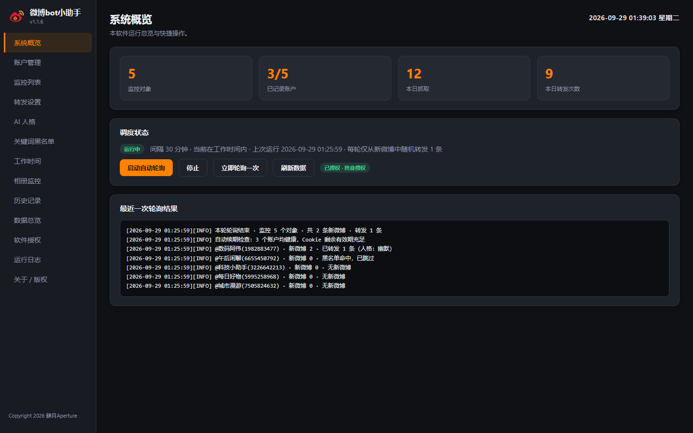

### 账户管理

最多 5 个账户，Cookie 本地加密存储；**Cookie 有效期预测 + 一键/自动续期**（临近失效自动滑动延长）。

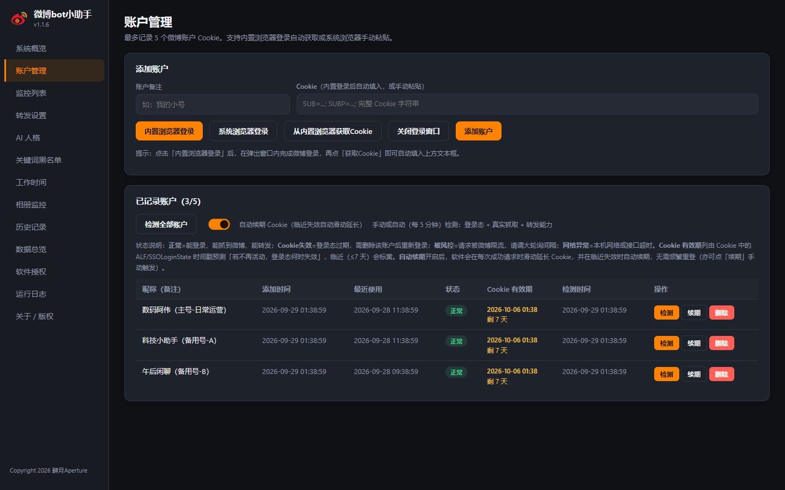

### 监控列表

填入 UID 即自动获取昵称并实时检测状态；监控数量无上限；支持批量导入导出。

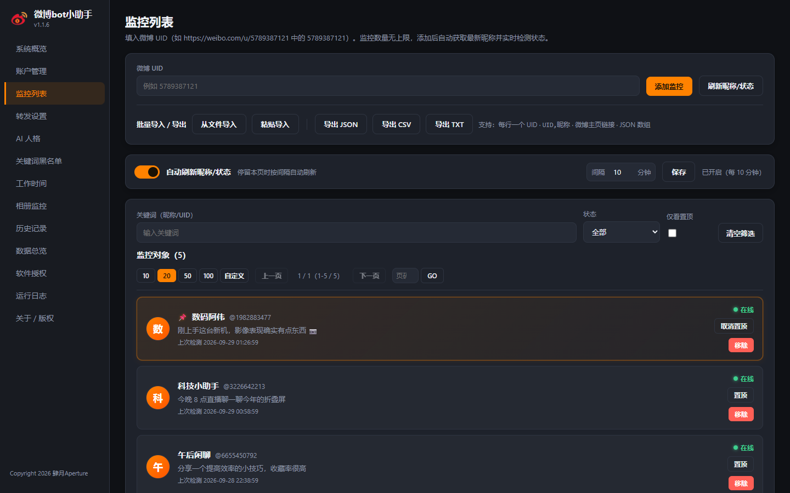

### 转发设置 / AI 人格

定时轮询 + 随机转发；内置离线 AI 生成引擎，多种内置人格可选、支持自定义。

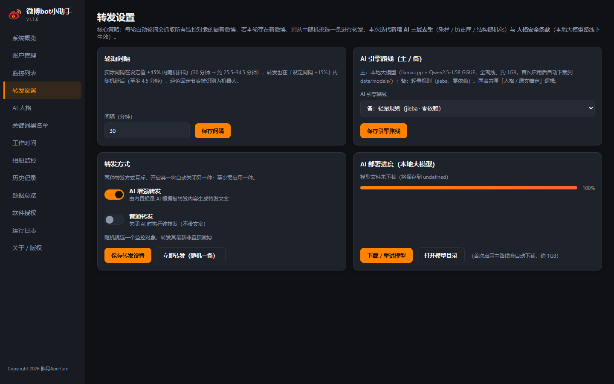

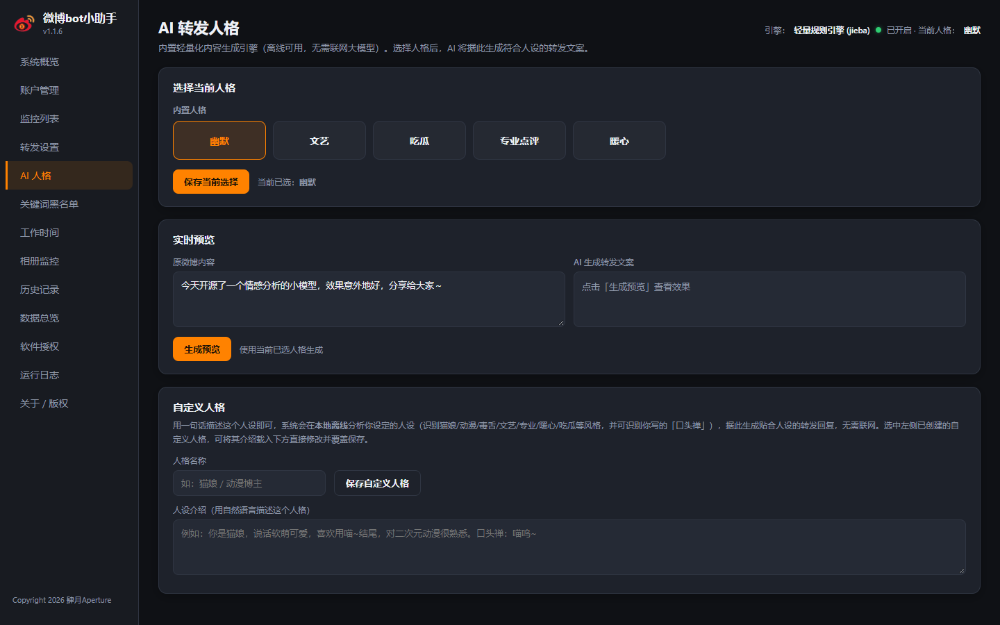

### 关键词黑名单 / 工作时间

黑名单关键词命中即跳过；工作时间外自动休眠（支持跨天时段）。

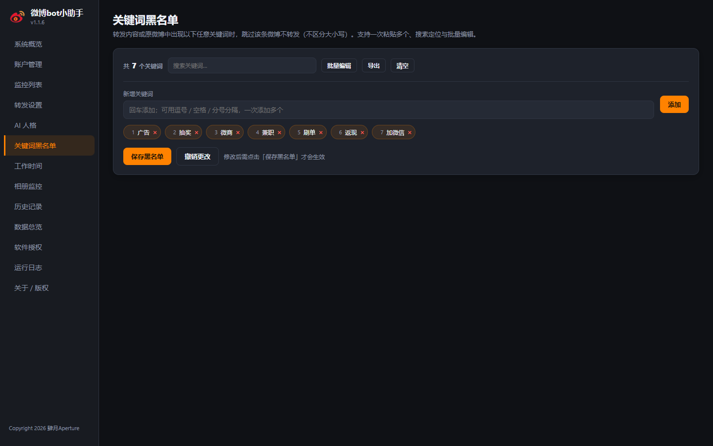

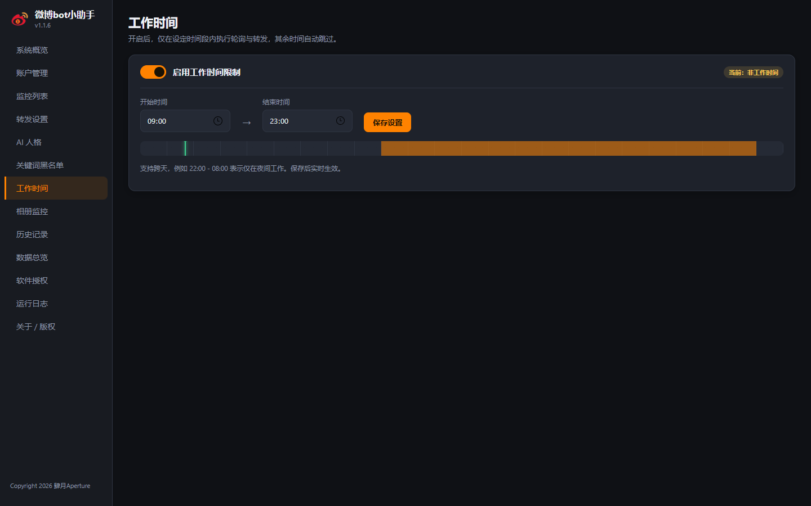

### 相册监控 / 历史记录

监控对象相册批量增量下载；微博与转发历史全程留档，支持按类型检索与导出。

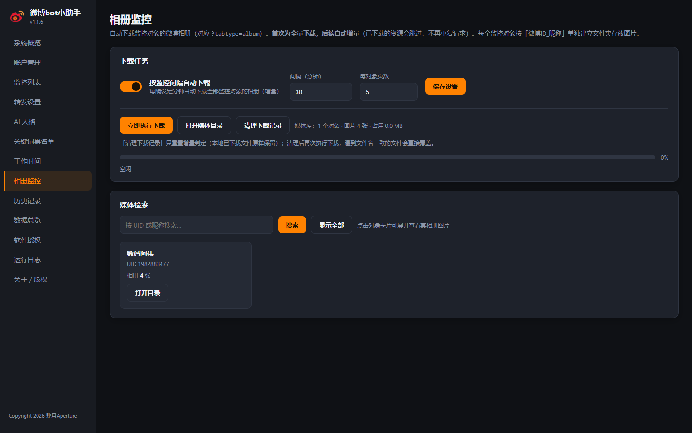

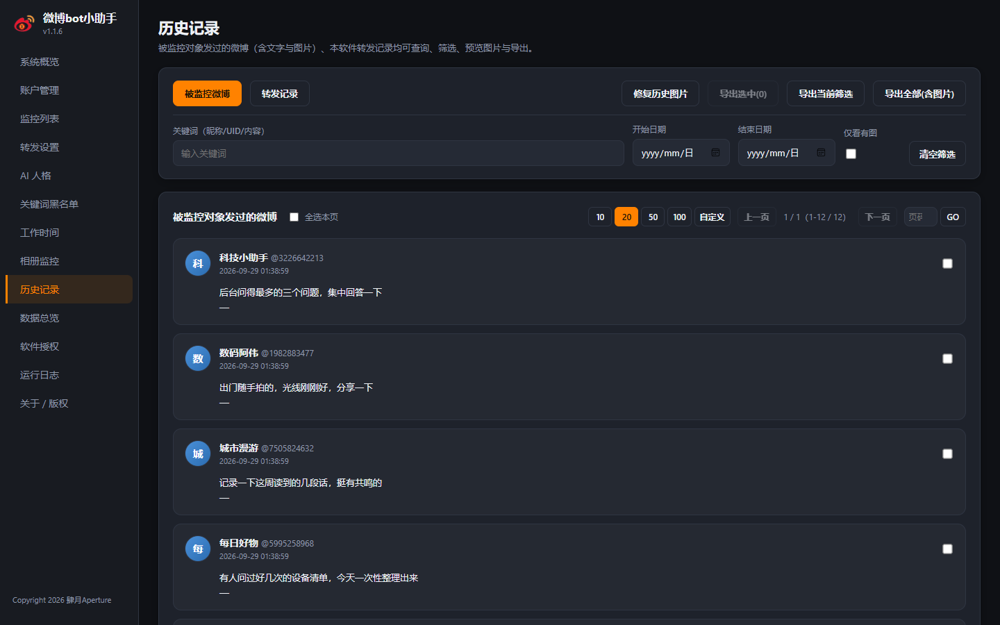

### 数据总览 / 运行日志

抓取/转发趋势曲线；分级分类日志系统，支持冗余调试模式与关键词检索。

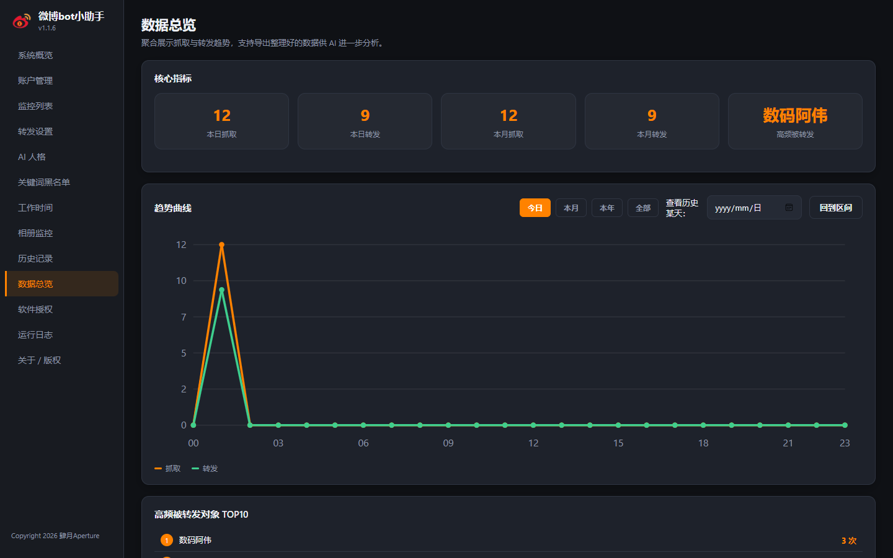

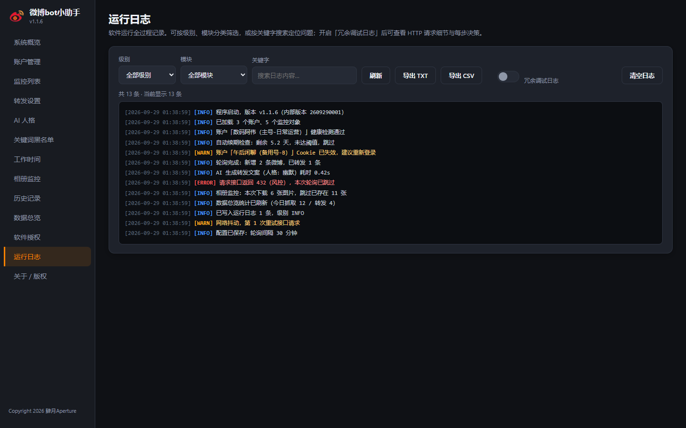

### 软件授权 / 关于

7 天免费试用；离线特征码 + 授权密钥激活（1 个月 / 3 个月 / 6 个月 / 1 年 / 永久）。

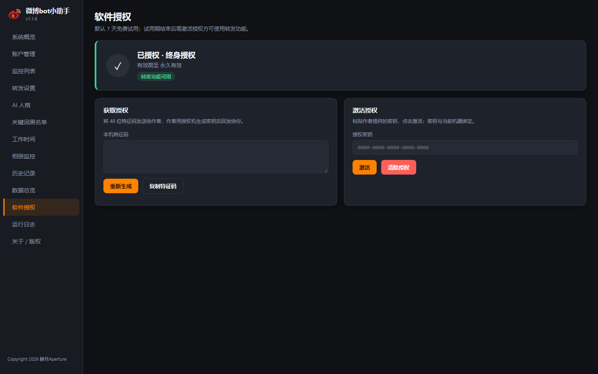

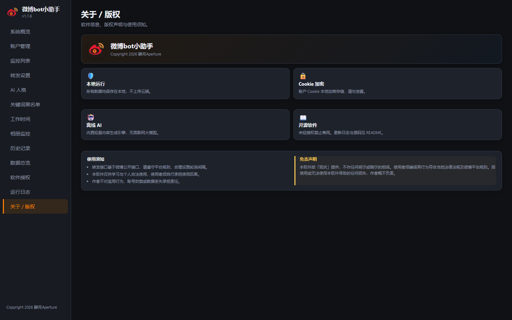

---

## 🚀 快速开始

### 方式一：使用已打包的 exe（推荐）

1. 从根目录或 `history/` 获取对应系统的 exe：
   - **Windows 10 / 11**：`微博bot小助手.exe`（基于 Python 3.13，已内嵌 VC++ 运行库，开箱即用）。
   - **Windows 7 / Server 2008 R2**：`微博bot小助手_Win7兼容版.exe`（基于 Python 3.8，最后一个支持 Win7 的版本，已内嵌 VCRUNTIME140.dll）。
2. **首次运行需确保本机已安装 [Microsoft Edge WebView2 运行时](https://developer.microsoft.com/zh-cn/microsoft-edge/webview2/)**

   （Windows 10/11 通常已预装；Windows 7 必须手动安装，且安装 WebView2 时会一并补上 UCRT 运行库）。
3. 双击运行，无需任何服务器或浏览器。

### 方式二：从源码运行

```bash
pip install -r requirements.txt
python app.py
```

### 自己打包 exe

```bash
python build.py          # 自动自增版本号并生成 微博bot小助手.exe（Python 3.13，Win10/11）
python build_win7.py     # 生成 微博bot小助手_Win7兼容版.exe（Python 3.8，Win7 兼容）
```

> 打包脚本会自动优先使用项目专属虚拟环境 `weibobot`（含 cryptography / requests / jieba / webview 等全部依赖）。请确保该 venv 已安装 `requirements.txt` 中的依赖，否则 PyInstaller 会漏收集模块导致 exe 启动崩溃。
>
> **Win7 兼容版**：需使用独立的 Python 3.8 环境（本项目置于 `C:\Users\zouzu\py38`，由 `python-3.8.10-embed-amd64.zip` 解压 + get-pip 搭建），因 Python 3.9+ 的 `python3x.dll` 依赖 `api-ms-win-core-path-l1-1-0.dll`（Win8+ 才有），无法在 Win7 内核加载。

---

## 📖 使用教程

### 1. 添加微博账户（获取 Cookie）

- 进入「账户管理」页。
- 点击 **内置浏览器登录** → 在弹出窗口内完成微博登录 → 点击 **获取 Cookie** 自动填入文本框 → 填写昵称 → **添加账户**。
- 或点击 **系统浏览器登录**，在浏览器登录后复制 Cookie 粘贴到文本框。
- 最多可添加 5 个账户，Cookie 采用本地加密存储。

### 2. 添加监控对象

- 进入「监控列表」页，填入微博 UID（从 `https://weibo.com/u/5789387121` 中取 `5789387121`）。
- 点击「添加监控」，软件会自动获取该 UID 的最新昵称并实时检测状态。
- 监控数量无上限。

### 3. 配置转发

- 「转发设置」：设置轮询间隔（分钟）。
- 「AI 人格」：开启 **AI 增强转发** 开关，并选择/自定义转发人格（幽默 / 文艺 / 吃瓜 / 专业点评 / 暖心 / 自定义）。
- 「关键词黑名单」：添加需跳过的敏感词。
- 「工作时间」：按需开启并设定时段。

### 4. 启动自动轮询

- 在「概览」页点击 **启动自动轮询**，软件将按间隔自动检测并转发。
- 也可点击 **立即轮询一次** 手动触发。

### 5. 查看与导出历史

- 「历史记录」页可查询被监控微博与转发记录，并导出数据。
- **单选 / 多选导出**：勾选需要导出的记录（任意页码均可勾选，选择跨页保留），点击「导出选中」即可仅导出这些条；也可用「导出当前筛选」按筛选条件批量导出。
- **分页**：每页支持 10 / 20 / 50 / 100 条，亦可自定义每页条数。
- 所有数据保存在 exe 同级的 `data/` 目录（账户加密密钥、数据库、图片、日志）。

### 6. 软件授权

- 软件默认提供 **7 天免费试用**，试用期结束后转发功能将被禁用（监控与历史记录不受影响）。
- 进入「授权」页：
  1. 点击 **生成特征码**，复制本机 48 位特征码（有效期 7 天）发送给作者；
  2. 作者使用 `license_gen.py` 授权机（`python license_gen.py <特征码> 1m|3m|6m|1y|permanent`）签发授权密钥；
  3. 将密钥粘贴到「激活授权」框并点击 **激活**，即可解锁转发功能。
- 授权密钥与生成特征码的机器绑定，复制到其他电脑无效。
- 如需更换机器或清除授权，可点击「清除授权」（试用期内不受影响）。

---

## 🗂 数据说明

```
微博bot小助手/
├── 微博bot小助手.exe      # 最新版（根目录）
├── history/               # 旧版本 exe 留档
├── ui/                    # 前端界面（已打包进 exe）
├── src/                   # 后端逻辑
├── data/                  # 运行时数据（自动生成，不含在版本库）
│   ├── accounts.json      # 账户（Cookie 已加密）
│   ├── monitor.json       # 监控列表
│   ├── config.json        # 配置
│   ├── history.db         # 历史记录数据库（SQLite）
│   ├── images/            # 被监控微博图片存档（相对路径：images/...）
│   ├── license.json       # 已激活的授权信息（未激活时不存在）
│   ├── trial.json         # 试用起始时间记录
│   └── app.log            # 运行日志
├── version.py / version.json  # 内部版本号
├── build.py               # 打包脚本
├── LICENSE
└── README.md
```

---

## ⚠️ 免责声明

1. 本软件仅供个人学习、合法自动化使用，使用者须遵守微博平台规则及相关法律法规。
2. 因使用本软件造成的账号封禁、数据泄露、法律纠纷等后果，由使用者自行承担。
3. 本软件为开源软件，**未经著作权人授权禁止用于任何商业用途**。

---

---


## 📌 版本迭代记录

| 版本     | 内部版本号      | 日期         | 更新内容                                                                                                                                                                                                                                                                                                                                                                                                                                                                                                                                                                                                                                                                                                                                                                                                                                                                                                                                                                                                                                                                                                                                                                                                                                                                                                                                                                                                                                                                                                                                                                                                                                                                                                                                                                                                                                                                                                                                                                                                                                                                                                                                                                                                                         |
| ------ | ---------- | ---------- | ---------------------------------------------------------------------------------------------------------------------------------------------------------------------------------------------------------------------------------------------------------------------------------------------------------------------------------------------------------------------------------------------------------------------------------------------------------------------------------------------------------------------------------------------------------------------------------------------------------------------------------------------------------------------------------------------------------------------------------------------------------------------------------------------------------------------------------------------------------------------------------------------------------------------------------------------------------------------------------------------------------------------------------------------------------------------------------------------------------------------------------------------------------------------------------------------------------------------------------------------------------------------------------------------------------------------------------------------------------------------------------------------------------------------------------------------------------------------------------------------------------------------------------------------------------------------------------------------------------------------------------------------------------------------------------------------------------------------------------------------------------------------------------------------------------------------------------------------------------------------------------------------------------------------------------------------------------------------------------------------------------------------------------------------------------------------------------------------------------------------------------------------------------------------------------------------------------------------------- |
| v1.1.6 | 2609290001 | 2026-09-29 | **【修复】启动概率性「未响应」+ Cookie 自动续期链路复核加固**：① **未响应根因与修复**——本程序常被直接放在 NAS（UNC 网络路径）上运行，Windows 会按需从网络读取 exe 代码页，NAS 抖动时主线程缺页等待，窗口即表现为「未响应」；叠加旧版日志系统**每条日志都在全局锁内同步写 NAS 文件 + NAS SQLite**（app.log 已达 55MB），媒体引擎/账户检测一晚数千条日志，网络稍有抖动全部业务线程排队。本次：**(a) 日志全面异步化**——log() 仅入队，唯一后台线程落盘，业务线程永不被 NAS 延迟拖住；**(b) get_state 2 秒缓存**——概览页每秒轮询的后端不再每秒做十余项 NAS 文件/SQLite 读取；**(c) 新增运行环境检测**——程序从网络路径运行时，概览页顶部显示⚠️提示横幅，建议复制到本地磁盘运行。② **自动续期链路复核**——发现并修复关键缺陷：会话预热（warm_session）成功只记录 last_renew 而**未同步滑动 last_ok_at**，在风控/网络抖动期间检测探测失败（status≠ok）时 7 天窗口停滞，活账户会在 7 天后被误判失效；现续期成功即同时滑动 last_ok_at，确保软件开启期间 Cookie 长期可用。③ **验证**：新增 tests/test_renew_v3.py（12 项断言：续期滑动 last_ok_at 且落盘、日志异步 50 条入队 0.000s 不阻塞并全部落盘、SUB 7 天窗口预测回归），连同 v1.1.5 的 tests/test_cookie_expiry_v2.py（18 项）全部通过。                                                                                                                                                                                                                                                                                                                                                                                                                                                                                                                                                                                                                                                                                                                                                                                                                                                                                                                                                                                                                                                                                                                                                                                                                                                                                                                                                                                                                                                            |
| v1.1.5 | 2609210002 | 2026-09-28 | **【重要修复】Cookie 失效预测错误导致 7 天掉线后不自动续期**：① **根因**——旧 `predict_cookie_expiry()` 只解析 `ALF`/`SSOLoginState`/`ALF_SSOINFO` 这组长期自动登录令牌（最长 ~30 天），给出「还剩约 22 天」的乐观预测；但微博网页端真实登录态由 **SUB 会话**决定，约 **7 天无活动**即失效（每次成功请求会滑动续期）。于是「剩余 ≤7 天才触发自动续期」的阈值永远触发不到。② **修复**：预测模型改为以 SUB 会话窗口优先——取 `max(SUBP 最早登录时间戳, 账户最近成功活动时间 last_ok_at) + 7 天` 作为失效点（来源 `SUB_SESSION`），仅当 ALF 更早才退回 ALF；新增账户字段 `last_ok_at`（成功检测/续期/被使用时回写）。③ **联动**：`auto_renew_accounts()` 续期均透传 `last_ok_at`，自动续期阈值（≤7 天）现在能正确命中。④ **验证**：新增 `tests/test_cookie_expiry_v2.py`，18 项断言全部通过。                                                                                                                                                                                                                                                                                                                                                                                                                                                                                                                                                                                                                                                                                                                                                                                                                                                                                                                                                                                                                                                                                                                                                                                                                                                                                                                                                                                                                                                                                                                                                                                                                                                                                  |
| v1.1.4 | 2609210001 | 2026-09-21 | **【新增】Cookie 失效时间预测 + 自动续期（会话保活）+ 添加账户 UI 压缩**：① **Cookie 失效时间预测**：`weibo_client.predict_cookie_expiry()` 解析 `ALF`/`SSOLoginState`/`ALF_SSOINFO` 中的 Unix 秒级时间戳（兜底 `SUBP`），给出「当前静止状态下」的登录态失效预测点与等级 `safe`（充裕）/ `warn`（≤7 天标黄）/ `expired`（已过期）/ `unknown`（无数据），「已记录账户」表格新增「Cookie 有效期」列实时展示失效时间与剩余时长；微博对活跃会话会滑动续期，故该值随软件实际使用不断后延。② **Cookie 自动续期（会话保活）**：账户检测线程每次跑完自动触发 `auto_renew_accounts()`，仅对「含 SUB 登录态、预测剩余 ≤7 天、距上次续期 >12 小时」的账户做 `warm_session()` 滑动续期（访问一次网页端触发服务端下发新 `SUB/SUBP/ALF` 并回写），其余情况跳过以避免骚扰微博接口；账户管理页新增「自动续期 Cookie」总开关（`config.auto_renew_cookie`，默认开）与每行「续期」手动按钮（`renew_account`）。③ **添加账户 UI 压缩**：Cookie 输入框高度与「账户备注」对齐（38px 单行、横向滚动），整体卡片高度显著下降、收进一屏。④ **验证**：新增 `tests/test_cookie_expiry_renew.py`，覆盖预测等级/SUBP 兜底/多键取最早/异常时间戳忽略/`_humanize_delta` 中文时长/自动续期筛选（充裕跳过、无 SUB 跳过、12h 节流跳过、无信息跳过、仅临近续期）与手动续期（成功回写/不存在/无变化）——**22 项断言全部通过**。                                                                                                                                                                                                                                                                                                                                                                                                                                                                                                                                                                                                                                                                                                                                                                                                                                                                                                                                                                                                                                                                                                                                                                                                                                                                                                                                                                 |
| v1.1.3 | 2609140001 | 2026-09-14 | **修复两个线上问题：全站 network_error + 账户检测始终无法确认**。① **BUG A：所有抓取同时报 `Could not find a suitable TLS CA certificate bundle, invalid path: ...\_MEI000066942\certifi\cacert.pem`** —— *根因*：PyInstaller onefile 会把 certifi 的 `cacert.pem` 解压到 `%TEMP%\_MEIxxxxxx\`，而**已核实该文件确实打进了 exe**（CArchive 中 `certifi\cacert.pem` 存在），所以不是打包缺失；真实原因是**该临时目录在程序运行期间被外部清掉**（Windows 存储感知 / 磁盘清理 / 杀毒软件 / CCleaner 一类工具），此后 `requests` 会对**每一个** HTTPS 请求抛 `OSError`（`requests/adapters.py` 的 `cert_verify` 会校验证书路径存在性），表现为微博流、相册、账户检测**同时**全灭且全部判定为 `network_error`；重启后重新解压出新的 `_MEI` 目录即恢复，与日志「10:51 退出 → 10:52 重启后立刻正常」完全吻合。*修复*：新增 `src/ca_bundle.py` + `weibo_client._ensure_ca_bundle()` —— 正常启动时把 certifi 证书包**备份到 `data/cacert.pem`**；运行期每次建会话做一次廉价存在性检查，一旦发现证书包失效就切到备份并写入 `REQUESTS_CA_BUNDLE`/`SSL_CERT_FILE`/`CURL_CA_BUNDLE`（requests 每次请求都会读这些环境变量，因此业务代码零改动、媒体下载等直连 `requests.get` 的模块同样受益）；`build.py` 显式加 `--collect-data certifi` 双保险。② **BUG B：账户检测日志出现 `web.ajax/profile/info → HTTP 400 · {"ok":0,"message":"缺少必要参数"}`，昵称始终回填不了** —— *根因*：微博已把 `/ajax/profile/info` 改为**强制要求 uid 参数**，不带 uid 直接 400；而账户自身 UID 无法从 Cookie 读出（SUB 是加密串），代码又一直不带 uid 调用。*修复*：新增 `get_self_uid()`，从 weibo.com 首页内联 JS 配置（`$CONFIG['uid']` 等 4 组正则，按特异性排序）解析账户自身 UID；`check_login()` 改为**按 uid 候选依次尝试**（已知自身 UID → 首页解析 → 监控 UID 兜底），`diagnose_account()` 新增 `self_uid` 参数，`account_manager` 新增 `wb_uid` 字段**缓存**账户 UID（首次解析后不再重复抓首页）。③ **重要防护**：用监控 UID 兜底探测时只确认「登录有效」，**不会把对方的昵称误填为账户昵称**（返回 `probe_only=True` 且 `screen_name` 置空），避免账户列表显示错人。④ **验证**：`tests/test_cookie_bugfix.py` 新增 5c（uid 强制场景 7 项：首页解析 / 昵称与 UID 正确回填 / 仅监控 UID 也能确认登录 / 探测模式不污染昵称）与 5d（CA 证书包自愈 3 项：正常可用 / 失效切备份 / 环境变量写入）两个分组，连同原有用例共 **41 项断言全部通过**。                                                                                                                                                                                                                                                                                                                                                                                                                                                                                                                        |
| v1.1.2 | 2609120003 | 2026-09-12 | **【修复 v1.1.1 引入的误报】全新登录的 Cookie 被误判「Cookie 已失效，请重新登录」**：① **根因**——v1.1.1 给移动端接口赋予了「否定登录态」的权力：`check_login()` 第 3 步中，只要 `m.weibo.cn/api/config` 回答未登录就直接返回 `cookie_expired`。但 Cookie 来自 **weibo.com**，而 **m.weibo.cn 与 weibo.com 不同源**，浏览器不会把 `.weibo.com` 的 Cookie 发给移动端 —— 也就是说移动端接口对一份**全新有效**的网页端 Cookie 同样会如实回答「未登录」。于是只要网页端 `profile/info` 因任何原因（网络抖动、响应结构变化未解析出昵称、偶发超时）没拿到用户对象，就会被跨域信号一票否决成「已失效」，与用户「刚登录完就提示失效」的现象完全吻合。`get_latest_posts()` 的策略 3 也存在同一问题（移动端 container 说未登录 → 整轮抓取被定性为 `cookie_expired`）。② **修复原则**：**只有与 Cookie 同源的 weibo.com 接口才有权判定「已失效」；移动端接口只能做正向确认，绝不能否定登录态。** 具体：`check_login()` 移除移动端两处 `cookie_expired` 分支，移动端仅在 `login/uid` 为真时确认登录；网页端新增正向兜底 —— `ok=1` 且 `data` 非空即判为已登录（昵称字段结构变化不再导致误判）；`_fetch_once()` 策略 3 只采纳风控状态码（432/418/429/403），其「未登录」仅计入诊断文本。③ **unknown 交由真实抓取裁决**：`check_login()` 无法确认时返回 `unknown`（不再下滑成 `cookie_expired`），`diagnose_account()` 对 `unknown` 继续执行真实抓取探测 —— 抓取成功即以 `status=ok` 收口并提示「登录接口未能确认，但真实抓取正常，账户可用」，真正做到**能不能抓到数据才是最终标准**。④ **收紧登录墙文本判定**：`_looks_not_login()` 的 `msg/message/error` 检查去掉宽松的 `"login" in v`，改为只认「登录 / not login / please login / unlogin / need login」，避免 `{"login":false}` 这类正常响应被误读成登录墙。⑤ **可诊断性**：`check_login()` 逐步记录 `steps`（每步的 HTTP 状态码 + 响应片段），`check_account` 会把它们写入运行日志（需开启冗余日志），下次再出现判定争议可直接从日志定位依据。⑦ **构建脚本自愈**：`build.py` 新增 `_reset_dir()` / `_purge_stale()` —— 某些托管终端会注入「安全删除」守卫拦截 `os.remove`，导致 PyInstaller `--clean` 清理上一轮遗留的 `.toc` 时直接 `OSError` 崩溃（本次 v1.1.2 首次打包即因此失败）；现在打包前会先清空 `build/` 与 `dist/`，若删除被守卫拦截则退化为重命名为 `*_stale_时间戳`，保证 PyInstaller 始终看到全新目录。⑧ **验证**：`tests/test_cookie_bugfix.py` 新增「跨域误判回归」5b 分组 7 项断言（网页端确认登录不受移动端影响 / ok=1 兜底 / 跨域未登录只降级 unknown / 真实失效仍正确判 cookie_expired / `login:false` 不触发登录墙 / unknown+抓取成功最终判 ok），连同原有用例共 **31 项断言全部通过**。                                                                                                                                                                                                                                                                                                                                                                                                                                                |
| v1.1.1 | 2609120001 | 2026-09-12 | **【重要修复】「检测显示正常、可转发，但一个微博都抓不到」**：① **根因一（误判源头）**——`weibo_client.check_login()` 的第三兜底是「Cookie 中存在 `XSRF-TOKEN` 即视为已登录」。但微博登录态实际由 **SUB** 决定，`XSRF-TOKEN` 只是 CSRF 令牌：服务端 session 过期后 SUB 失效、所有数据接口返回 `{"ok":-100,"url":".../login.php..."}`，而 `XSRF-TOKEN` **仍残留在客户端 Cookie 里**，于是检测输出「登录正常，已具备转发能力」（假阳性）；`get_st()` 同样把 `XSRF-TOKEN` 当最权威令牌，导致转发能力也一起误判。用户只能删账户重登（写入新 SUB）才恢复，与反馈现象完全吻合。② **根因二（诊断与抓取不同源）**——`diagnose_account()` 只校验「能否登录 + 能否拿到 st」，从不真正抓一次数据，两条路径结论可以完全相反。③ **根因三（风控无识别）**——`m.container HTTP 432`（微博反爬/限流）在旧代码里与「网络超时」无差别对待，`ok=-100` 登录墙、`「新浪通行证」`登录页 HTML 也只被塞进错误串，上层拿不到可操作结论。④ **修复内容**：新增纯函数 `_looks_not_login()`（识别 `ok=-100` / `login.php` / 通行证 HTML / 302/401）与 `_looks_risk_control()`（识别 **432/418/429/403** + 「验证码/访问过于频繁」）；`check_login()` 重写为四级判定——先查 **SUB 存在性**（无 SUB 直接判失效）→ 网页端 `profile/info`（显式识别登录墙）→ 移动端 `api/config`（`login=false` 判失效，不再静默放过）→ 只有 `XSRF-TOKEN` 时**降级为 `unknown` 而非 ok**；`get_st()` 增加「无 SUB 直接返回空」；`diagnose_account()` 在登录校验通过后**追加一次与轮询同路径的真实抓取探测**（`probe_uid` 取监控列表首个对象），只有真能取到数据才算 `ok`；`get_latest_posts()` 拆出 `_fetch_once()` 并对三种接口的响应打 flag，失败原因结构化返回 `status`（`cookie_expired` / `risk_control` / `network_error` / `empty`）+ 中文 `reason`。⑤ **新增 Cookie 自动续期（会话保活）**——`_session()` 现在把 Cookie 同时灌入 `requests` 的 CookieJar（此前只用请求头传，服务端下发的 `Set-Cookie` 根本收不到），新增 `_merge_cookies()` 捕获微博续期的 `SUB/SUBP/XSRF-TOKEN/ALF` 并过滤无关追踪 Cookie；新增 `warm_session()` 在首次抓取失败时先访问一次真实页面触发续期、再用新 Cookie 重试一轮；`AccountManager.update_cookie()` 负责回写，`forward_engine.run_once` / `api_bridge.refresh_monitors` / 账户检测均会落盘并沿用新 Cookie，实现「越用越不容易掉线」。移动端兜底接口改为 **移动 UA + 先访问 m.weibo.cn 首页预热**（此前用桌面 UA 直打 API 极易 432）。⑥ **UI 可见性**：账户状态新增 `risk_control`（被风控）/ `network_error`（网络异常）标签与配色；账户页新增状态说明（含「软件会自动续期 Cookie」）；监控列表顶部新增**账户健康横幅**，Cookie 失效时直接提示「请到账户管理删除该账户后重新登录」，不再只显示一排无解释的「异常」。⑦ **验证**：新增 `tests/test_cookie_bugfix.py`，用用户日志里的真实失败签名（mymblog `ok=-100` + 通行证 HTML + `HTTP 432`）做回归，**24 项断言全部通过**——旧逻辑下该场景会被判为 `status=ok`，现判定为 `cookie_expired` 并给出重新登录指引；成功路径（正常解析 + `status=ok`）与 Cookie 续期合并规则同时覆盖。另增 `tests/test_session_cookie.py`（起本地 HTTP 服务实测）：确认 Cookie 仍完整发出（`SUB`/`SUBP`/`XSRF-TOKEN`/`ALF` 均在请求头中）、且服务端 `Set-Cookie` 的续期能被捕获、无关追踪 Cookie 不会被混入。 |
| v1.1.0 | 2609090005 | 2026-09-09 | **三种导出全部包含图片 + 关键词黑名单 UI 优化**：① **导出统一为「文件夹」形态，选中/筛选/全部三种导出都带图片**：此前只有「导出全部」会拷图片，选中与当前筛选只产出一个纯数据文件。现在 `exporter` 统一走 `_bundle()`：在目标位置生成 `微博bot导出_xxx_时间戳/` 文件夹，内含数据文件 + `images/`（**只复制本次记录实际引用的配图与头像**，保持相对结构，不再是全库拷贝）+ `README.txt`（条数/图片数/目录说明）。对应地「导出选中/导出当前筛选/导出全部(含图片)」三个按钮改为**选择文件夹**（`Api._pick_folder`），完成后 toast 显示「已导出 N 条，含图片 M 张」并调用新增的 `open_path` 自动打开导出目录。格式提示增加校验（仅 csv/json/xlsx），JSON 保留 images 数组、CSV/XLSX 以分号连接。② **修复 XLSX 导出一直不可用**：`openpyxl` 从未安装（requirements 里被注释为可选），选择 xlsx 必然报「未安装 openpyxl」；现已安装并在 requirements.txt 中改为正式依赖。③ **关键词黑名单 UI 优化**：新增工具栏（实时数量统计 + **未保存修改提示** + 搜索框 + 批量编辑 + 导出 txt + 清空）；新增关键词支持**一次添加多个**（换行/逗号/顿号/分号/空格分隔，自动去重并提示跳过数，回车即可添加）；标签带序号便于定位；「批量编辑」用文本框按行重建整个列表（自动去重去空），兼顾批量粘贴导入与整体编辑；保存按钮在有未保存改动时黄色描边高亮，并新增「撤销更改」。                                                                                                                                                                                                                                                                                                                                                                                                                                                                                                                                                                                                                                                                                                                                                                                                                                                                                                                                                                                                                                                                                                                                                                                                                                                                                                                                                                                                                                                 |
| v1.1.0 | 2609090004 | 2026-09-09 | **大版本 v1.1.0：新增「清理下载记录」+ 修复历史记录抓成表情包**：① **相册监控新增「清理下载记录」按钮**（位于「下载任务」卡操作行，紧邻「立即执行下载」/「打开媒体目录」）：调用 `HistoryDB.clear_media_files()` 与 `Api.clear_media_records()`，**只删除 `media_files` 表记录并重置自增、绝不触碰已下载文件**；清理后增量判定归零，再次执行下载会重新拉取全部资源，且**同名文件直接覆盖**（`media_engine` 去掉原来的 `_unique_name()` 重名规避逻辑，文件名固定为 `pid`，无 pid 时取 URL 的 md5 前 16 位，保证「同一张图 = 同一文件名」）。② **【重要修复】历史记录抓到的是表情包而非推文配图**：*根因*——`_build_posts()` 写的是 `extract_images(raw, pics if isinstance(pics, list) else None)`，微博改版后图片字段 `pic_infos` 是 **dict**，被这一行**直接丢弃**，于是回退到正文 HTML 正则取图，而正文里的 `` 全是表情（`h5.sinaimg.cn/upload/.../hotface/*.gif`），故存下来的全是表情包；且原来的表情过滤只判断 URL 含 `emoji`/`static`，对真实表情域名完全无效。修复：`pics` 原样传入（dict/list 都解析）；新增 `_is_emoji_url()`（`h5.sinaimg.cn/upload/`、`face/img.t.sinajs.cn`、`/emoticon/`、\`/hotface                                                                                                                                                                                                                                                                                                                                                                                                                                                                                                                                                                                                                                                                                                                                                                                                                                                                                                                                                                                                                                                                                                                                                                                                                                                                                                                                                                                                                            |
| v1.0.1 | 2609090003 | 2026-09-09 | **修复转发设置行间距 + 模块改版「相册监控」+ 修复历史记录图片不显示**：① **转发设置行间距修复（根因）**：全局 `.card` 自带 `margin-bottom:18px`，在网格内与 `row-gap:16px` 叠加，导致**行间距 34px ≫ 列间距 16px**（用户截图红框/蓝框）；`#view-forward .card` 改 `margin-bottom:0` 后行=列=16px；同时精简「轮询间隔」长说明、压缩标题区间距，**转发设置整页控制在一屏内**。② **「视频/相册」模块改版为「相册监控」**：视频下载功能删除（接口不稳定），仅保留相册下载；目录简化为 `data/media/{微博ID}_{昵称}/` 直接存放图片（不再分 video/album 子文件夹）；下载任务由「每日定时」改为**按「监控间隔」（分钟）周期执行**（`last_run_ts` 时间戳判定间隔，调度器每轮检查）；任务卡简化为「开关 + 间隔 + 每对象页数」。③ **修复历史记录图片不显示（前端 BUG）**：`renderImageThumbs` 生成的 `` **没有 src 且无人加载**（头像有 hydrate 逻辑、缩略图漏了），缩略图永远空白；在 `bindImagePreviews` 中补上异步加载（`data-loaded` 防重复，失败显示 × 占位），点击预览功能本就正常。                                                                                                                                                                                                                                                                                                                                                                                                                                                                                                                                                                                                                                                                                                                                                                                                                                                                                                                                                                                                                                                                                                                                                                                                                                                                                                                                                                                                                                                                                                                                                                   |
| v1.0.1 | 2609090002 | 2026-09-09 | **修复视频/相册下载不到 + 监控列表导入导出 + 日志页 UI 优化**：① **修复视频/相册下载不到（关键）**：*根因一*——微博已改版，图片字段由 `pics`(list) 变为 `pic_infos`(dict)、视频改藏在 `mix_media_info.items[].data.media_info`，原解析取不到；*根因二*——**相册与视频是独立 tab**，分别对应 `?tabtype=album` 与 `?tabtype=newVideo`，仅抓微博流永远拿不到这两类内容。修复：`extract_images` 兼容 `pic_infos`(dict) 与 `pics`(list)；`extract_videos` 支持 `mix_media_info` 与新清晰度键（`hevc_mp4_720p`/`mp4_720p_mp4`/`stream_url_hd`…）；新增 `get_album_photos()`（三策略：getImageWall → photo.weibo.com albums+photos → 微博流兜底）与 `get_user_videos()`（主接口 `getWaterFallContent` 按 `next_cursor` 翻页，兜底微博流）；新增递归式宽容解析 `extract_media_from_json()`（不依赖固定层级，按特征键取值，适配后续改版，且每张图/每个视频只取最高一档避免重复下载）；`media_engine` 改为视频走视频 tab 接口、相册走相册 tab 接口，并记录实际命中的数据源。② **监控列表导入/导出**：支持 JSON / CSV / TXT 三种导出；导入支持「每行一个 UID」「`UID,昵称`」「微博主页链接」「JSON 数组或 `{"monitors":[...]}`」，自动识别并提取链接中的 UID，已存在自动跳过、无效行计数，提供「从文件导入」与「粘贴导入」两种方式；界面在添加监控卡片下方新增批量工具栏与粘贴文本框。③ **运行日志 UI**：工具栏改为底部对齐（下拉框/输入框与刷新、导出、冗余开关对齐），日志框高度改为 `calc(100vh - 330px)` 自适应窗口，保证整页在一屏内。                                                                                                                                                                                                                                                                                                                                                                                                                                                                                                                                                                                                                                                                                                                                                                                                                                                                                                                                                                                                                                                                                                                                                                                                                       |
| v1.0.1 | 2609090001 | 2026-09-09 | **新增「视频 / 相册」模块 + 运行日志细化 + 转发设置间距统一**：① **视频/相册模块（新功能，位于导航「工作时间」与「历史记录」之间）**：可设定每日定时或手动执行，下载监控对象的微博视频与相册；**首次全量、后续增量**（`media_files` 表以 `(url, media_type)` 唯一索引判定，已下载资源自动跳过不再请求）；执行时实时显示进度（对象 N/M、当前昵称、扫描微博数、新下载/跳过/失败计数）；目录按「微博ID_昵称」为每个监控对象单独建文件夹，其下再分 `video/`（视频）与 `album/`（相册）；支持按 UID 或昵称搜索，点击对象卡片展开视频与相册缩略图并预览（图片 base64、视频 `file://` 直链避免大文件卡顿）。新增 `src/media_engine.py`（下载引擎：多清晰度视频候选依次尝试、`download_video` 多 Referer×Cookie 重试并排除 HTML 错误页、每日定时触发用 5 分钟时间窗 + `last_run_date` 防漏触发与重复执行）；`weibo_client.extract_videos()` 兼容 `page_info` 三种结构；`api_bridge` 新增 11 个媒体接口；`scheduler` 每轮心跳后检查定时。② **运行日志细化**：`logger.py` 重写，新增模块分类（`CORE/CONF/ACCT/MON/HTTP/FWD/SCHED/MEDIA/AI/LIC`）、`debug()`（受冗余开关控制）、`exception()`（自动附完整 traceback），日志格式 `[时间][级别][模块] 消息`；`logs` 表加 `category` 列（含旧库迁移）；`app.py` 记录启动/退出与初始状态，`forward_engine` 记录轮询开始、候选池大小、随机选中详情与未授权原因，`weibo_client` 记录 HTTP 状态码与耗时；运行日志页新增级别/模块筛选、关键字搜索（防抖）、冗余日志开关、清空与导出 TXT/CSV，日志按级别着色。③ **转发设置间距统一**：网格行/列间隙、卡片内边距、卡片内部区块间距**全部统一为 16px**（此前卡片 `padding:16px 18px` 导致高宽间隙不等），四张卡片等高且操作区底部对齐（`.fwd-body{flex:1}` + `.fwd-actions{margin-top:auto}`）。                                                                                                                                                                                                                                                                                                                                                                                                                                                                                                                                                                                                                                                                                                                                                                                                                                                                                                                                                                                                                                                                                                          |
| v1.0.1 | 2609080011 | 2026-09-08 | **【重要修复】自动轮询完全不执行（调度线程静默崩溃）**：① **根因**：`src/scheduler.py` 的 `_loop()` 在计算抖动间隔时调用 `random.uniform()`，但文件**从未 `import random`**（v2609080002 引入抖动时漏加），导致调度线程一启动即抛 `NameError: name 'random' is not defined` 并**静默死亡**；该行位于 `try` 块之外，`except` 捕获不到，日志里**不会留下任何 ERROR**，且 `self._running` 仍为 `True` —— 界面显示「运行中」却永远不再轮询，只有手动「立即轮询一次」（走 `manual_run_async`，不经 `_loop`）能正常转发，与用户反馈现象完全一致。② **修复**：补 `import random`；`_loop()` 整个循环体包进 `try/except`，任何异常均 `error()` 记录消息 + `traceback`，**不再静默死亡**（异常后按配置间隔继续下一轮）；`is_running()` 改为 `self._running and 线程 is_alive()`，杜绝「线程已死但界面显示运行中」的假死状态；`start()` 增加自愈——检测到线程已死则 warn 后自动重建；`status()["running"]` 同步改用 `is_running()`。③ **验证**：冒烟测试（mock `run_once`/`get_config`/logger，间隔 1 分钟）确认线程存活、`is_running()=True`、`run_once` 被调用、零 error、心跳日志正常输出「调度器心跳 · 下次轮询约 HH:MM」；并全局 AST 扫描 `src/*.py` 确认无其他「使用标准库但未导入」的同类隐患。                                                                                                                                                                                                                                                                                                                                                                                                                                                                                                                                                                                                                                                                                                                                                                                                                                                                                                                                                                                                                                                                                                                                                                                                                                                                                                                                                                     |
| v1.0.1 | 2609080010 | 2026-09-08 | **日志排查 + 转发设置等高 UI + 数据总览趋势曲线优化**：① **日志可见性（针对「自动轮询无法启动」排查）**：`scheduler._loop()` 新增「调度器心跳」日志——每轮计算好间隔后即打印 `调度器心跳 · 下次轮询约 HH:MM（间隔 N 分钟）`，非工作时间附加「当前非工作时间，等待中」，便于从日志直接确认调度器是否在跑、下次何时轮询；结合 v2609080009 及之前的日志确认自动轮询代码路径本身正常（多次 `调度器已启动` + 多次 `已转发（normal）/已排程转发`，无 ERROR），感知上的「无法启动」多为进程未运行、首轮抓取 88 个监控较慢或工作时段外静默等待所致。② **转发设置卡片等高**：新增 `.fwd-grid`（`align-items: stretch` + flex 纵向子卡 `.fwd-body{flex:1}` + `.fwd-actions{margin-top:auto}`），「轮询间隔 / AI 引擎路线 / 转发方式 / AI 部署进度」四张卡等高、操作区底部对齐、间距统一为 16px。③ **趋势曲线优化**：`drawLineChart` 改为响应式（宽度取容器 `clientWidth`，不再拉伸变形），新增渐变面积填充（`#gradA` 主色 / `#gradB` 绿色）、圆角折线、坐标轴标题；卡片新增「区间合计：抓取 N 条 · 转发 M 条」汇总行；悬浮提示（`#dovChartTip` + 引导线 `#dovGuide` + 高亮圆点 `#dovHiA/#dovHiB`）显示该时间点的抓取/转发数值；窗口 resize 时自动重绘。                                                                                                                                                                                                                                                                                                                                                                                                                                                                                                                                                                                                                                                                                                                                                                                                                                                                                                                                                                                                                                                                                                                                                                                                                                                                                                                                                                                                                                                                            |
| v1.0.1 | 2609080008 | 2026-09-08 | **修复自动轮询"抓取漏抓" + 数据总览趋势曲线新增日期选择**：① **抓取漏抓根因**：`forward_engine.fetch_uid` 用 `last_post_id` 游标判定"新微博"，且每轮轮询都把游标抬到最新一条；但 `run_once` 每轮只随机转发 **1 条** 新微博，导致多条新微博里其余的被游标永久排除（漏抓），自动轮询表现为"抓不到/转不到新微博"。② **修复**：候选判定改为以 `history_db.is_post_processed(post_id)`（该微博是否已有任意转发记录：成功/跳过/失败）为准，不再依赖游标；每条未处理的新微博都会持续进入候选、在后续轮询中逐条被转发（保留每轮只转 1 条的防检测设计），已处理的微博不再反复进入候选。③ **数据总览趋势曲线新增日期选择**：`history_db.data_overview_date(date)` 返回指定某天（YYYY-MM-DD）的抓取/转发汇总 + 24 小时级曲线 + 当日高频对象；`api_bridge.get_data_overview_by_date(date)` 暴露接口；前端在趋势曲线卡片加「查看历史某天」日期输入（`max` 限今天），选中后图表与核心指标切换为该日数据，点击区间 tab 或「回到区间」按钮复原。④ **验证**：mock 单测确认 3 条新微博经 3 轮全部转发、无重复无漏抓；`data_overview_date` 结构与异常日期格式均正确。                                                                                                                                                                                                                                                                                                                                                                                                                                                                                                                                                                                                                                                                                                                                                                                                                                                                                                                                                                                                                                                                                                                                                                                                                                                                                                                                                                                                                                                                                                                                                  |
| v1.0.1 | 2609080007 | 2026-09-08 | **修复自动轮询转发"看起来没转发" + 改为设定时间 ±15%**：① **根因**：上一版（2609080006）「启动自动轮询」保留 `forward_time_jitter`，但 `_compute_forward_offset()` 的延后上限是"工作窗口或间隔的 0.9 倍"（最长约 **27 分钟**），导致轮询"运行了"却最长延后 ~27 分钟才真正转发，用户侧表现为"没转发"。② **修复**：`_compute_forward_offset()` 改为以 `interval × poll_jitter_ratio` 作为延后上限——既保留防检测的时间散布，又保证转发在合理时间内可见完成（30 分钟间隔、ratio=0.15 → 至多延后 **4.5 分钟** 随机触发）。③ **`poll_jitter_ratio` 0.2 → 0.15**：轮询间隔抖动与转发延后统一为 ±15%（UI「轮询间隔」说明同步：30 分钟 → 实际约 **25.5–34.5 分钟** 随机触发；并注明自动轮询转发在「设定间隔 ±15%」内随机延后完成）。④ **去重不变**：候选池仍经 `is_post_forwarded` 过滤 + `_repost_now` 二次校验，确保同一微博不重复转发（已用 mock 单测验证：自动轮询在 ±15% 内完成且只转 1 条；重复轮询同一微博 `forwarded=0` / "本轮无新微博"；`force_immediate=True` 立即轮询一次零延后）。三个按钮职责保持不变：「立即转发（随机一条）」直转不轮询、「启动自动轮询」按 ±15% 抖动定时转发、「立即轮询一次」零延后轮询并立即转一条。                                                                                                                                                                                                                                                                                                                                                                                                                                                                                                                                                                                                                                                                                                                                                                                                                                                                                                                                                                                                                                                                                                                                                                                                                                                                                                                                                                                                                                                                  |
| v1.0.1 | 2609080006 | 2026-09-08 | **撤回上版过激改动，按用户要求重新厘清三个按钮职责**：① **「立即转发（随机一条）」回退到 v2609080004 行为**：随机挑一个监控对象、取其最新非置顶微博直接转发（不同步轮询、不保留抖动），`forward_random_now` 恢复内联"随机挑选+直转"逻辑，前端 `forwardRandomNow` 恢复同步读取 `{ok,uid,screen_name,detail}` 的 toast 反馈。② **「启动自动轮询」保留延迟抖动**：撤销 `_first_run` 首轮立即转发，`Scheduler._loop` 改回 `run_once()`（默认按 `forward_time_jitter` 随机延时转发，最长约 27 分钟），恢复反检测"不齐步走"。③ **「立即轮询一次」改为不保留抖动 + 轮询完毕立即转发一条 + 不重复**：`api_bridge.manual_run_async` 改调 `manual_run_async(force_immediate=True)`，走 `run_once(force_immediate=True)`——先完整轮询建候选池、轮询完毕立即转发一条（绕过抖动），且候选池经 `is_post_forwarded` 去重，确保转发内容不重复（已验证：同一帖子已转发后再次轮询 `forwarded=0` / "本轮无新微博"）。`force_immediate` 参数保留于 `run_once`/`_forward_one`/`manual_run_async` 仅供「立即轮询一次」使用。                                                                                                                                                                                                                                                                                                                                                                                                                                                                                                                                                                                                                                                                                                                                                                                                                                                                                                                                                                                                                                                                                                                                                                                                                                                                                                                                                                                                                                                                                                               |
| v1.0.1 | 2609080003 | 2026-09-08 | **转发设置单页化 + AI 三层去重 + 人格安全条款**：① **转发设置 UI 紧凑化**：将「轮询间隔／转发方式／AI 引擎路线／AI 部署进度」四张卡片由纵向堆叠改为两列网格（新增 `.fwd-grid`，窄屏自动回退单列），显著压缩垂直高度，尽量收进一屏。② **AI 三层去重**：**单条内部重复**——`model_manager.generate()` 默认采样参数改为高温度多样性 `temperature=0.95 / top_p=0.92 / min_p=0.05 / repeat_penalty=1.15`（llama-cpp-python 0.3.35 不支持 DRY 的 `dry_multiplier/dry_base`，改由更强 `repeat_penalty` + `_clean_model_output` 首句截断实现）；**跨条重复**——`forwards` 表新增 `persona` 列并自动迁移旧表，新增 `get_recent_ai_texts(persona)` 与 `get_recent_same_topic(topic)` 查询，`model_generate()` 在生成前把该人格最近 N 条历史文案 + 平台同话题已发文案注入 prompt「以下内容你已经说过，绝对不要再用相同句式或开头」；**结构级随机化**——每次随机指定句长区间（10-15字／20-40字）、开头方式（疑问／感叹／陈述／省略主语／接口头脸）、是否带 emoji 及个数、是否用「说真的」「讲道理」等口语插入语。③ **人格 Prompt 内置安全条款**：在 `[System - 人格层]` 下写入 `[硬性规则]`——绝不评论政治／灾难／命案／民族宗教／性别对立话题，遇上述内容输出中性转发或直接说「转了」；绝不辱骂／嘲讽／引战／站队，不使用攻击性词汇；不 @ 任何人、不发起任何互动号召；不编造原文没有的事实。所有改动经 py_compile + 导入冒烟 + 去重查询与 prompt 拼装单测验证。                                                                                                                                                                                                                                                                                                                                                                                                                                                                                                                                                                                                                                                                                                                                                                                                                                                                                                                                                                                                                                                                                                                                                                                                                                                                                                                |
| v1.0.1 | 2609080002 | 2026-09-08 | **轮询抖动 + 转发时间偏移 + 换引擎（llama.cpp 本地大模型，主/备路线开关）**：① **轮询间隔加抖动**：`scheduler._loop()` 将设定间隔按 `poll_jitter_ratio`（默认 20%）做 `±jitter` 随机（如 30min → 实际 30±20% 随机），避免所有客户端同步请求被识别为机器人。② **转发时间工作时段内随机偏移**：`forward_engine` 新增 `_compute_forward_offset()` + `_schedule_forward()`，当开启 `forward_time_jitter` 时在本轮剩余工作窗口内（或间隔 0.9 倍内）随机延时后台转发，单条间隔上限 1800s。③ **更换生成引擎为本地离线大模型（主路线）**：`ai_generator.generate()` 的 `custom_templates is str` 分支改为调用 `model_generate()`，以 `llama-cpp-python + Qwen2.5-1.5B-Instruct-Q4_K_M.gguf`（全离线、CPU 可跑、约 1GB，置于运行时 `data/models/` 不进 exe）替换原 `analyze_persona`+`_fill_voice` 规则推理；Prompt 采用 Character.AI 分层结构 `[System-人格层]/[Context-内容层]/[Task-任务层]`，**保留 role prompting 原则——人格只决定「怎么说」，事实由原文锚定**，模型输出经 `_clean_model_output()` 仅取首句且限长 2–80 字，杜绝幻觉/跑题（若模型缺失或返回空则自动回退规则引擎，转发永不中断）。④ **转发方式新增主/备路线开关**：「转发设置」新增「AI 引擎路线」卡片，`config.ai_engine ∈ {model, rule}`，`rule` 为 jieba 规则引擎兜底；AI 页状态徽章区分「本地大模型 (llama.cpp · Qwen2.5-1.5B)」与「轻量规则引擎 (jieba)」。⑤ **AI 部署进度在转发设置体现**：`model_manager` 负责 `data/models/` 自动建目录、多镜像（HuggingFace→ModelScope→hf-mirror）断点续下 + 进度回传；「转发设置」新增「AI 部署进度（本地大模型）」卡片，显示下载进度条/速度/状态、「立即下载」与「打开模型目录」按钮，软件运行且启用 model 路线时自动触发下载。                                                                                                                                                                                                                                                                                                                                                                                                                                                                                                                                                                                                                                                                                                                                                                                                                                                                                                                                                                                                                                                 |
| v1.0.1 | 2609080001 | 2026-09-08 | **AI 页模型状态徽章 + 自定义人格改为自然语言人设介绍**：① **标题右侧显示模型与状态**：`renderAI()` 在「AI 转发人格」标题右侧新增 `aiModelStatus` 徽章，展示「模型：本地离线轻量引擎 · ●已开启/已关闭 · 当前人格：XXX」，配套新增 `.ai-header` / `.ai-model-status` / \`.dot.on                                                                                                                                                                                                                                                                                                                                                                                                                                                                                                                                                                                                                                                                                                                                                                                                                                                                                                                                                                                                                                                                                                                                                                                                                                                                                                                                                                                                                                                                                                                                                                                                                                                                                                                                                                                                                                                                                                                                                                                                                                 |
| v1.0.1 | 2609070001 | 2026-09-07 | **自定义人格可编辑 + 文不对题修复 + 轮询防重复转发**：① **自定义人格可编辑**：点击左侧已创建的自定义人格卡片，其名称与模板自动载入「自定义人格」编辑区，修改后点「保存自定义人格」即覆盖更新（改名时自动删除旧条目避免残留）；新增编辑状态提示。② **重构 AI 生成器（根治文不对题）**：`ai_generator.py` 改为「主题/意图感知」——用 jieba 词性标注 + 实体抽取（引号/@/#/英文品牌词）提取真正的主话题作 `{k1}`，按原文意图（提问/吐槽/炫耀/分享/新闻/日常）匹配最贴合的模板分组，并新增「主话题偏弱时退回通用安全模板」兜底；内置 5 种人格模板全部按意图分组重写，确保 `{k1}` 始终处于主语/话题位。③ **避免随机转发重复推文**：`run_once` 增加非阻塞并发锁，防止「启动轮询」与「立即轮询一次」同时执行导致同一批新微博被重复转发；同时 `history_db` 新增 `is_post_forwarded(post_id)`，已成功转发过的微博不再进入候选，从源头杜绝重复。                                                                                                                                                                                                                                                                                                                                                                                                                                                                                                                                                                                                                                                                                                                                                                                                                                                                                                                                                                                                                                                                                                                                                                                                                                                                                                                                                                                                                                                                                                                                                                                                                                                                                                                                  |
| v1.0.1 | 2609060007 | 2026-09-06 | **系统概览实时时钟移至右上角**：将 `#ovClock` 移出标题下方，与「系统概览」标题同处一行（新增 `.overview-header` flex 容器，`justify-content: space-between`），时钟现在显示在标题右侧；其余功能（轮询进度条、本日转发次数等）不变。                                                                                                                                                                                                                                                                                                                                                                                                                                                                                                                                                                                                                                                                                                                                                                                                                                                                                                                                                                                                                                                                                                                                                                                                                                                                                                                                                                                                                                                                                                                                                                                                                                                                                                                                                                                                                                                                                                                                                                                                                                                                       |
| v1.0.1 | 2609060006 | 2026-09-06 | **系统概览体验优化（轮询进度 + 实时时钟）**：① **立即轮询显示进度条**：`forward_engine` 新增全局 `_poll_progress` 进度追踪与 `manual_run_async()`（后台线程执行 `run_once`，不阻塞界面），`run_once` 在遍历监控对象时实时更新 `done/total/current/phase`；`api_bridge` 新增 `manual_run_async()` / `get_poll_progress()`；前端「立即轮询一次」改为后台异步触发，并以 300ms 轮询进度条（`#pollProgressBar` + 文案「轮询中 N/M · 昵称」），完成后自动刷新概览。② **系统概览左上角实时时钟**：`#ovClock` 每秒刷新，展示「日期 时间 星期」，并新增 `.ov-clock` 等样式。                                                                                                                                                                                                                                                                                                                                                                                                                                                                                                                                                                                                                                                                                                                                                                                                                                                                                                                                                                                                                                                                                                                                                                                                                                                                                                                                                                                                                                                                                                                                                                                                                                                                                                                                                                                                                  |
| v1.0.1 | 2609060005 | 2026-09-06 | **数据总览页 + 概览细节优化**：① **新增「数据总览」页**：放在「历史记录」与「软件授权」之间，核心指标卡展示「本日抓取 / 本日转发 / 本月抓取 / 本月转发 / 高频被转发」；`history_db.py` 新增 `data_overview()` 聚合多维度统计与曲线序列（今日小时级、本月天级、本年/全部月级），`api_bridge.py` 新增 `get_data_overview()` / `export_data_overview(fmt)` 接口；前端用纯 SVG 绘制双曲线图（抓取橙色、转发绿色），支持「今日/本月/本年/全部」标签切换，并提供「导出 JSON（完整数据 + 序列）」和「导出 CSV（汇总表）」供 AI 分析。② **概览「转发次数」改为「本日转发次数」**：`history_db.stats()` 新增 `forwards_today` 统计（仅成功转发），前端对应展示为「本日转发次数」。③ **控制最近一次轮询结果高度**：`#lastResult` 新增 `.last-result-box`，`max-height: 220px` + 滚动条，避免单页面被撑出屏幕。                                                                                                                                                                                                                                                                                                                                                                                                                                                                                                                                                                                                                                                                                                                                                                                                                                                                                                                                                                                                                                                                                                                                                                                                                                                                                                                                                                                                                                                                                                                                                                                                                                                                                         |
| v1.0.1 | 2609060004 | 2026-09-06 | **监控列表与概览优化**：① **修复监控列表筛选无法清空**：`applyMonFilter()` 与 `clearMonFilters()` 之前只调用 `renderMonPage()`，没有重新计算筛选结果，导致清空/修改筛选后仍显示旧数据；改为统一调用 `renderMonitors()` 重新排序并计算筛选，清空后立即恢复完整列表，不再需要等自动刷新。② **监控列表分页移到上方**：`index.html` 将 `#monPagination` 从列表底部移到「监控对象」标题下方、列表上方，并新增 `.mon-pagination-top` 样式（底部边框、下边距），省去每次翻页都要拉到列表底部的操作。③ **最近一次轮询结果改为日志模式**：`#lastResult` 改为 `log-box` 样式，`renderOverview()` 不再输出原始 JSON，而是调用新增的 `formatLastResult()` 生成 `[时间][级别] 内容` 的日志格式，按 action 优先级排序，清晰展示本轮监控对象数量、新微博总数、转发结果及每个对象的明细。                                                                                                                                                                                                                                                                                                                                                                                                                                                                                                                                                                                                                                                                                                                                                                                                                                                                                                                                                                                                                                                                                                                                                                                                                                                                                                                                                                                                                                                                                                                                                                                                                                                                                                               |
| v1.0.1 | 2609060003 | 2026-09-06 | **UI 细节调整**：① 左侧导航「概览」改为「系统概览」，对应页面标题同步改为「系统概览」；② 品牌区版本号仅显示大版本 `v1.0.1`，隐藏内部编号 `(内部 2609060002)`；③ 侧边栏底部 `Copyright 2026 肆月Aperture` 改为可点击，点击后调用系统浏览器打开 `https://github.com/zouzuo1994321/Weibo_Bot`。                                                                                                                                                                                                                                                                                                                                                                                                                                                                                                                                                                                                                                                                                                                                                                                                                                                                                                                                                                                                                                                                                                                                                                                                                                                                                                                                                                                                                                                                                                                                                                                                                                                                                                                                                                                                                                                                                                                                                                                                                        |
| v1.0.1 | 2609060002 | 2026-09-06 | **标题栏回退为系统原生（撤销 v1.0.1 的自定义 JS 拖动方案）**：用户反馈 v1.0.1 的 JS 受控拖动（`bindTitleDrag` + 后端 `window_move`）在 edgechromium 下故障更严重，故撤销该方案——`app.py` 改回 `frameless=False`、移除自定义三圆点标题栏（`index.html` 的 `#titlebar`）与 `app.js` 的 `bindTitleDrag`/窗口控制函数，恢复系统原生标题栏（与 2609050016 一致）；窗口拖动交由系统标题栏处理，主体区域文本可自由选中/复制，彻底消除拖动与选词冲突。Bug 2（概览每秒自动刷新）与 Bug 3（图片稳健下载）保持有效。旧版 2609060001 已归档 history/ 可恢复。                                                                                                                                                                                                                                                                                                                                                                                                                                                                                                                                                                                                                                                                                                                                                                                                                                                                                                                                                                                                                                                                                                                                                                                                                                                                                                                                                                                                                                                                                                                                                                                                                                                                                                                                                                                                                                                |
| v1.0.1 | 2609060001 | 2026-09-06 | **大版本：修复 3 个 BUG（拖动/概览刷新/图片保存）**：① **修复标题栏拖动与文本选择冲突（Bug 1）**：移除 `#titlebar` 与 `.titlebar-drag` 的 CSS `app-region: drag`（pywebview edgechromium 后端对该属性支持不稳定，导致主体区域误触发窗口拖动）；改为由 JS `mousedown` 监听标题栏 + 后端 `get_window_pos`/`window_move` 完全受控拖动——仅标题栏左键可拖动窗口，主体区域（含日志、历史记录等）恢复自由选中/复制文本，不再误拖。② **概览界面每秒自动刷新（Bug 2）**：`init()` 增加 `setInterval(refreshOverviewLive, 1000)`，仅当概览页处于激活时才拉取 `get_state` 重渲染，无需手动点击刷新。③ **修复被监控微博图片仍无法保存（Bug 3）**：重写 `weibo_client.download_image` 为多维稳健重试——覆盖 `""/large/mw2000/bmiddle/orj360` 多尺寸变体、`带/不带 Cookie` 两种、以及多 Referer（网页端/移动端/用户主页），严格排除防盗链返回的 `text/html` 错误页，并用文件魔数兜底校验图片类型，确保图片落盘。                                                                                                                                                                                                                                                                                                                                                                                                                                                                                                                                                                                                                                                                                                                                                                                                                                                                                                                                                                                                                                                                                                                                                                                                                                                                                                                                                                                                                                                                                                                                                                                                  |
| v1.0   | 2609050023 | 2026-09-05 | **监控列表新增筛选 / 分页 / 置顶**：① **筛选**：监控对象卡片上方新增筛选栏，支持按「关键词（昵称/UID）」「状态（全部/在线/异常/未知）」过滤，并提供「仅看置顶」开关与「清空筛选」，复用了历史记录筛选栏的暗色样式与对齐规则。② **多页显示**：监控对象列表接入与历史记录一致的分页控件——每页 10/20/50/100 分段按钮 + 自定义条数 + 上一页/下一页 + 跳转到指定页，列表数量大时不再一次性渲染全部。③ **置顶功能**：每个监控卡片新增「置顶 / 取消置顶」按钮；置顶对象在列表内**靠前排列**（稳定排序，其余保持原顺序）；置顶卡片获得专属视觉——橙色渐变背景、橙色高亮边框与微光阴影，并在昵称前显示 📌 图标。后端 `monitor_manager` 新增 `pinned` 字段与 `set_pinned()`，`api_bridge` 新增 `set_monitor_pinned(uid, pinned)` 接口。                                                                                                                                                                                                                                                                                                                                                                                                                                                                                                                                                                                                                                                                                                                                                                                                                                                                                                                                                                                                                                                                                                                                                                                                                                                                                                                                                                                                                                                                                                                                                                                                                                                                                                                                                                            |
| v1.0   | 2609050021 | 2026-09-05 | **UI/UX 细节打磨 + 拖动选择冲突彻底修复**：① **历史记录顶部栏重构**：将标题、全选本页、每页分段按钮（10/20/50/100/自定义）、翻页、跳转全部整合为单行工具栏，消除文字竖排与自定义输入框错位问题。② **关于/版权页面一屏化**：压缩 Hero、信息卡片、使用须知与免责声明的 padding/字号/间距，合并使用须知与免责声明为双列卡片，确保在常见窗口高度下无需滚动即可完整显示。③ **彻底修复标题栏拖动与文本选择冲突**：`#titlebar` 整体显式设置 `-webkit-app-region: no-drag`，仅保留左侧 `.titlebar-drag` 品牌区为拖动区；窗口主体（含日志区）恢复自由选中文本，方便复制日志。                                                                                                                                                                                                                                                                                                                                                                                                                                                                                                                                                                                                                                                                                                                                                                                                                                                                                                                                                                                                                                                                                                                                                                                                                                                                                                                                                                                                                                                                                                                                                                                                                                                                                                                                                                                                                                                                               |
| v1.0   | 2609050020 | 2026-09-05 | **UI/UX 三次迭代 + 图片保存修复 + 历史记录头像/跳转**：① **关于/版权页面优化**：升级为 Hero 头图 + 信息卡片网格 + 使用须知 + 免责声明区块，视觉层次更清晰。② **左侧导航「授权」改为「软件授权」**。③ **历史记录分页选择器优化**：「每页」由默认 select 下拉改为 10/20/50/100/自定义 分段按钮组，更贴合暗色主题。④ **监控列表自动刷新间隔优化**：标签、输入框、单位横向紧凑排列，减少垂直空间。⑤ **历史记录被监控微博显示头像**：`monitored_posts` 表新增 `avatar_local` 字段并自动迁移旧表；`forward_engine` 在记录微博时同步写入头像；前端异步加载并支持 fallback 首字母。⑥ **修复被监控微博图片无法保存**：`weibo_client.extract_images` 补全 `//` 协议头；`download_image` 增加 Content-Type 校验、文件魔数校验、多 UA/Referer 重试、更完整的尺寸变体，避免微博防盗链返回 HTML 错误页被误存。⑦ **历史记录增加跳转到某页**：分页区新增「跳转」输入框与 GO 按钮。⑧ **修复标题栏拖动与文本选择冲突**：拖动区域仅保留左侧品牌/标题区，右侧窗口控制按钮与标题栏其余区域不再触发拖动，避免鼠标选择文本时误拖动窗口。                                                                                                                                                                                                                                                                                                                                                                                                                                                                                                                                                                                                                                                                                                                                                                                                                                                                                                                                                                                                                                                                                                                                                                                                                                                                                                                                                                                                                                                                                                                                                                                     |
| v1.0   | 2609050019 | 2026-09-05 | **UI/UX 二次迭代 + 核心体验优化**：① **授权界面优化**：改为顶部大状态卡片（图标+标题+描述+状态标签），下方左右分栏显示特征码生成与密钥激活，信息层级更清晰。② **监控列表显示真实头像**：`weibo_client.get_user_info` 提取 `avatar_url`，新增 `_download_avatar` 下载到 `data/images/avatars/{uid}.ext`；`api_bridge.add_monitor`/`refresh_monitors` 与 `forward_engine.fetch_uid` 自动更新头像；前端通过 `load_image_base64` 异步加载 base64 头像，失败 fallback 到首字母。③ **监控自动刷新 UI 紧凑化**：宽大的设置卡片改为内联工具条，开关+标签居左，间隔输入+保存+状态居右，更省空间。④ **历史记录工具栏整合**：标题、全选本页、分页控件整合为统一工具栏，左侧标题+全选，右侧每页条数（含自定义）+翻页+统计，避免控件分散。⑤ **概览增加本日抓取统计**：`history_db.stats()` 按 `fetched_at` 统计今日抓取数量，概览统计卡片显示「本日抓取」。⑥ **转发策略说明强化**：转发设置页与概览调度状态均明确提示「每轮仅从新微博中随机转发 1 条」。                                                                                                                                                                                                                                                                                                                                                                                                                                                                                                                                                                                                                                                                                                                                                                                                                                                                                                                                                                                                                                                                                                                                                                                                                                                                                                                                                                                                                                                                                                                                                                                               |
| v1.0   | 2609050018 | 2026-09-05 | **UI/UX 全面迭代**：① **暗色主题滚动条**：全局 `::-webkit-scrollbar` 样式与软件深色主题统一，不再使用系统默认滚动条。② **无边框窗口 + 三圆点标题栏**：移除原生顶部标题栏，改为自绘标题栏与红黄绿三圆点窗口控制按钮（最小化/最大化/关闭），支持拖动。③ **监控列表卡片化**：弃用表格，改为头像+昵称/UID+最新微博预览+状态指示灯+移除按钮的卡片式布局。④ **历史记录卡片化**：被监控微博与转发记录均改为卡片式展示，保留并优化单选/多选/全选导出体验。                                                                                                                                                                                                                                                                                                                                                                                                                                                                                                                                                                                                                                                                                                                                                                                                                                                                                                                                                                                                                                                                                                                                                                                                                                                                                                                                                                                                                                                                                                                                                                                                                                                                                                                                                                                                                                                                                                                                                                |
| v1.0   | 2609050017 | 2026-09-05 | **软件授权 + 多项体验优化与修复**：① **新增软件授权系统**：默认 7 天试用，过期禁用转发；新增「授权」页生成 48 位本机特征码（时间+机器识别码+MAC，可重生成，7天有效）与离线密钥激活（格式 `0000-0000-0000-0000-0000`，支持 1月/3月/6月/1年/永久，密钥与机器绑定）；配套 `授权机.exe`（源码 `license_gen.py`）由作者签发密钥；转发前统一校验授权。② **自定义人格删除**：人格卡片悬停出现删除按钮（确认后删除）。③ **监控列表定时刷新**：新增「定时自动刷新昵称/状态」开关与间隔（分钟），停留本页时按设定周期自动刷新。④ **工作时间界面优化**：新增当前状态标签与 24 小时可视化时间条（支持跨天）。⑤ **历史记录优化**：分页新增 100 条与自定义每页条数；新增**单选/多选导出**（勾选跨页保留）。⑥ **修复微博图片记录与获取**：图片存储统一为相对 `DATA_DIR` 的 `images/...`，读取端健壮解析旧路径并兼容 `data/images/...`；`extract_images` 优先取 large 大图，`download_image` 自适应多种尺寸与 Referer 重试。⑦ 修复授权接口因缺少 `import time` 导致的页面崩溃。                                                                                                                                                                                                                                                                                                                                                                                                                                                                                                                                                                                                                                                                                                                                                                                                                                                                                                                                                                                                                                                                                                                                                                                                                                                                                                                                                                                                                                                                                                                                                                                                                     |
| v1.0   | 2609050014 | 2026-09-05 | **UI 与功能优化**：① **概览页模块间隙统一**：统计卡片区与下方卡片的垂直间距统一为 16px；**替换软件图标**：根据提供的 `logo.png` 生成 `logo.ico`，侧边栏品牌区显示 Logo，打包后的 exe 使用新图标，HTML 同步加 favicon；**转发设置对齐**：「间隔（分钟）」输入框与「保存间隔」按钮改为底部对齐。② **轮询一次只随机转发一条**：`forward_engine.run_once` 重构为「先对所有监控对象拉取并记录微博，汇总本轮新微博为候选池，再随机挑选一条转发」，其余新增微博显示「本轮随机未选中」，避免一次转发多条。③ **历史记录增强**：被监控微博 / 转发记录增加关键词、日期范围、状态/类型/仅看有图等筛选；被监控微博的图片支持点击预览（后端 `load_image_base64` 转 Data URL 浮层展示）；新增「导出当前筛选」按钮。④ **被监控微博模块**补齐导出与图片预览能力。                                                                                                                                                                                                                                                                                                                                                                                                                                                                                                                                                                                                                                                                                                                                                                                                                                                                                                                                                                                                                                                                                                                                                                                                                                                                                                                                                                                                                                                                                                                                                                                                                                                                                                                                                                         |
| v1.0   | 2609050013 | 2026-09-05 | **修复两处功能缺陷**：① **昵称无法获取**（账户管理 + 监控列表）——`weibo.com/ajax/profile/info` 实际把用户对象嵌套在 `data.user` 下，而 `get_user_info`/`check_login` 直接读 `data.name`/`screen_name`，导致两处昵称始终为空。新增 `_find_user_obj()` 健壮提取（兼容扁平 `data` 与 `data.user`/`data.userInfo`/`data.data.user` 嵌套），昵称回填与监控显示均修复。② **AI 增强转发失效**——`build.py` 仅 `--collect-submodules jieba`、未收数据文件，打包出的 exe 内 `jieba.lcut` 因找不到 `dict.txt` 崩溃，AI 模式整体失败（普通模式不调用故正常）。修复：`ai_generator` 对 jieba 调用加容错（失败退化为正则分词）且 `generate()` 整体 try/except 永不抛异常；`process_uid`/`forward_random_now` 的 AI 调用加 try/except 兜底为普通转发；`build.py` 增 `--collect-data jieba`（已验证 `dict.txt` 打进 exe）。                                                                                                                                                                                                                                                                                                                                                                                                                                                                                                                                                                                                                                                                                                                                                                                                                                                                                                                                                                                                                                                                                                                                                                                                                                                                                                                                                                                                                                                                                                                                                                                                    |
| v1.0   | 2609050007 | 2026-09-05 | **打包修复（exe 启动即崩溃 `No module named 'cryptography'`）**：根因为 `build.py` 使用 managed 全局 Python 打包，而该环境缺失 `cryptography`，PyInstaller 仅在收集阶段静默跳过该模块，运行时即 `ModuleNotFoundError`。修复：`build.py` 改为自动优先使用项目专属 venv（`~/.workbuddy/binaries/python/envs/weibobot`），其依赖齐全；验证 `cryptography` 已正确打进 exe 归档。                                                                                                                                                                                                                                                                                                                                                                                                                                                                                                                                                                                                                                                                                                                                                                                                                                                                                                                                                                                                                                                                                                                                                                                                                                                                                                                                                                                                                                                                                                                                                                                                                                                                                                                                                                                                                                                                                                                                   |
| v1.0   | 2609050006 | 2026-09-05 | **Bug 修复（账户备注标签 + 监控接口细化）**：① 前端「添加账户」标签由「账户昵称」改为「账户备注」；账户列表读取后端 `display_name`（微博昵称 + 备注）而非已废弃的 `nickname` 字段，解决昵称列空白问题。② 监控刷新进一步改用更稳定的网页端接口 `/ajax/statuses/mymblog?uid=` 作为首选，`/ajax/profile/getProfileFeed` 次之，`m.weibo.cn` 兜底；失败时返回 HTTP 状态码与响应摘要，便于前端 Toast 直接查看异常根因。                                                                                                                                                                                                                                                                                                                                                                                                                                                                                                                                                                                                                                                                                                                                                                                                                                                                                                                                                                                                                                                                                                                                                                                                                                                                                                                                                                                                                                                                                                                                                                                                                                                                                                                                                                                                                                                                                                                                                  |
| v1.0   | 2609050005 | 2026-09-05 | **Bug 修复（监控检测异常 + 账户昵称/备注拆分）**：① 修复监控列表刷新判定始终「异常」——`get_user_info` 与 `get_latest_posts` 此前走 `m.weibo.cn` 接口，但 Cookie 来自 `weibo.com` 登录、跨域导致 m 站识别不到登录态而请求失败；现两接口均改用**网页端同源**接口（`weibo.com/ajax/profile/info?uid=` 取昵称、`weibo.com/ajax/profile/getProfileFeed` 取最新微博），新增 `_safe_json`/`_extract_feed`/`_build_posts` 鲁棒解析（兼容 data 为 dict/list/JSON 字符串与 card 包裹结构），`m.weibo.cn` 作为兜底。② 账户管理拆分「账户备注」与「微博昵称」——新增 `wb_nickname`（Cookie 读取到的微博昵称，检测/登录后自动回填）与 `remark`（用户备注）；已记录账户列表列显示「昵称（备注）」，昵称取自 Cookie、备注追加其后。                                                                                                                                                                                                                                                                                                                                                                                                                                                                                                                                                                                                                                                                                                                                                                                                                                                                                                                                                                                                                                                                                                                                                                                                                                                                                                                                                                                                                                                                                                                                                                                                                                                                                                               |
| v1.0   | 2609050001 | 2026-09-05 | **Bug 修复（登录/Cookie 获取）**：① 修复内置浏览器「获取 Cookie」解析失败——pywebview 的 `get_cookies()` 返回的是 `SimpleCookie`，原代码用 `c.get('name')` 取不到值，导致 Cookie 拼成空串、误报「未检测到登录态」。改为遍历 Morsel 的 `.key`/`.value` 正确提取。② 修复打开内置浏览器时同时弹出外部浏览器——微博登录页触发的 `NewWindowRequested` 被 pywebview 默认用 `webbrowser.open()` 甩到系统浏览器；已在 `app.py` 将 `OPEN_EXTERNAL_LINKS_IN_BROWSER` 设为 False，新窗口请求改为在内部 webview 加载，保持登录会话。                                                                                                                                                                                                                                                                                                                                                                                                                                                                                                                                                                                                                                                                                                                                                                                                                                                                                                                                                                                                                                                                                                                                                                                                                                                                                                                                                                                                                                                                                                                                                                                                                                                                                                                                                                                                                                            |
| v1.0   | 2609040001 | 2026-09-04 | 首个完整版本：多账户 Cookie 登录（内置/系统浏览器，最多5个，本地加密）；UID 监控（无上限、自动获取昵称、状态检测）；定时轮询随机转发；普通/AI 增强转发开关 + 人格化轻量生成器；关键词黑名单跳过；工作时间限制；历史记录（含图片）与日志查询导出（CSV/JSON/XLSX）；独立 exe 打包与旧版本归档；版权与开源声明                                                                                                                                                                                                                                                                                                                                                                                                                                                                                                                                                                                                                                                                                                                                                                                                                                                                                                                                                                                                                                                                                                                                                                                                                                                                                                                                                                                                                                                                                                                                                                                                                                                                                                                                                                                                                                                                                                                                                                                                                                                    |
